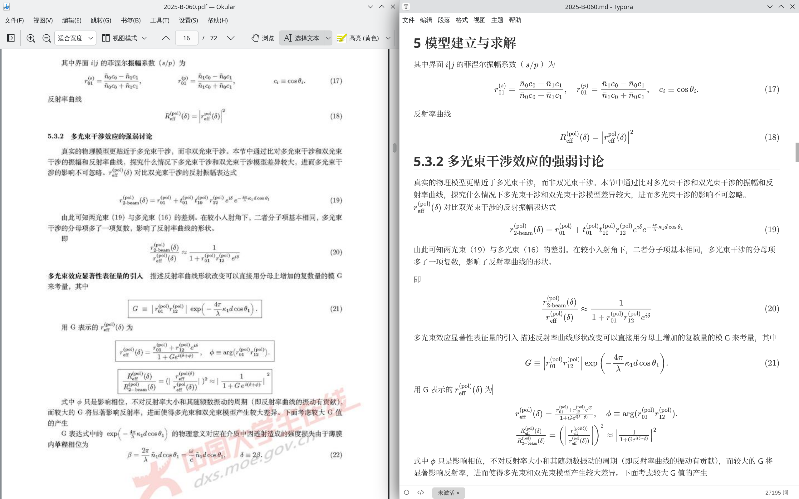

# 高教社杯全国大学生数学建模竞赛资料库

全国大学生数学建模竞赛（CUMCM）历年题目、优秀论文与官方讲评的整理仓库。资料同时保留原始格式与 Markdown 版，支持全文检索、公式复制与按年份浏览。

## 快速导航

- **找题目**：从 [`INDEX.md`](INDEX.md) 进入，或直接打开 `赛题/<年份>/INDEX.md`
- **找论文**：`优秀论文_MarkDown/<年份>/INDEX.md`，按题号、编号、标题浏览
- **全库检索**：`rg "关键词" 优秀论文_MarkDown/`
- **结构化筛选**：`metadata.csv`（逐年、逐篇的编号、标题、文件路径、图片数）

## 目录结构

```
.
├── 赛题/                          # 2010–2025 年题目与附件
│   └── <年份>/
│       ├── A/ … E/                # 按题号统一命名
│       │   ├── 题目.pdf / 题目.doc(x)
│       │   └── 附件…
│       ├── format<年份>.doc       # 论文格式模板
│       ├── *规则*.pdf             # 部分年份的参赛规则
│       └── INDEX.md               # 本年题目与附件索引
├── 优秀论文/                      # 论文原件
│   ├── 1992-2000优秀论文汇编.pdf
│   ├── 2005-2011优秀论文评析A.pdf
│   ├── 2005-2011优秀论文评析B.pdf
│   └── <年份>/<年份>-<题号>-<编号>.pdf / .doc(x)
├── 优秀论文_MarkDown/             # 论文 Markdown 版
│   ├── 1992-2000优秀论文汇编/
│   ├── 2005-2011优秀论文评析A/
│   ├── 2005-2011优秀论文评析B/
│   └── <年份>/
│       ├── <年份>-<题号>-<编号>/
│       │   ├── <年份>-<题号>-<编号>.md
│       │   └── images/            # Markdown 引用的图片
│       └── INDEX.md               # 本年论文索引
├── 数模讲评：中国大学生在线网/    # 官方参赛评阅情况与各题讲评
│   └── <年份>年/
├── 工具/build_index.py            # 索引与 metadata.csv 生成脚本
├── INDEX.md                       # 总索引
├── metadata.csv                   # 结构化元数据
├── DUPLICATES.md                  # 重复论文与多格式说明
├── orphan-images.txt              # 未被 Markdown 引用的图片清单
├── pdf与markdown对比图.png        # 原件与 Markdown 版对照图
├── LICENSE
└── README.md
```

赛题目录统一为 `赛题/<年份>/<题号>/`。2016、2022、2023 年的题目文件命名为 `题目.pdf` 或 `题目.doc(x)`；其余年份保留官方题目文件名。2022、2023 年的附件仍放在年份根目录，按题目 PDF 中的“附件 1 / 2 / 3”对应。

## 内容说明

### 赛题（`赛题/`）

2010–2025 年全部题目，A/B/C/D 题，2019 年起增加 E 题。包含题目文档、附件数据、图片、参赛规则与论文格式模板。

### 优秀论文（`优秀论文/`）

获奖论文原件，共 **221 份 PDF** 与 **31 份 doc/docx**，覆盖 **253 个编号**。另有 3 份汇编文集：

- 《1992-2000 优秀论文汇编》
- 《2005-2011 优秀论文评析 A / B》

同一编号可能同时保留 PDF 与 Word 版本；重复关系见 [`DUPLICATES.md`](DUPLICATES.md)。

### 优秀论文 Markdown 版（`优秀论文_MarkDown/`）

使用 [MinerU](https://github.com/opendatalab/MinerU) 由 PDF / Word 转换（OCR + 版面解析）生成的 Markdown 全文。公式以 LaTeX 渲染，图片存放在各篇的 `images/` 目录。

- 每篇论文一个目录，入口文件为 `<年份>-<题号>-<编号>.md`
- 仅保留被 Markdown 引用的图片
- 共 249 篇，另有 3 本汇编的完整 Markdown



*左：`2025-B-060.pdf`（Okular）；右：`2025-B-060.md`（Typora）。公式、表格与图片可直接检索、复制。*

### 数模讲评（`数模讲评：中国大学生在线网/`）

来自中国大学生在线网的官方讲评，含各年“参赛和评阅情况”以及各题“背景与思路 / 讲评”PDF。

| 年份 | 主要内容 |
| ---- | -------- |
| 2018 | 参赛和评阅情况、A 题讲评 |
| 2019 | 参赛和评阅情况、A–E 题讲评 |
| 2020 | 参赛和评阅情况、A–E 题讲评 |
| 2022 | 参赛和评阅情况、A–E 题讲评 |
| 2023 | A–E 题讲评 |
| 2024 | 参赛和评阅情况、A–E 题讲评 |
| 2025 | 参赛和评阅情况、A–E 题讲评、AI 工具使用情况与建议 |

## 历年资料统计

| 年份 | PDF | doc/docx | Markdown | 编号数 |
| ---- | --: | :------: | -------: | -----: |
| 2010 | 19 | 0  | 19 | 19 |
| 2011 | 3  | 2  | 4  | 5  |
| 2012 | 16 | 17 | 37 | 37 |
| 2013 | 11 | 5  | 13 | 14 |
| 2014 | 13 | 3  | 15 | 15 |
| 2015 | 15 | 4  | 17 | 19 |
| 2016 | 15 | 0  | 15 | 15 |
| 2017 | 18 | 0  | 18 | 18 |
| 2018 | 13 | 0  | 13 | 13 |
| 2019 | 17 | 0  | 17 | 17 |
| 2020 | 17 | 0  | 17 | 17 |
| 2021 | 17 | 0  | 17 | 17 |
| 2022 | 10 | 0  | 10 | 10 |
| 2023 | 14 | 0  | 14 | 14 |
| 2024 | 16 | 0  | 16 | 16 |
| 2025 | 7  | 0  | 7  | 7  |
| **合计** | **221** | **31** | **249** | **253** |

- 2012 年有 17 份 `.doc` 原件，因此 Markdown 数多于 PDF 数。
- 2013、2014 年部分编号同时保留 PDF 与 Word 版本。

## 索引与元数据

- [`INDEX.md`](INDEX.md)：总索引，按年份链接到赛题与论文分索引
- `优秀论文_MarkDown/<年份>/INDEX.md`：论文编号、标题、PDF/Markdown 链接、图片数、备注
- `赛题/<年份>/INDEX.md`：题目目录与公共附件
- [`metadata.csv`](metadata.csv)：全部论文的结构化字段，UTF-8 with BOM

索引由脚本生成，可重复运行：

```bash
python3 工具/build_index.py
```

## 使用方法

1. **浏览题目**：打开 `赛题/<年份>/INDEX.md`，或直接进入 `赛题/<年份>/<题号>/`
2. **阅读论文**：优先使用 `优秀论文_MarkDown/` 下的 `.md`；需要原始排版时打开 `优秀论文/` 中的 PDF
3. **查阅讲评**：进入 `数模讲评：中国大学生在线网/<年份>年/`
4. **全文检索**：

   ```bash
   # 全库检索
   rg "优化模型" 优秀论文_MarkDown/

   # 只搜某一年
   rg "多波束" 优秀论文_MarkDown/2023/
   ```

5. **按元数据筛选缺 Markdown 的论文**：

   ```bash
   python3 - <<'PY'
   import csv
   for r in csv.DictReader(open('metadata.csv', encoding='utf-8-sig')):
       if not r['md']:
           print(r['year'], r['id'], r['notes'])
   PY
   ```

## 命名规范

- **赛题**：`赛题/<年份>/<题号>/`
- **优秀论文**：`<年份>-<题号>-<编号>`，例如 `2010-A-3377`
- **Markdown 版**：与原件同编号，目录结构一一对应

## 大文件与 Git LFS

PDF、Excel、赛题 CSV、视频等二进制资料通过 Git LFS 管理。克隆前建议安装：

```bash
git lfs install
git clone <repo-url>
```

只取文本与索引、不下载大文件：

```bash
GIT_LFS_SKIP_SMUDGE=1 git clone <repo-url>
# 或
git clone --filter=blob:none <repo-url>
```

## 数据来源

- **讲评**：中国大学生在线网 —— [数模讲评专栏](https://dxs.moe.gov.cn/zx/hd/sxjm/sxjmstjp/)
- **2010–2025 年优秀论文**：全国大学生数学建模竞赛官网 —— [中国大学生数学建模竞赛](https://www.cmathc.org.cn/)
- **其他年份论文**（1992–2000 汇编、2005–2011 评析）：整理自公开出版书籍
- **题目与附件**：整理自竞赛官方及历年公开资料

## 已知缺口

- **4 篇论文仅有 doc/docx，无 Markdown**：`2011-A-4605`、`2013-A-6738`、`2015-C-0010`、`2015-C-7024`
- **讲评**：缺 2010–2017 年；缺 2021 年；2018 年仅 A 题；2023 年缺“参赛和评阅情况”
- **2025 年优秀论文仅 7 篇**，少于其他年份

欢迎通过 Issue / PR 补充缺失资料。

## 版权与免责声明

本仓库仅用于学习与研究目的，收录资料版权归原作者及发布机构所有。如相关内容侵犯您的权益，请联系仓库维护者删除。

本项目自身以 [Unlicense](LICENSE) 协议发布（公有领域）。
