# 基于旅行商模型的文字碎纸片拼接复原

## 摘要

文字碎纸片拼接复原是一项在司法物证复原、历史文献修复以及军事情报获取等领域有着广泛应用的工作。所以对文字碎纸片的研究的重要性不言而喻。本文研究的目的皆在建立数学模型与算法，解决碎片复原中的三个问题，使得对三种不同特点碎片复原的人工干预次数较少，尽可能实现碎片复原的全自动化。

问题一，对纵切碎片复原。我们建立模型一，给出了基于旅行商问题的拼接策略。我们发现，碎片的拼接问题就是找到碎片最好的排列，找到一个排列类似于在一个图中找到一条路径。基于此，我们将碎片拼接问题抽象为一个图论问题，将碎片看做图中的顶点，碎片与碎片之间的匹配程度（匹配距离）看做图的边权。由此我们将碎片的拼接问题转化为一个哈密尔顿路径问题（不回到源点的旅行商问题）。

在问题一中的匹配距离为碎片边界横向匹配距离，即为一种衡量碎片与碎片在左右方向上边界图像匹配程度的指标，匹配距离越短，说明两碎片边界越相似，匹配程度越好。

模型一可用lingo与matlab编程求解。由于旅行商问题的求解是整体寻优，得到的结果为全局最优解，所以其准确性较高。对附件1与附件2的碎片还原结果我们没有进行人工干预。

问题二，对既纵切又横切的碎片复原。我们建立模型二，给出基于文本行特征的碎片行分组算法，对行分组碎片进行横向拼接得到复原的碎片行，再对碎片行进行纵向拼接，得到最终复原结果。这两种拼接策略均为模型一中基于旅行商问题的拼接策略。

其中，文本行特征即为文本行之间的规整性，利用文本行的规整性不仅可以对碎片进行行分组，而且还可以提高文本纵向拼接的准确度。

我们根据模型二，对附件3碎片还原的结果没有人工于预；在对附件4碎片还原时在行分组碎片横向拼接后有人工干预，即偶尔人工调整个别碎片还原结果。

问题三，对双面碎片复原。我们建立模型三，该模型中对碎片的行分组以及横向拼接同模型二中的方法，但考虑到碎片有两面，所用到的匹配距离需要替换为正反面匹配(两面的匹配距离之和)。此外，在对碎片行做纵向拼接时与模型二中的方法略有不同，由于碎片有双面信息，我们将模型一中基于旅行商问题的拼接策略扩展为多旅行商（2个旅行商）问题的拼接策略，即一条旅行商路径代表纸张的一面，另一条旅行商路径代表纸张的另一面。

对于模型三，由于采用了正反面匹配距离，用到了两面信息，其可用于拼接的信息量相对于单面碎片而言增大了一倍，所以对附件5碎片还原结果没有人工干预。

综上所述，我们建立的碎片复原模型与算法人工干预次数较少，对碎片复原工作有一定的参考价值。

关键词：哈密尔顿路径旅行商问题匹配距离文本行特征碎片分组

## 1问题重述

碎纸片的拼接是一项在司法物证复原、历史文献修复以及军事情报获取等领域有着广泛应用的工作。在碎片数量较小的情况下，人们可以根据碎片上的文字逻辑、形状、纹理、色彩等快速将碎片拼接成功。然而现实中，更多地是要拼接大量的碎片，这时手工的方法就不适用了，需要靠计算机辅助完成。

本文研究的目的接在建立数学模型，对于给定的来自同一页印刷文字文件的碎纸机破碎纸片，主要解决文字碎片拼接中的以下3种情况。

（1）一页单面文字文件被纵切得到的碎片还原。

（2）一页单面文字文件既被纵切又被横切得到的碎片还原。

（3）一页双面打印的文字文件既被纵切又被横切得到的碎片还原。

## ⅡI模型的假设

本文研究的碎片具有如下特征。

● 所有碎片来自同一张纸。

●所有碎片能够拼出完整的一张纸。

●所有碎片尺寸大小相等，边缘轮廓为规则的矩形。

● 所有碎片中的文字颜色一致，且与背景颜色有较大反差。

●所有碎片图片只有两种颜色，文字颜色与背景颜色。

●所有碎片中的文字边缘清晰，已被去除噪音。

●所有碎片中的文字是从左至右、从上至下书写的。

●所碎片都已摆放端正，即碎片中的文字端正。

● 所有碎片中的文本行距相等。

## ⅢⅢ符号说明

本文中，用到的主要符号与说明见表1。

表 1 符号说明表
<table><tr><td>符号 说明</td><td></td></tr><tr><td> $A _ { i }$ </td><td>第i个碎片</td></tr><tr><td> $\pi$ </td><td>某种排列</td></tr><tr><td> $d _ { i j }$ </td><td>碎片j拼接在碎片i后的匹配距离</td></tr><tr><td> $\mathbf { r } _ { k }$ </td><td>第k个碎片的行距特征向量</td></tr><tr><td> $B _ { l }$ </td><td>纸张左分组碎片组成的集合</td></tr><tr><td> $B _ { r }$ </td><td>纸张右分组碎片组成的集合</td></tr><tr><td> $\mathbf { f r } _ { i }$ </td><td>碎片  $A _ { i }$  反面的行距特征向量</td></tr></table>

## IV问题分析与模型概述

问题一是对被纵切的碎片还原的问题，考虑到碎片的拼接问题是找到碎片与碎片之间最好的排列问题，由此，我们想到将碎片看做一个完全图的顶点，将碎片拼接转化为一个不回到源点的旅行商问题，即找到一条能够走过所有顶点(每个顶点只被访问一次)并且使得边权值之和符合要求的路径。基于此，我们建立了模型一，给出了基于旅行商问题的碎片拼接策略。

问题二是对既被纵切又被横切的碎片还原。先考虑纵切，此时就可用问题一的解决方法来处理，也就是说，对一些在同一行的碎片可用问题一的拼接策略解决。再考虑到横切，其实也与纵切无异，同样地，我们可以将拼接好的碎片行用问题一的拼接策略拼接起来得到最终的还原纸张。所以对问题二的处理过程中，我们首先需要先找到一些同在一行的碎片。在本文中我们结合文字行距特征给出了碎片分组的算法。基于此，我们建立了模型二。

问题三是对双面碎片的还原，我们可以用解决问题二的方法得到一些拼接好的碎片行，用类似问题一的方法将碎片行拼接起来，但此时由于碎片有正反面之分，我们所用的拼接策略是基于多旅行商问题（2个旅行商）的。基于此，我们建立了模型三。

综上所述，本文所研究的三个问题是环环相扣的，由此我们对三个问题分别建立的模型也具有这样的特点。即模型二是由若干模型一构成的，而模型三是由若干模型一与变化后的模型一构成的。

此外，对碎片与碎片间匹配程度的衡量，我们引入匹配距离（匹配距离越小，匹配程度越好)，将匹配距离作为完全图的距离，如此一来模型一即为边权值之和最小的旅行商路径模型。而在模型二与模型三中，匹配距离根据文字特征与碎片特征而略有所不同。

## V模型的建立与求解

## 5.1 问题一

## 5.1.1 模型一主要思想

模型一主要解决被纵切的碎片。考虑到碎片的拼接其实找到是碎片与碎片之间最好的排列，我们将碎片找排列问题转化为寻找一个符合特定条件的旅行商问题。

## 5.1.2 模型一建立

## ● 基于旅行商问题的拼接策略

首先我们将所有碎片构成一个集合，记做 $\left\{ A _ { 0 } , A _ { 1 } \ldots A _ { n } \right\}$ 。当所有碎片 $A _ { i }$ 能够组成一页完整的纸张A时，对碎片的拼接工作就是找到一个可以让碎片复原的排列，即找到一个排列π，使得 $\mathit { \Pi } . \mathit { A } = \mathit { \Pi } \ A _ { \pi } ( 0 ) \| \ A _ { \pi } ( 1 ) \| . . . A _ { \pi } ( n )$ ，其中“”为连接符号。

为了能够找到合适的排列，我们需要判断两个碎片能否拼接。在这里，我们用 $d _ { i j }$ 来衡量碎片 $A _ { j }$ 能够拼接在 $A _ { i }$ 后的可能性大小，称其为匹配距离，匹配距离越小说明匹配得越好。匹配距离的计算可以根据图片边缘的情况确定（详见后文“匹配距离”段落），一旦所有碎片之间的匹配距离确定下来后，我们的工作就是找到合适的排列π使得

$$
\sum _ { i = 0 } ^ { n - 1 } d _ { \pi ( i ) \pi ( i + 1 ) }\tag{1}
$$

在n个碎片所有可能的排列π中最小，此时这样的排列最有可能使碎片完全复原。

如此一来，找到(1)式中最小的和就可以抽象为一个图论问题[1]。我们将所有的匹配度 $d _ { i j }$ 构成一个完全图的邻接矩阵，将碎片 $A _ { i }$ 看做图的顶点。这样，在我们所构造的这个有n条边的图中，匹配距离 $d _ { i j }$ 就表示为第i个顶点到第个顶点的边权值，找到一个合适的排列 $\mathcal { \pi }$ 就是找到一条能够走过所有顶点（每个顶点只被访问一次）并且使得边权值之和最小的路径。于是，我们的问题就等价于找到一条边权和最小的哈密尔顿路径问题，也同样是一个不回到源点的旅行商问题。若一张纸被切成五个碎片，其哈密尔顿路径示意图见图1。

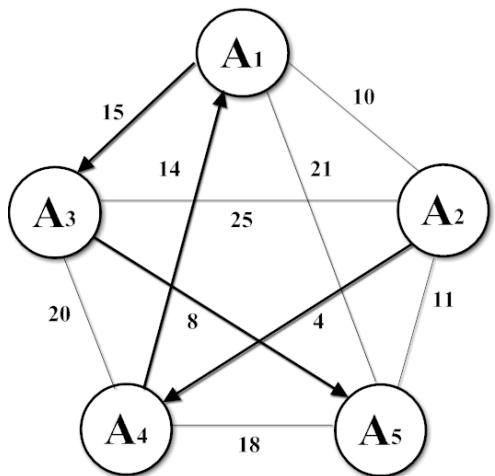  
图1 五个碎片组成的完全图以及其哈密尔顿路径 $( A _ { 2 } A _ { 4 } A _ { 1 } A _ { 3 } A _ { 5 } )$

走过的路径可以用如下序列表示：

$$
\pi = \left( \ A _ { \_ } { ( 0 ) , A _ { \pi } ( 1 ) \dots A _ { \pi } ( n ) } \right)\tag{2}
$$

其中 $A _ { \pi } ( i )$ 表示在路径π上第i个被访问的碎片编号，对于任意 $i = 0 , 2 , \dots n - 1$ ，满足：

$$
0 \leq A _ { \pi } ( i ) \leq n - 1 ,\tag{3}
$$

且当i≠j时，

$$
A _ { \pi } ( i ) \neq A _ { \pi } ( j ) ,\tag{4}
$$

根据式(1)总边权f(π)计算如下：

$$
f ( \pi ) = \sum _ { i = 0 } ^ { n - 1 } d ( A _ { \pi } ( i ) , A _ { \pi } ( i + 1 ) )\tag{5}
$$

其中 $d ( i , j ) = d _ { i j }$ 表示碎片j拼接到碎片i的匹配距离。

问题一的目标函数为

$$
\operatorname* { m i n } { f ( \pi ) }\tag{6}
$$

这样一来，由哈密尔顿路径找到的排列是全局最优解。

## ● 匹配距离

借鉴灰度图像的聚类方法中的最小色差法[2]，在这里，我们采用两两图像边缘像素点的差异大小作为衡量标准，以此判别两张碎纸片图像匹配的可能性。所以在这里的匹配距离等价于差异大小。

首先，我们需要对图片进行采样获取信息。第n张碎纸片图像可以表示为一个RGB值的二维矩阵，记为 $A _ { n }$

$$
{ \left[ \begin{array} { l l l l l } { a _ { 1 1 } ^ { ^ { n } } } & { a _ { 1 2 } ^ { ^ { n } } } & { a _ { 1 3 } ^ { ^ { n } } } & { \cdots } & { a _ { 1 q ^ { ^ { n } } } } \\ { a _ { 2 1 } ^ { ^ { n } } } & { a _ { 2 2 } ^ { ^ { n } } } & { a _ { 2 3 } ^ { ^ { n } } } & { \cdots } & { a _ { 2 q ^ { ^ { n } } } } \\ { a _ { 3 1 } ^ { ^ { n } } } & { a _ { 3 2 } ^ { ^ { n } } } & { a _ { 3 3 } ^ { ^ { n } } } & { \cdots } & { a _ { 3 q ^ { ^ { n } } } } \\ { \vdots } & { \vdots } & { \vdots } & { } & { \vdots } \\ { a _ { p 1 } ^ { ^ { n } } } & { a _ { p 2 } ^ { ^ { n } } } & { a _ { p 3 } ^ { ^ { n } } } & { \cdots } & { a _ { p q } ^ { ^ { n } } } \end{array} \right] }  & { a _ { 1 j } ^ { ^ { n } } \in [ 0 , 2 5 5 ] }
$$

其中 $a _ { i j }$ 的取值范围即为RGB的数字表示范围， $q ^ { \ i }$ 和p分别表示一张图片在长和宽方向

上的像素总个数。

这样，一张图片就转化成为了由不同像素点组成的矩阵。在此基础上，我们对其特征进行分析判断。

我们所选取的特征为图像边缘像素点的差异大小，我们记碎纸片 $A _ { j }$ 拼接在碎纸片 $A _ { i }$ 后，边缘差异大小为 $| d _ { i j }$ o

问题一的碎片边界匹配距离为碎片边界横向匹配距离 $\dot { \mathbf { \xi } } d _ { c } ( i , j ) = \sum _ { k = 1 } ^ { p } \left| { a _ { k q } } ^ { i } - { a _ { k 1 } } ^ { j } \right|$ ，q为碎片像素矩阵 $A _ { i } |$ 的列数，用以表示碎纸片 $A _ { i ^ { \prime } }$ 右端边缘文字图像和碎纸片 $A _ { j } ,$ 左端边缘文字图像的匹配程度，匹配距离越小，则两张碎纸片越匹配。不同大小匹配度示意如下图2所示。

（b）081号碎片与200号碎片匹配度小  
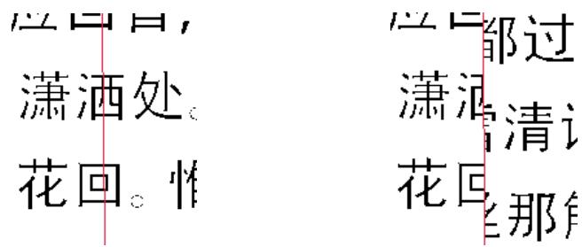  
（a）081号碎片与189号碎片匹配度大

图2 碎片边界纵向匹配程度示意图

## 5.1.3 问题一的求解

由于问题一中，所有碎片都是纵切的，只存在纵向差异，所以我们只需要对碎片进行一维排列。

首先我们用matlab编程将所有碎片读入，并计算出碎片与碎片之间的匹配距离。接着，为了求解旅行商的路径π这样一个NP问题，我们根据模型一中的式(3)(4)(5)(6)，用$x _ { i j } = 1$ 表示走过顶点i到顶点j， $x _ { i j } = 0$ 表示不选择这条路，将原模型转化得到如下旅行商问题的线性规划模型，

$$
\begin{array} { c } { { \operatorname* { m i n } \displaystyle \sum _ { i = { i } } d _ { i } x _ { i } \quad ( 7 ) } } \\ { { \mathrm { s . t . } \ } } \\ { { \mathrm { s . L } \ \displaystyle \sum _ { j = 1 } ^ { n } x _ { i j } = 1 , \ i = 0 , 1 , 2 . . . n - 1 \ ( \widetilde { \mathrm { s . H . Y . H i g h t } } \mathrm { J i f f . } \breve { \mathrm { S . } } \breve { \mathrm { H . W h . W h . } } \breve { \mathrm { J . } } ) \ ( 8 ) } } \\ { { \mathrm { s . t . } \ } } \\ { { \displaystyle \sum _ { i = 1 } ^ { n } x _ { i j } = 1 , \ j = 0 , 1 , 2 . . . n - 1 ( \widetilde { \mathrm { s . H . Y . H . i g h t } } \mathrm { J i f . } \breve { \mathrm { S . } } \breve { \mathrm { H . W h . } } + \widetilde { \mathrm { S . } } \breve { \mathrm { H . W h . } } \breve { \mathrm { J . } } ) \ ( 5 ) } } \\ { { \mathrm { s . H . } \ } } \\ { { \displaystyle \sum _ { i \neq 2 } \ | s | - 1 , 2 \leq | s | \leq n - 1 , s \ \mathrm { C . } \ \{ | s | , 2 , \cdots , n \} \ ( | s | \leq \breve { \mathrm { s . H . X . H . } } \breve { \mathrm { J . } } \breve { \mathrm { S . } } \breve { \mathrm { H . W h . } } \breve { \mathrm { J . } } \breve { \mathrm { S . } } \breve { \mathrm { H . W h . } } \breve { \mathrm { J . } } ) \ ( 1 0 ) } } \\ { { \displaystyle x _ { i j } \in \{ 0 , 1 , 1 , \ i , j = 0 , 1 , . . . , 1 \ } \ } \  \end{array} \ ( 1 0 )
$$

由此可以用善于求解规划问题的lingo语言(内部利用分支定界的剪枝算法)编写求解程序。

由于我们将模型转化了为上式(7)\~(11)的形式，所以由lingo编程求得的结果是一个0-1矩阵，并没有一个真正的排列。故，我们需要确定旅行商路径的源点，再根据求得的0-1矩阵得到最后的结果。

由日常经验，我们可以知道，纸张的边界一般会有留白区域。如果碎片是属于纸张

的左右两侧，则边缘的像素值必为背景像素值（本文问题中的背景颜色为白色，像素值为255)，根据这一特点，我们将碎纸片进行分类，分为边界碎纸片和中间碎纸片。具体的算法见模型二中的边界碎片查找算法。

对于问题一中的纵切碎纸片，左右侧碎片只有一张，所以设此时边界碎纸片查找算法中的 $n _ { c } = 1$ ，根据该算法求得，左右侧碎纸片编号分别为8、6，即得到碎片8为旅行商路径的源点。

至此，我们便可再运用matlab软件进行处理，运行得到最终结果。附件一中文字碎片与附件二英文字碎片还原后的序号见表2，还原图见附图一。

表 2 问题一碎片还原序列
<table><tr><td>附件1 </td><td>8 14</td><td></td><td>12 </td><td>15 </td><td>3 </td><td>10 </td><td>2 </td><td>16 </td><td>1 </td><td>4 </td><td>5 </td><td>9 </td><td>13 </td><td>18 </td><td>11 </td><td></td><td>7 17</td><td>0</td><td>6</td></tr><tr><td>附件2</td><td>3 </td><td>6</td><td>2</td><td>7</td><td>15</td><td>18</td><td>11</td><td>0</td><td>5</td><td>1</td><td>9</td><td>13</td><td>10</td><td>8</td><td>12</td><td>14 </td><td>17</td><td>16</td><td>4</td></tr></table>

## 5.2 问题二

## 5.2.1 模型二的主要思想

模型二主要解决既被纵切又被横切的碎片还原。

我们先考虑纸张被纵切会有一些碎片行，所以先根据文本行特征得到碎片行分组。接着，利用模型一基于旅行商问题的拼接策略得到每个碎片行分组的拼接排列，得到被还原的碎片行。再根据模型一基于旅行商问题的拼接策略将碎片行纵向拼接。

最后我们根据文本行距相等这一假设条件对所得的碎片还原进行自动调整，得到最后的就碎片还原结果。

综上所述，模型二将既被纵切又被横切的碎片还原问题分解为若干模型一中的旅行商问题。

对一个被切成切为 $n _ { r } \times n _ { c }$ 个碎片的纸张，需要做 $n _ { r }$ 次横向旅行商问题以及1次纵向旅行商问题。故，模型二的目标函数如下。

$$
\mathrm { m i n } f _ { k } ( \pi ) { = } \mathrm { m i n } \sum _ { i = 0 } ^ { n - 1 } d _ { k } ( A _ { \pi } ( i ) , A _ { \pi } ( i + 1 ) ) \qquad k { = } 1 , 2 \ldots n _ { r } { + } 1
$$

其中 $d ( i , j ) = d _ { i j }$ 表示碎片j拼接到碎片i的匹配距离。

其中，当 $k = 1 , 2 \ldots n _ { r }$ 时 $f _ { k } ( \pi )$ 为横向旅行商问题的目标函数，其匹配距离为碎片横向匹配距离，当 $k { = } n _ { r } + \ 1$ 时 $f _ { k } ( \pi )$ 为纵向旅行商问题的目标函数，其匹配距离为碎片纵向匹配距离。

## 5.2.2 模型二的建立与求解

## ● 纸张左右两侧的碎片

一般，我们在书写文章时，纸张左右两侧会留有一定的页边距，所以在纸张左右两侧会有一定的留白区。

虽然我们并不清楚留白区占有多少列像素，但是我们可以肯定的是纸张左右两侧的留白一定比文字与文字或者文字与符号之间的留白要多。所以我们在这里，采取一种逐步缩小范围的搜索方法。

我们以左侧留白为例，给出查找左右两侧碎片的算法及步骤。

已知一张纸在列方向上可由 $n _ { c }$ 张碎片拼接成，我们记为符合纸张左侧特征的碎片组成的集合为 $B _ { l } , \mathrm { ~ \ r ~ ~ } \delta _ { l }$ 为从碎片最左侧起开始编号的像素列号。

边界碎片查找算法如下。

（1）初始化。 $B _ { l }  \{ A _ { 0 } , A _ { 1 } \dotsc A _ { n } \} , \delta _ { l }  1$ ，其中 $1 ^ { \mathfrak { c } \mathfrak { c } }  2 ^ { \mathfrak { d } }$ 为赋值符号。

(2） 从集合 $B _ { l }$ 中按碎片 $A _ { k }$ 的编号顺序依次选出需要判别的碎片。若在选出的碎片在第 $\delta _ { l }$ 像素列中有任意一点像素 $a _ { i j } ^ { \ k }$ （其中， $j = \delta _ { l } )$ 不为背景像素值（即该列不留白），则将该碎片 $A _ { k }$ 从集合为 $B _ { l }$ 中去除，否则（该列留白）重复步骤（2）直至将集合 $B _ { l }$ 中的碎片都判断完。

（3）若集合 $B _ { l }$ 中的碎片个数 > nc，则 $\delta _ { l } \gets \delta _ { l } + 1$ ，转至步骤（2）；

若集合 $B _ { l }$ 中的碎片个数=nc，则找到所有符合条件的碎片，算法终止。

根据上述边界碎片查找算法，同样地，我们能够找到右侧的碎片及其集合 $B _ { r }$ ，由此得到所有左右两侧碎片。

## ● 文本行特征

当文字碎片即被纵切又被横切时，我们需要同时考虑其横纵拼接。在前文中我们已经考虑了纵向特征，所以在这里，我们考虑横向特征，将可能处在同一行的碎片找出。

由于中文字与英文字有所区别，我们在此分别讨论其文字行的特征。

## 中文文本行

由于中文字非常方正，所以，对于一个中文字碎片 $A _ { k }$ 我们按行扫描，记 $\delta _ { u }$ 为从碎片最上端起开始编号的像素行号，记 $r _ { i } ^ { k }$ 为碎片 $A _ { k }$ 在第 $\delta _ { u } = i$ 行的特征值。对任意碎片碎片 $A _ { k }$ ，从 $\delta _ { u } = 1$ 开始逐次以1递增扫描碎片的像素行，若碎片 $A _ { k }$ 在 $\delta _ { u }$ 像素行有一个文字像素值（该行有文字笔画）则 $r _ { i } ^ { k } = 0 ~ \left( i = \delta _ { u } \right)$ ，否则（该行无文字笔画） $r _ { i } ^ { k } = 1$ 。这样，我们可以得到碎片 $A _ { k }$ 的行距特征向量 $\mathbf { r } _ { k } = [ { r _ { 1 } } ^ { k } , { r _ { 2 } } ^ { k } . . . \ { r _ { p } } ^ { k } ] ^ { \mathrm { T } }$ ，见示意图图5。

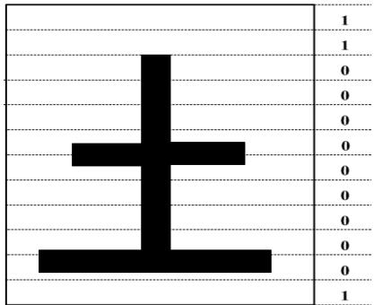  
图3 中文字文本行特征示意图

根据统计结果，得到上下两个文字之间的空白距离为63个像素距离。

## 英文文本行

英文字相对于中文字而言没有那么规整，但是一般英文的书写是在四线三格的中间，而英文字母的笔画一般不会超过第三条线，只有g、j、p、q、y、Q这六个英文字母字符超过第三条线（如图4所示），所以我们以第三条线作为底线判别文字行。

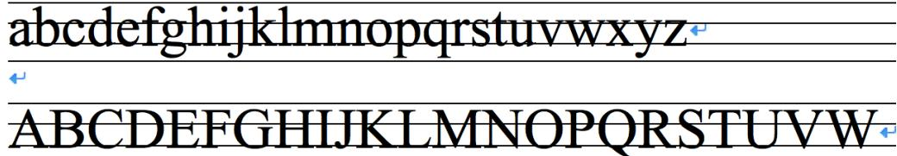  
图 4 英文字文本行

也就是说，当从上往下扫描碎片图片时，突然有90%以上的像素点为背景像素值时，我们就认为该行为底线。根据统计，文本占底线间距的三分之二，所以我们在底线上面三分之二设为文字像素值，底线下面三分之一设为背景像素值。填充之后，同中文字碎

片，我们可以得到英文字碎片的行距特征向量 $\mathbf { r } _ { k }$ ，见示意图图5。

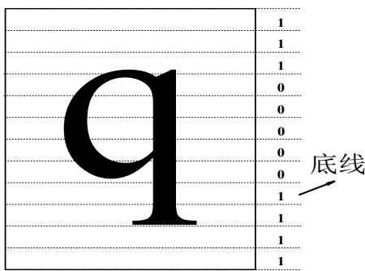  
图 5 英文字文本行特征示意图  
根据统计结果，得到底线与底线之间的距离为63个像素距离。

## ● 同一行碎片

有了碎片行距特征向量后，我们定义碎片 $A _ { j }$ 归为碎片 $A _ { i }$ 所在行后由行距特征向量$\mathbf { r } _ { i }$ 与 $\mathbf { r } _ { j }$ 作异或操作 $\circledast$ 得到的模为文本行距匹配距离 $d _ { g } ( i , j )$ ，即即 $d _ { g } ( i , j ) { = } | \mathbf { r } _ { i } \oplus \mathbf { r } _ { j } |$

我们记θ为文本行距匹配的梯度阈值，当 $d _ { g } ( i , j ) \geq \theta$ 时，我们认为碎片 $A _ { j }$ 归为 $A _ { i }$ 所在行的匹配度较高。

接下来，根据文本行距匹配距离我们可以通过行匹配得到同在一行的文字碎片。

已知一张纸在行方向上可由 $n _ { r }$ 张碎片拼接成，以纸张右侧碎片作为行分组的标准，我们记纸张右侧碎片组成的集合为 $B _ { r }$ ，非纸张右侧且未被分组的碎片集合记为 $B _ { u } .$

## 行碎片查找算法如下。

在步骤（2）～（5）中，我们找到的是一个粗略的行分组，在步骤（5）（6）后我们找到的是一个较精确的行分组。

（1）初始化。集合 $B _ { r }$ 中的碎片 $A _ { i }$ 所在行碎片个数 $\kappa ( A _ { i } ) \gets 1$

(2） 从集合 $B _ { u }$ 中选出一个碎片 $A _ { j }$ ，若集合 $B _ { u }$ 为空则转至步骤（5）。

(3)从集合 $B _ { r }$ 中按碎片编号顺序依次选出碎片 $A _ { i }$ ，求得碎片 $A _ { i }$ 与碎片 $A _ { j }$ 的文本行距匹配距离 $d _ { g } ( i , j )$ ，放入匹配队列 $\mathrm { Q } _ { i }$ 中。

（4）将匹配队列 $\mathrm { Q } _ { i }$ 中的 $d _ { g } ( i , j )$ 排序，得到最大的 $d _ { g } ( i , j )$ ，此时将碎片 $A _ { j }$ 归为碎片$A _ { i }$ 所在行，并将 $A _ { j }$ 从集合 $B _ { u }$ 中去除，转至步骤（2）。

（5）从集合 $B _ { r }$ 中按碎片编号顺序依次选出碎片 $A _ { i }$ ，若该碎片未被选出过则执行步骤（6），否则终止算法。

（6）将所有归为碎片 $A _ { i }$ 所在行的碎片 $A _ { j }$ 按 $d _ { g } ( i , j )$ 从大到小排序，若 $d _ { g } ( i , j ) <$ 或者 $\kappa ( A _ { i } ) = n _ { r }$ 则转至（5）否则该行 $\kappa ( A _ { i } )  \kappa ( A _ { i } ) + 1$

根据上述步骤我们即可得到以纸张右侧碎片作为分组标准的行分组。

## ● 基于纸张碎片左右分组的碎片行分组

由于段落首行缩进以及段落结尾行留白，会导致在进行碎片查找算法时发生未满构成整行的碎片数 $n _ { r }$ 就停止查找某行的碎片。为了弥补这样的分组结果，我们采用对碎片先右分组，再左分组，最后由左右分组结合的方法来对行分组，如图6所示。

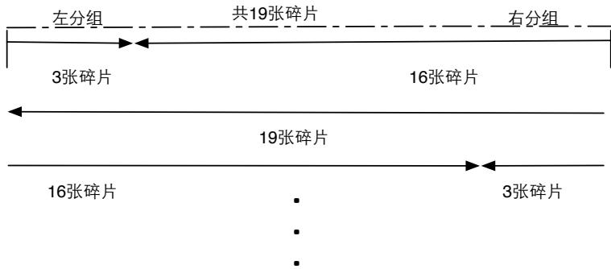  
图 6 左右分组与双侧分组算法

由纸张双侧向中间进行行分组的算法如下。

（1）以纸张右侧碎片为行分组标准，用行碎片查找算法找到一些行分组，其集合记为 $G _ { r } ,$ 我们称其为右边分组碎片。

（2）以纸张左侧碎片为行分组标准，用行碎片查找算法找到一些行分组，其集合记为 $G _ { l } ,$ 我们称其为左边分组碎片。

（3）我们将左右分组集合 $G _ { r }$ 和 $G _ { l }$ 中组内碎片数κ之和为整行的碎片数 $n _ { r }$ 的两个分组拼接在一起，形成一些完整的行。

（4）将未被行分组的碎片与纸张左侧碎片进行碎片边界横向匹配距离的匹配。即将集合 $B _ { u }$ 中的碎片与集合 $B _ { l }$ 中的碎片进行匹配，选择边界横向匹配距离最大的作为拼接在纸张左侧碎片右侧的碎片，这些碎片即为纸张左侧第2列碎片。这样就避免了由段落首行缩进引起留白而无法进行分组的情形。

（5）以纸张左侧第2列碎片为行分组标准，用行碎片查找算法，得到一些行分组，记入集合 $G _ { l }$ 中。再重复一遍步骤（3）。

下面给出一个结合左右分组对碎片行分组的具体的实例。

图7所示为同一行的碎片分组，该图中的组内碎片已横向拼接过。

风不解笛化仕。片片者人尤数。楼上望春归去。方早述归踏。犀钱玉果。

利市平分沾四坐。多谢无功。此事如何到得侬。元宵似是欢游好。何况公庭民讼少。万家游赏上春台，十里神仙迷海岛。

图7 附件三中196号碎片所在行的分组  
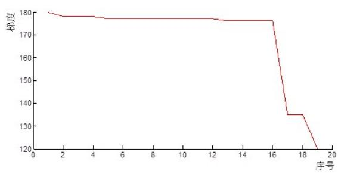  
图8附件三中196号碎片所在行右分组文本行距匹配梯度。

图8中的文本行距匹配梯度曲线为图7（b）的分组碎片的文本行距匹配梯度情况，可以看到第19个碎片的文本行距匹配梯度特别小，结合图7中我们可以看到实际情况也确实如此（左右分组衔接处匹配程度较低）。

## ● 横向碎片拼接

用模型一中基于旅行商问题的拼接策略，对得到的行分组进行横拼接，得到还原后的碎片行。

需要注意的是，横向碎片拼接得到的是没有关联的碎片行，碎片行与碎片行之间的排列还未找出，即纵向文本还原还没有处理。

## ● 纵向碎片拼接

由纸张双侧向中间拼接碎片后，我们能够得到一行一行还原后的碎片组。我们将每一行碎片组看做图的顶点，用模型一中基于旅行商问题的拼接策略，对碎片组纵向排列。在纵向排列时，我们需要用到碎片边界纵向匹配距离。

碎片边界纵向匹配距离 $d _ { r } ( i , j ) = \sum _ { k = 1 } ^ { q } \left| { a _ { p k } } ^ { i } - { a _ { 1 k } } ^ { j } \right|$ ，p为碎片像素矩阵A的行数，用以表示碎纸片 $\cdot \cdot \_ s i$ 下端边缘文字图像和碎纸片 $\cdot _ { A _ { j - } }$ 上端边缘文字图像的匹配程度，匹配距离小，则两张碎纸片越匹配。不同大小匹配度示意如下图9所示。

<table><tr><td>任刘 戈，</td></tr><tr><td>目得 空</td></tr><tr><td>应回 点相</td></tr><tr><td>潇泥 潇泥</td></tr><tr><td>花回 花E</td></tr></table>

（a）041号碎片与081号碎片匹配度大 （b）100号碎片与081号碎片匹配度小  
图9附件三中碎片边界横向匹配程度示意图

这样一来我们可以得到一整张还原后的纸张，但这样的排列还有一定问题，下面我们做进一步调整。

## ● 中文字基于行距的碎片拼接

由纵向碎片拼接，我们可以得到一整张还原后的纸张，但是定由此拼接后纸张中的文本行距不一相等。而根据我们的假设，我们认为一般纸张中的文本行距相等，所以我们需要对纵向碎片拼接后的结果做一定调整。

当一行碎片组下边缘为背景色时，另一行碎片组上边缘为背景色时，这两行碎片组边界纵向匹配程度较高，被拼接在一起，导致这两行间的行距变大。我们将这样情形的碎片组拼接断开，分成几组碎片段，每个碎片段都由一些碎片行组成。

这样我们可以将碎片段重新排列组合，选出文本行距最符合文本行距相等这一条件的碎片段组合，以此组合作为最终的碎片还原结果。

下面给出判别文本行距相等的方法。

由于文字书写时行距一般相等，所以若按行扫描原文字文件，则其行距会呈现一定的周期规律。对于某一文字碎片，我们有行距特征的0-1向量，那么对某一碎片行的每个碎片行距特征向量做求和运算，就可以得到文本行距的变化曲线，见图10。

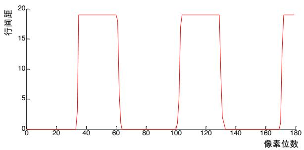  
图 10 附件3 中 078号碎片所在行的行距图  
（高处部分的曲线表示无文字，低处部分的曲线表示有文字)

由图10我们可以看到该碎片行有无文字出现的交替非常规整，我们称这样的文本符合文本行距相等这一条件。

若将每一碎片行首尾连接后，我们可以得到整个纸张中的文本行距变化曲线图，见图11、图 12。

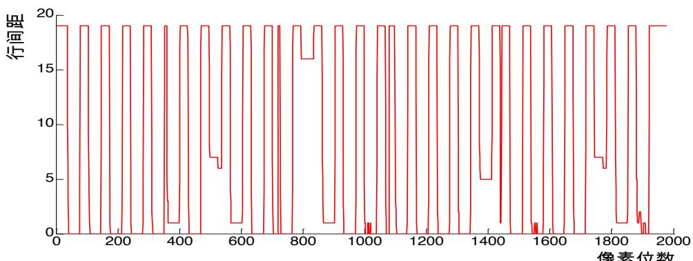  
图 11 文本行距周期错误曲线

（附件3碎片错误还原结果，其还原图见附图四）  
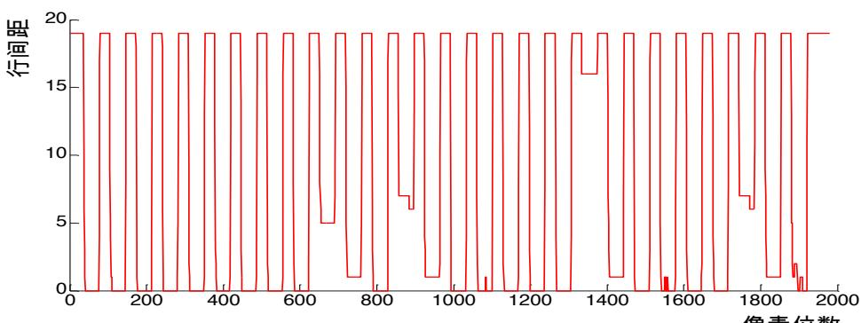  
图 12 文本行距周期正确曲线  
(附件3碎片还原结果)

从图11中我们可以看到，该曲线中在像素位350附近、750附近、1100附近以及1400附近的有无文字交替比曲线其他部分要频繁，我们认为这样的结果是不符合条件的。而图12中的曲线变化规律相当规整，我们认为这样的结果是正确的。

## ● 英文字基于底线间距（行距）的碎片拼接

因为英文文字比较稀疏，横切的时候可能会有多个两端空白的碎片行在其中，利用碎片纵向匹配距离 $d _ { r }$ 会出现问题。为了对其进一步优化，我们之前分析得到英文字母的底线间距一定(63个像素单位)，我们可以通过之前的方法求出每个碎片行的底线位置。

如果两个碎片行相邻则其两个底线之间的距离应该尽可能逼近63，所以我们引入一个碎片纵向逼近距离 $d _ { e } ( i , j ) { = } 6 3 { \ - } . . . . . 0 0 0 0 ( l ( i , j ) , 6 3 )$ ，其中 $\bmod { ( l ( i , j ) , 6 3 ) }$ 为碎片 $A _ { i } , \ A _ { j }$ 底线之间距离与63做取余数运算，因为 $d _ { e } ( i , j )$ 与 $d _ { r } ( i , j )$ 的量纲不一致，所以我们可以对其先进行标准化（除以各自的最大值）得到 ${ d _ { e } } ^ { * } ( i , j )$ 和 $\boldsymbol { d } _ { r } ^ { * } ( i , j )$ ，我们定义一种新的复合距离$d _ { r e } { = } d _ { r } ^ { ~ * } ( i , j ) { + } d _ { e } ^ { ~ * } ( i , j )$ ，如此便可以转化为旅行商问题进行排序。

## 5.2.3 问题二的求解结果

对于附件3的中文字碎片，由模型二的建立与求解，得到最后的结果见附图二(a)、附表一。

对于附件4的英文字碎片，由模型二的建立与求解，得到最后的结果见附图二(b)、附表二。其中人工干预的时间节点为对行分组碎片横向拼接后。

其人工干预方式，我们举例说明。

以191号碎片所在行为例，利用模型一拼接策略对行分组碎片横向拼接得出的结果如下：

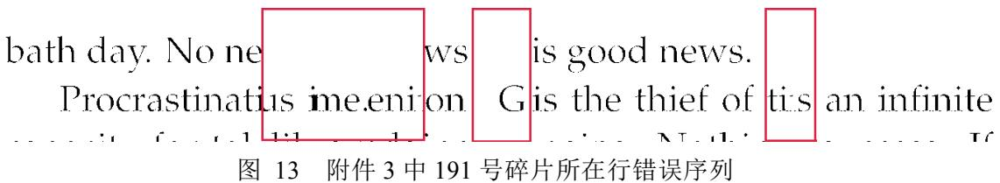

我们从图13中可以看出红色框的碎片拼接出现了问题。某些碎片有一个共同特征，两侧中有一侧为白色，且与其匹配的左侧或右侧碎片边缘也为白色，产生了背景色匹配背景色的情况，即匹配距离小的情况，在这种情况下，产生的答案可能是不正确的，而且同一碎片行中带有白色边缘的数量越多，错误匹配的可能性越大。

在这里，我们进行人工干预，容易发现该段碎片行上面部分文字有断裂，将红色框内涉及的碎片顺序进行交换后，得到新的序列，并画出图像验证，手工调整的结果正确。正确图像如图14所示。

bath day. No news is good news.

Procrastination is the thief of time. Genius is an infinite Tf 图 14 附件3 中 191 号碎片所在行正确序列

## 5.3 问题三

## 5.3.1 模型三主要思想

模型三主要解决碎片有双面内容的还原。

该模型同模型二，将原问题分解为若于模型一中的旅行商问题，但考虑到碎片的双面问题，我们将文本行距匹配距离替换为正反文本行距匹配距离。在对碎片进行航分组与拼接等处理方法同模型二。此外，值得一提的是，由于纸张有两面，所以该模型中对碎片行纵向拼接时用到模型一的拼接策略为多旅行商的情形，即对一个被切成切为 $n _ { r } { \times } n _ { c }$ 个双面碎片的纸张，需要做 $n _ { r }$ 次横向旅行商问题以及1次纵向多旅行商问题（2个旅行商)。故，模型三的目标函数如下。

$$
\begin{array} { r l } { \operatorname* { m i n } f _ { k } ( \pi ) } & { { } \ k = 1 , 2 \ldots n _ { r } } \end{array}
$$

$$
\operatorname* { m i n } { f ( \pi ) } { = } \sum _ { 1 } ^ { n _ { r } } d _ { \pi ( i ) \pi ( i + 1 ) } + \sum _ { n _ { r } + 1 } ^ { 2 n _ { r } } d _ { \pi ( i ) \pi ( i + 1 ) }
$$

其中，当 $k = 1 , 2 \ldots n _ { r }$ 时 $f _ { k } ( \pi )$ 为横向旅行商问题的目标函数，其匹配距离为正反面碎片边界横向匹配距离，当 $k { = } n _ { r } + 1$ 时 $f _ { k } ( \pi )$ 为纵向旅行商问题（2个旅行商）的目标函数，其匹配距离为正反面碎片边界复合匹配距离。

## 5.3.2 模型三的建立与求解

## ● 纸张左右两侧的碎片

同模型二，通过前面的方法我们可以搜索到属于左端的纸集合{a54、a89、a99、a100、a114、a136、a143、a146、b3、b5、b13、b23、b35、b78、b83、b88、b90、b91、b105、b165、b172、b186、b199}和右端的碎纸集合{a3、a5、a13、a23、a35、a78、a83、a88、a90、a105、a165、a172、a186、a199、b9、b54、b89、b99、b114、b136、b143、b146}。

因为纸面a面与b面是在一张纸的同一个地方，有其独特的性质，例如a纸在左上角则对应于其同一个地方的b面纸，则在其面的右上角。所以，我们可以通过此种方法对其集合A、B进行检验最后发现A集合多出a100、b91，缺少 $a 9$ ，B集合正确，所以得到最终集合A、B。

## ● 正反匹配距离

同上文中用到的一些匹配距离，我们在第三问中会用到类似的匹配距离，但其定义略有不同。

正反面碎片边界横向匹配距离： ${ d _ { r } } ^ { * } ( i , j ) = \sum _ { k = 1 } ^ { p } \bigl | a _ { q k } ^ { i } - a _ { 1 \downarrow } ^ { i } \bigr | + \bigl | a f _ { q k } ^ { i } - a f _ { 1 k } ^ { j } \bigr |$

其中p为碎片像素矩阵 $A _ { i }$ 的列数 $a f$ 为a的反面。

正反文本行距匹配距离： ${ d _ { g } } ^ { * } ( i , j ) = \left| \mathbf { r } _ { i } \oplus \mathbf { r } _ { j } \right| + \left| \mathbf { f r } _ { i } \oplus \mathbf { f r } _ { j } \right|$

其中 $\mathbf { f r } _ { i }$ 为碎片 $A _ { i }$ 反面的行距特征向量。

正反面碎片边界复合匹配距离： $d _ { r e } { } ^ { * } ( i , j ) = d _ { r e } ( i , j ) + f d _ { r e } ( i , j )$

$f d _ { r e } ( i , j )$ 为碎片 $A _ { i }$ 反面和碎片 $A _ { j }$ 反面之间的复合距离

## ● 基于纸张碎片左右分组的碎片行分组

方法同模型二

## ● 横向碎片拼接

我们只需要将文本行距匹配距离替换为正反文本行距匹配距离，碎片横向处理方法同模型二。

## ● 纵向碎片拼接

在对纵向多旅行商问题（2个旅行商）的处理上，我们发现可以通过改变距离矩阵将2个旅行商的问题简化为一个旅行商的问题，只需要把不属于同一列的首尾间距离定义为0，其意义即相当于旅行商的又一次出发，将其转化为多旅行商问题。在该问题中我们可以通过边界碎片查找算法找到该碎片行中处于原图第一行的碎片行 $y _ { 1 } , \ y _ { 2 }$ 和最后一行的 $s _ { 1 } , s _ { 2 } .$ 。所以我们只需要令 $d ( y 1 , s 1 ) , d ( y 1 , s 2 ) , d ( y 2 , s 1 ) , d ( y 2 , s 2 )$ 都为0即可。

因为该碎片行图有正反面，所以我们以正反面碎片边界复合匹配距离 $\boldsymbol { d } _ { \mathit { r e } } ^ { * } ( i , j )$ 来表示其两两之间的距离。因为每张碎片自身的正反面不可以相互连接，所以我们定义其间的距离为一个足够大的数字M， $d ( i , j )$ 的意义代表第 $i , j$ 碎片行之间的正反匹配度距离。综上所述，我们可以得到距离矩阵中D中第i行第j列的元素 $d ( i , j )$ 计算公式如下

$$
d ( i , j ) = = \left\{ \begin{array} { c c } { d _ { r e } ^ { ~ * } ( i , j ) } & { \sharp \sharp ^ { \prime } \sharp } \\ { M } & { \sharp \sharp i , j \overline { { \sharp \sharp } } \sharp \sharp ^ { \prime } \sharp \jmath _ { \exists } \underline { { \operatorname { I F } } } \jmath _ { \overline { { \operatorname { X } } } } \overline { { \operatorname { I f } } } } \\ { 0 } & { \sharp \jmath _ { \overline { { \operatorname { E } } } } ^ { * } \sharp \sharp \underline { { \operatorname { I f } } } \sharp } \end{array} \right.
$$

计算得到所有的 $d ( i , j )$ 之后，只需要根据目标函数(7)，利用lingo求解即可。

## 5.3.3 问题三的求解结果

对于附件5的碎片，由模型三的建立与求解，得到最后的结果见附图三、附表三。此外，根据模型三对问题三的求解过程中无人工干预，我们分析其原因下。

## ● 干预分析

因为我们建立的指标包含碎片双面的信息，所以碎片可用于拼接的信息增加一倍，在之前单面的分析中，我们了解到在排行出问题的碎片中其基本特征为两边空白面积大，即被切割的地方在空白处，而在双面的碎片中，其两面都切到空白的概率很低，所以一般不会出问题。

## VI 模型的优点与改进

## 6.1 模型的优点

将碎片拼接问题抽象为旅行商问题（不回到源点的旅行商问题)，有利于利用现有算法找到全局最优解，并且具有一定的扩展性。在本问的三问中，均有使用，体现出我们模型的连贯性。

根据文本行距特征，对碎片行分组，既简化了问题便于拼接，同时体现了对文本碎片的具体的探究。

## 6.2 模型的改进

O 在行距调整过程中我们用调整碎片段再评判行距的方法，其实也可以直接根据碎片行的行距特征做一定计算直接拼接出结果。

由于我们将模型一已转化为旅行商问题，而旅行商问题是一个已被证明的“NP难”问题，当图中顶点个数很多时，传统的方法已不能在可接受的时间内给出最优解。在本文所解决的问题中均未涉及到太多的顶点，所以用0-1整数规划方法可以得到最优解，但是实际情况下，碎片数可能很庞大，此时借鉴遗传算法解决旅行商问题的方法可以解决，遗憾的是我们没有时间将结果实践出来。

纸张纵切时若没有切到任何文字时，我们是人工干预完成的。改进方法为将原来1×1的单个碎片组合成 $2 \times 1$ 的碎片组合，减少人工干预次数。

对碎片分组考虑到了一些文本特征，所以除了用本文所用的分类算法外还可以可虑用聚类方法或者人工智能中模式识别方法做分组。

## VII 文献

[1] Pal A, Shanmugasundaram K, Memon N. Automated reassembly of fragmented images[C]//Multimedia and Expo , 2003. ICME'03. Proceedings. 2003 International Conference on. IEEE, 2003, 1: I-625-8 vol. 1.

[2]贾海燕．碎纸自动拼接关键技术研究[D]. 国防科学技术大学，2005.

[3]司守奎.数学建模算法与应用.北京:国防工业出版社，59-60，2011年

## VIII 附录

## ● 附件1、附件2的复原结果见附图一。

城上层楼叠巇、城下清淮古汴、举手揖吴云，人与暮天俱远、魂断魂断。后夜松江月满。簌簌衣巾莎枣花。村里村北响缲车。牛衣古柳卖黄瓜。海棠珠缀一重重。清晓近帘栊。脑脂谁与匀淡，偏向脸边浓。小郑非常强记，二南依旧能诗。更有鲈鱼堪切脍，儿辈莫教知。自古相从休务日，何妨低唱微吟。天垂云重作春阴。坐中人半醉，帘外雪将深。双绿坠。娇眼横波眉黛翠。妙舞蹁跹。掌上身轻意态妍。碧雾轻笼两凤，寒烟淡拂双鸦。为谁流睇不归家。错认门前过马。

我劝髯张归去好，从来自己忘情。尘心消尽道心平。江南与塞北，何 处不堪行。闲离阻。谁念萦损襄王，何曾梦云雨。旧恨前欢，心事两无据。 要知欲见无由，痴心犹自，倩人道、一声传语。风卷珠帘自上钩。萧萧乱 叶报新秋。独携纤手上高楼。临水纵横回晚鞚。归来转觉情怀动。梅笛烟 中闻几弄、秋阴重。西山雪淡云凝冻。凭高眺远，见长空万里，云无留迹 桂魄飞来光射处，冷浸一天秋碧。玉宇琼楼，乘鸾来去，人在清凉国。江 山如画，望中烟树历历。省可清言挥玉尘，真须保器全真。风流何似道家 纯。不应同蜀客，惟爱卓文君。自惜风流云雨散。关山有限情无限。待君 重见寻芳伴。为说相思，目断西楼燕。莫恨黄花未吐。且教红粉相扶。酒 阑不必看茱萸。俯仰人间今古。玉骨那愁瘴雾，冰姿自有仙风。海仙时遣 探芳丛。倒挂绿毛么凤。

俎豆庚桑真过矣，凭君说与南荣。愿闻吴越报丰登。君王如有问，结袜赖王生。师唱谁家曲，宗风嗣阿谁。借君拍板与门槌。我也逢场作戏、莫相疑。晕腮嫌枕印、印枕嫌腮晕。闲照晚妆残。残妆晚照闲。可恨相逢能几日，不知重会是何年。茱萸仔细更重看。午夜风翻幔，三更月到床。簟纹如水玉肌凉。何物与侬归去、有残妆。金炉犹暖麝煤残。惜香更把宝钗翻。重闻处，余熏在，这一番、气味胜从前。菊暗荷枯一夜霜。新苞绿叶照林光。竹篱茅舍出青黄。霜降水痕收。浅碧鳞鳞露远洲。酒力渐消风力软，飕飕。破帽多情却恋头。烛影摇风，一枕伤春绪。归不去。凤楼何处、芳草迷归路、汤发云腴醉白，盏浮花乳轻圆。人间谁敢更争妍、斗取红窗粉面。炙手无人傍屋头。萧萧晚雨脱梧楸。谁怜季子敞貂裘。

(a)附件1碎片复原图

fair of face.

The customer is always right. East, west, home's best. Life's not all beer and skittles. The devil looks after his own. Manners maketh man. Many a mickle makes a muckle. A man who is his own lawyer has a fool for his client.

You can't make a silk purse from a sow's ear. As thick as thieves. Clothes make the man. All that glisters is not gold. The pen is mightier than sword. Is fair and wise and good and gay. Make love not war. Devil take the hindmost. The female of the species is more deadly than the male. A place for everything and everything in its place. Hell hath no fury like a woman scorned. When in Rome, do as the Romans do. To err is human; to forgive divine. Enough is as good as a feast. People who live in glass houses shouldn't throw stones. Nature abhors a vacuum. Moderation in all things.

Everything comes to him who waits. Tomorrow is another day. Better to light a candle than to curse the darkness

Two is company, but three's a crowd. It's the squeaky wheel that gets the grease. Please enjoy the pain which is unable to avoid. Don't teach your Grandma to suck eggs. He who lives by the sword shall die by the sword. Don't meet troubles half-way. Oil and water don't mix. All work and no play makes Jack a dull boy.

The best things in life are free. Finders keepers, losers weepers. There's no place like home. Speak softly and carry a big stick. Music has charms to soothe the savage breast. Ne'er cast a clout till May be out. There's no such thing as a free lunch. Nothing venture, nothing gain. He who can does, he who cannot, teaches. A stitch in time saves nine. The child is the father of the man. And a child that's born on the Sab-

## (b)附件2碎片复原图

附图一问题一碎片复原图

●附件3、附件4的复原结果见附图二，复原序列见附表一和附表二。

便邮。温香熟美。醉慢云霊垂两耳、多谢春工。不是花红是玉红。一颗樱桃樊素口。不爱黄金，只爱人长久。学画鸦儿犹未就。眉尖已作伤春皱。清泪斑斑，挥断柔肠寸。嗔人问。背灯偷温拭尽残妆粉。春事阑珊芳草歇。客里风光，又过清明节。小院黄昏人忆别。落红处处闻啼鳩。岁云暮，须早计，要褐裘。故乡归去千里，佳处辄迟留。我醉歌时君和，醉倒须君

缺月向人舒窈窕，三星当户照绸缪。香生雾縠见纤柔。搔首赋归欤。自觉功名懒更疏。若问使君才与术，何如。占得人间一味愚。海东头，山尽处、自古空槎来去。槎有信，赴秋期。使君行不归。别酒劝君君一醉清润潘郎，又是何郎婿。记取钗头新利市。莫将分付东邻子。西塞山边白鹭飞。散花洲外片帆微。桃花流水鳜鱼肥。主人瞋小。欲向东风先醉倒。扶我，惟酒可忘忧。一任刘玄德，相对卧高楼。记取西湖西畔，正暮山好处，空翠烟霏。算诗人相得，如我与君稀。约他年、东还海道，愿谢公、雅志莫相违。西州路，不应回首，为我沾衣。料峭春风吹酒醒。微冷。山头斜照却相迎。回首向来潇洒处。归去。也无风雨也无晴。紫陌寻春去，红尘拂面来。无人不道看花回。惟见石榴新蕊、一枝开。

已属君家。且更从容等待他。愿我已无当世望，似君须向古人求。岁寒松柏肯惊秋。

水涵空，山照市。西汉二疏乡里。新白发，旧黄金。故人恩义深。谁道东阳都瘦损，凝然点漆精神。瑶林终自隔风尘。试看披鹤氅，仍是谪仙人。三过平山堂下，半生弹指声中。十年不见老仙翁。壁上龙蛇飞动。暖风不解留花住。片片著人无数。楼上望春归去。芳草迷归路。犀钱玉果。利市平分沾四坐。多谢无功。此事如何到得侬。元宵似是欢游好。何况公庭民讼少。万家游赏上春台，十里神仙迷海岛。

九十日春都过了，贪忙何处追游。三分春色一分愁。雨翻榆荚阵，风 转柳花球。自雪清词出坐间。爱君才器两俱全。异乡风景却依然。团扇只 堪题往事，新丝那解系行人。酒阑滋味似残春。

虽抱文章，开口谁亲。且陶陶、乐尽天真。几时归去，作个闲人。对 一张琴，一壶酒，一溪云。相如未老。梁苑犹能陪俊少。莫惹闲愁。且折 bath day. No news is good news.

Procrastination is the thief of time. Genius is an infinite capacity for taking pains. Nothing succeeds like success. If you can't beat em, join em. After a storm comes a calm. A good beginning makes a good ending.

One hand washes the other. Talk of the Devil, and he is bound to appear. Tuesday's child is full of grace. You can't judge a book by its cover. Now drips the saliva, will become tomorrow the tear. All that glitters is not gold. Discretion is the better part of valour. Little things please little minds. Time flies. Practice what you preach. Cheats never prosper.

The early bird catches the worm. It's the early bird that catches the worm. Don't count your chickens before they are hatched. One swallow does not make a summer. Every picture tells a story. Softly, softly, catchee monkey. Thought is already is late, exactly is the earliest time. Less is more.

A picture paints a thousand words. There's a time and a place for everything. History repeats itself. The more the merrier. Fair exchange is no robbery. A woman's work is never done. Time is money.

Nobody can casually succeed, it comes from the thorough self-control and the will. Not matter of the today will drag tomorrow. They that sow the wind, shall reap the whirlwind. Rob Peter to pay Paul. Every little helps. In for a penny, in for a pound. Never put off until tomorrow what you can do today. There's many a slip twixt cup and lip. The law is an ass. If you can't stand the heat get out of the kitchen. The boy is father to the man. A nod's as good as a wink to a blind horse. Practice makes perfect. Hard work never did anyone any harm. Only has compared to the others early, diligently

## (a)附件3碎片复原图

## (b)附件4碎片复原图

附图二 问题二碎片复原图  
附表一附件3碎片复原序列
<table><tr><td rowspan=1 colspan=1>49</td><td rowspan=1 colspan=1>54</td><td rowspan=1 colspan=1>65</td><td rowspan=1 colspan=1>143</td><td rowspan=1 colspan=1>186</td><td rowspan=1 colspan=1>2</td><td rowspan=1 colspan=1>57</td><td rowspan=1 colspan=1>192</td><td rowspan=1 colspan=1>178</td><td rowspan=1 colspan=1>118</td><td rowspan=1 colspan=1>190</td><td rowspan=1 colspan=1>95</td><td rowspan=1 colspan=1>11</td><td rowspan=1 colspan=1>22</td><td rowspan=1 colspan=1>129</td><td rowspan=1 colspan=1>28</td><td rowspan=1 colspan=1>91</td><td rowspan=1 colspan=1>188</td><td rowspan=1 colspan=1>141</td></tr><tr><td rowspan=1 colspan=1>61</td><td rowspan=1 colspan=1>19</td><td rowspan=1 colspan=1>78</td><td rowspan=1 colspan=1>67</td><td rowspan=1 colspan=1>69</td><td rowspan=1 colspan=1>99</td><td rowspan=1 colspan=1>162</td><td rowspan=1 colspan=1>96</td><td rowspan=1 colspan=1>131</td><td rowspan=1 colspan=1>79</td><td rowspan=1 colspan=1>63</td><td rowspan=1 colspan=1>116</td><td rowspan=1 colspan=1>163</td><td rowspan=1 colspan=1>72</td><td rowspan=1 colspan=1>6</td><td rowspan=1 colspan=1>177</td><td rowspan=1 colspan=1>20</td><td rowspan=1 colspan=1>52</td><td rowspan=1 colspan=1>36</td></tr><tr><td rowspan=1 colspan=1>168</td><td rowspan=1 colspan=1>100</td><td rowspan=1 colspan=1>76</td><td rowspan=1 colspan=1>62</td><td rowspan=1 colspan=1>142</td><td rowspan=1 colspan=1>30</td><td rowspan=1 colspan=1>41</td><td rowspan=1 colspan=1>23</td><td rowspan=1 colspan=1>147</td><td rowspan=1 colspan=1>191</td><td rowspan=1 colspan=1>50</td><td rowspan=1 colspan=1>179</td><td rowspan=1 colspan=1>120</td><td rowspan=1 colspan=1>86</td><td rowspan=1 colspan=1>195</td><td rowspan=1 colspan=1>26</td><td rowspan=1 colspan=1>1</td><td rowspan=1 colspan=1>87</td><td rowspan=1 colspan=1>18</td></tr><tr><td rowspan=1 colspan=1>38</td><td rowspan=1 colspan=1>148</td><td rowspan=1 colspan=1>46</td><td rowspan=1 colspan=1>161</td><td rowspan=1 colspan=1>24</td><td rowspan=1 colspan=1>35</td><td rowspan=1 colspan=1>81</td><td rowspan=1 colspan=1>189</td><td rowspan=1 colspan=1>122</td><td rowspan=1 colspan=1>103</td><td rowspan=1 colspan=1>130</td><td rowspan=1 colspan=1>193</td><td rowspan=1 colspan=1>88</td><td rowspan=1 colspan=1>167</td><td rowspan=1 colspan=1>25</td><td rowspan=1 colspan=1>8</td><td rowspan=1 colspan=1>9</td><td rowspan=1 colspan=1>105</td><td rowspan=1 colspan=1>74</td></tr><tr><td rowspan=1 colspan=1>71</td><td rowspan=1 colspan=1>156</td><td rowspan=1 colspan=1>83</td><td rowspan=1 colspan=1>132</td><td rowspan=1 colspan=1>200</td><td rowspan=1 colspan=1>17</td><td rowspan=1 colspan=1>80</td><td rowspan=1 colspan=1>33</td><td rowspan=1 colspan=1>202</td><td rowspan=1 colspan=1>198</td><td rowspan=1 colspan=1>15</td><td rowspan=1 colspan=1>133</td><td rowspan=1 colspan=1>170</td><td rowspan=1 colspan=1>205</td><td rowspan=1 colspan=1>85</td><td rowspan=1 colspan=1>152</td><td rowspan=1 colspan=1>165</td><td rowspan=1 colspan=1>27</td><td rowspan=1 colspan=1>60</td></tr><tr><td rowspan=1 colspan=1>14</td><td rowspan=1 colspan=1>128</td><td rowspan=1 colspan=1>3</td><td rowspan=1 colspan=1>159</td><td rowspan=1 colspan=1>82</td><td rowspan=1 colspan=1>199</td><td rowspan=1 colspan=1>135</td><td rowspan=1 colspan=1>12</td><td rowspan=1 colspan=1>73</td><td rowspan=1 colspan=1>160</td><td rowspan=1 colspan=1>203</td><td rowspan=1 colspan=1>169</td><td rowspan=1 colspan=1>134</td><td rowspan=1 colspan=1>39</td><td rowspan=1 colspan=1>31</td><td rowspan=1 colspan=1>51</td><td rowspan=1 colspan=1>107</td><td rowspan=1 colspan=1>115</td><td rowspan=1 colspan=1>176</td></tr><tr><td rowspan=1 colspan=1>94</td><td rowspan=1 colspan=1>34</td><td rowspan=1 colspan=1>84</td><td rowspan=1 colspan=1>183</td><td rowspan=1 colspan=1>90</td><td rowspan=1 colspan=1>47</td><td rowspan=1 colspan=1>121</td><td rowspan=1 colspan=1>42</td><td rowspan=1 colspan=1>124</td><td rowspan=1 colspan=1>144</td><td rowspan=1 colspan=1>77</td><td rowspan=1 colspan=1>112</td><td rowspan=1 colspan=1>149</td><td rowspan=1 colspan=1>97</td><td rowspan=1 colspan=1>136</td><td rowspan=1 colspan=1>164</td><td rowspan=1 colspan=1>127</td><td rowspan=1 colspan=1>58</td><td rowspan=1 colspan=1>43</td></tr><tr><td rowspan=1 colspan=1>125</td><td rowspan=1 colspan=1>13</td><td rowspan=1 colspan=1>182</td><td rowspan=1 colspan=1>109</td><td rowspan=1 colspan=1>197</td><td rowspan=1 colspan=1>16</td><td rowspan=1 colspan=1>184</td><td rowspan=1 colspan=1>110</td><td rowspan=1 colspan=1>187</td><td rowspan=1 colspan=1>66</td><td rowspan=1 colspan=1>106</td><td rowspan=1 colspan=1>150</td><td rowspan=1 colspan=1>21</td><td rowspan=1 colspan=1>173</td><td rowspan=1 colspan=1>157</td><td rowspan=1 colspan=1>181</td><td rowspan=1 colspan=1>204</td><td rowspan=1 colspan=1>139</td><td rowspan=1 colspan=1>145</td></tr><tr><td rowspan=1 colspan=1>29</td><td rowspan=1 colspan=1>64</td><td rowspan=1 colspan=1>111</td><td rowspan=1 colspan=1>201</td><td rowspan=1 colspan=1>5</td><td rowspan=1 colspan=1>92</td><td rowspan=1 colspan=1>180</td><td rowspan=1 colspan=1>48</td><td rowspan=1 colspan=1>37</td><td rowspan=1 colspan=1>75</td><td rowspan=1 colspan=1>55</td><td rowspan=1 colspan=1>44</td><td rowspan=1 colspan=1>206</td><td rowspan=1 colspan=1>10</td><td rowspan=1 colspan=1>104</td><td rowspan=1 colspan=1>98</td><td rowspan=1 colspan=1>172</td><td rowspan=1 colspan=1>171</td><td rowspan=1 colspan=1>59</td></tr><tr><td rowspan=1 colspan=1>7</td><td rowspan=1 colspan=1>208</td><td rowspan=1 colspan=1>138</td><td rowspan=1 colspan=1>158</td><td rowspan=1 colspan=1>126</td><td rowspan=1 colspan=1>68</td><td rowspan=1 colspan=1>175</td><td rowspan=1 colspan=1>45</td><td rowspan=1 colspan=1>174</td><td rowspan=1 colspan=1>0</td><td rowspan=1 colspan=1>137</td><td rowspan=1 colspan=1>53</td><td rowspan=1 colspan=1>56</td><td rowspan=1 colspan=1>93</td><td rowspan=1 colspan=1>153</td><td rowspan=1 colspan=1>70</td><td rowspan=1 colspan=1>166</td><td rowspan=1 colspan=1>32</td><td rowspan=1 colspan=1>196</td></tr><tr><td rowspan=1 colspan=1>89</td><td rowspan=1 colspan=1>146</td><td rowspan=1 colspan=1>102</td><td rowspan=1 colspan=1>154</td><td rowspan=1 colspan=1>114</td><td rowspan=1 colspan=1>40</td><td rowspan=1 colspan=1>151</td><td rowspan=1 colspan=1>207</td><td rowspan=1 colspan=1>155</td><td rowspan=1 colspan=1>140</td><td rowspan=1 colspan=1>185</td><td rowspan=1 colspan=1>108</td><td rowspan=1 colspan=1>117</td><td rowspan=1 colspan=1>4</td><td rowspan=1 colspan=1>101</td><td rowspan=1 colspan=1>113</td><td rowspan=1 colspan=1>194</td><td rowspan=1 colspan=1>119</td><td rowspan=1 colspan=1>123</td></tr></table>

附表二附件4碎片复原序列
<table><tr><td rowspan=1 colspan=1>191</td><td rowspan=1 colspan=1>75</td><td rowspan=1 colspan=1>11</td><td rowspan=1 colspan=1>154</td><td rowspan=1 colspan=1>190</td><td rowspan=1 colspan=1>184</td><td rowspan=1 colspan=1>2</td><td rowspan=1 colspan=1>104</td><td rowspan=1 colspan=1>180</td><td rowspan=1 colspan=1>64</td><td rowspan=1 colspan=1>106</td><td rowspan=1 colspan=1>4</td><td rowspan=1 colspan=1>149</td><td rowspan=1 colspan=1>32</td><td rowspan=1 colspan=1>204</td><td rowspan=1 colspan=1>65</td><td rowspan=1 colspan=1>39</td><td rowspan=1 colspan=1>67</td><td rowspan=1 colspan=1>147</td></tr><tr><td rowspan=1 colspan=1>201</td><td rowspan=1 colspan=1>148</td><td rowspan=1 colspan=1>170</td><td rowspan=1 colspan=1>196</td><td rowspan=1 colspan=1>198</td><td rowspan=1 colspan=1>94</td><td rowspan=1 colspan=1>113</td><td rowspan=1 colspan=1>164</td><td rowspan=1 colspan=1>78</td><td rowspan=1 colspan=1>103</td><td rowspan=1 colspan=1>91</td><td rowspan=1 colspan=1>80</td><td rowspan=1 colspan=1>101</td><td rowspan=1 colspan=1>26</td><td rowspan=1 colspan=1>100</td><td rowspan=1 colspan=1>6</td><td rowspan=1 colspan=1>17</td><td rowspan=1 colspan=1>28</td><td rowspan=1 colspan=1>146</td></tr><tr><td rowspan=1 colspan=1>86</td><td rowspan=1 colspan=1>51</td><td rowspan=1 colspan=1>107</td><td rowspan=1 colspan=1>29</td><td rowspan=1 colspan=1>40</td><td rowspan=1 colspan=1>158</td><td rowspan=1 colspan=1>186</td><td rowspan=1 colspan=1>98</td><td rowspan=1 colspan=1>24</td><td rowspan=1 colspan=1>117</td><td rowspan=1 colspan=1>150</td><td rowspan=1 colspan=1>5</td><td rowspan=1 colspan=1>59</td><td rowspan=1 colspan=1>58</td><td rowspan=1 colspan=1>92</td><td rowspan=1 colspan=1>30</td><td rowspan=1 colspan=1>37</td><td rowspan=1 colspan=1>46</td><td rowspan=1 colspan=1>127</td></tr><tr><td rowspan=1 colspan=1>19</td><td rowspan=1 colspan=1>194</td><td rowspan=1 colspan=1>93</td><td rowspan=1 colspan=1>141</td><td rowspan=1 colspan=1>88</td><td rowspan=1 colspan=1>121</td><td rowspan=1 colspan=1>126</td><td rowspan=1 colspan=1>105</td><td rowspan=1 colspan=1>155</td><td rowspan=1 colspan=1>114</td><td rowspan=1 colspan=1>176</td><td rowspan=1 colspan=1>182</td><td rowspan=1 colspan=1>151</td><td rowspan=1 colspan=1>22</td><td rowspan=1 colspan=1>57</td><td rowspan=1 colspan=1>202</td><td rowspan=1 colspan=1>71</td><td rowspan=1 colspan=1>165</td><td rowspan=1 colspan=1>82</td></tr><tr><td rowspan=1 colspan=1>159</td><td rowspan=1 colspan=1>139</td><td rowspan=1 colspan=1>1</td><td rowspan=1 colspan=1>129</td><td rowspan=1 colspan=1>63</td><td rowspan=1 colspan=1>138</td><td rowspan=1 colspan=1>153</td><td rowspan=1 colspan=1>53</td><td rowspan=1 colspan=1>38</td><td rowspan=1 colspan=1>123</td><td rowspan=1 colspan=1>120</td><td rowspan=1 colspan=1>175</td><td rowspan=1 colspan=1>85</td><td rowspan=1 colspan=1>50</td><td rowspan=1 colspan=1>160</td><td rowspan=1 colspan=1>187</td><td rowspan=1 colspan=1>97</td><td rowspan=1 colspan=1>203</td><td rowspan=1 colspan=1>31</td></tr><tr><td rowspan=1 colspan=1>20</td><td rowspan=1 colspan=1>41</td><td rowspan=1 colspan=1>108</td><td rowspan=1 colspan=1>116</td><td rowspan=1 colspan=1>136</td><td rowspan=1 colspan=1>73</td><td rowspan=1 colspan=1>36</td><td rowspan=1 colspan=1>207</td><td rowspan=1 colspan=1>135</td><td rowspan=1 colspan=1>15</td><td rowspan=1 colspan=1>76</td><td rowspan=1 colspan=1>43</td><td rowspan=1 colspan=1>199</td><td rowspan=1 colspan=1>45</td><td rowspan=1 colspan=1>173</td><td rowspan=1 colspan=1>79</td><td rowspan=1 colspan=1>161</td><td rowspan=1 colspan=1>179</td><td rowspan=1 colspan=1>143</td></tr><tr><td rowspan=1 colspan=1>208</td><td rowspan=1 colspan=1>21</td><td rowspan=1 colspan=1>7</td><td rowspan=1 colspan=1>49</td><td rowspan=1 colspan=1>61</td><td rowspan=1 colspan=1>119</td><td rowspan=1 colspan=1>33</td><td rowspan=1 colspan=1>142</td><td rowspan=1 colspan=1>168</td><td rowspan=1 colspan=1>62</td><td rowspan=1 colspan=1>169</td><td rowspan=1 colspan=1>54</td><td rowspan=1 colspan=1>192</td><td rowspan=1 colspan=1>133</td><td rowspan=1 colspan=1>118</td><td rowspan=1 colspan=1>189</td><td rowspan=1 colspan=1>162</td><td rowspan=1 colspan=1>197</td><td rowspan=1 colspan=1>112</td></tr><tr><td rowspan=1 colspan=1>70</td><td rowspan=1 colspan=1>84</td><td rowspan=1 colspan=1>60</td><td rowspan=1 colspan=1>14</td><td rowspan=1 colspan=1>68</td><td rowspan=1 colspan=1>174</td><td rowspan=1 colspan=1>137</td><td rowspan=1 colspan=1>195</td><td rowspan=1 colspan=1>8</td><td rowspan=1 colspan=1>47</td><td rowspan=1 colspan=1>172</td><td rowspan=1 colspan=1>156</td><td rowspan=1 colspan=1>96</td><td rowspan=1 colspan=1>23</td><td rowspan=1 colspan=1>99</td><td rowspan=1 colspan=1>122</td><td rowspan=1 colspan=1>90</td><td rowspan=1 colspan=1>185</td><td rowspan=1 colspan=1>109</td></tr><tr><td rowspan=1 colspan=1>132</td><td rowspan=1 colspan=1>181</td><td rowspan=1 colspan=1>95</td><td rowspan=1 colspan=1>69</td><td rowspan=1 colspan=1>167</td><td rowspan=1 colspan=1>163</td><td rowspan=1 colspan=1>166</td><td rowspan=1 colspan=1>188</td><td rowspan=1 colspan=1>111</td><td rowspan=1 colspan=1>144</td><td rowspan=1 colspan=1>206</td><td rowspan=1 colspan=1>3</td><td rowspan=1 colspan=1>130</td><td rowspan=1 colspan=1>34</td><td rowspan=1 colspan=1>13</td><td rowspan=1 colspan=1>110</td><td rowspan=1 colspan=1>25</td><td rowspan=1 colspan=1>27</td><td rowspan=1 colspan=1>178</td></tr><tr><td rowspan=1 colspan=1>171</td><td rowspan=1 colspan=1>42</td><td rowspan=1 colspan=1>66</td><td rowspan=1 colspan=1>205</td><td rowspan=1 colspan=1>10</td><td rowspan=1 colspan=1>157</td><td rowspan=1 colspan=1>74</td><td rowspan=1 colspan=1>145</td><td rowspan=1 colspan=1>83</td><td rowspan=1 colspan=1>134</td><td rowspan=1 colspan=1>55</td><td rowspan=1 colspan=1>18</td><td rowspan=1 colspan=1>56</td><td rowspan=1 colspan=1>35</td><td rowspan=1 colspan=1>16</td><td rowspan=1 colspan=1>9</td><td rowspan=1 colspan=1>183</td><td rowspan=1 colspan=1>152</td><td rowspan=1 colspan=1>44</td></tr><tr><td rowspan=1 colspan=1>81</td><td rowspan=1 colspan=1>77</td><td rowspan=1 colspan=1>128</td><td rowspan=1 colspan=1>200</td><td rowspan=1 colspan=1>131</td><td rowspan=1 colspan=1>52</td><td rowspan=1 colspan=1>125</td><td rowspan=1 colspan=1>140</td><td rowspan=1 colspan=1>193</td><td rowspan=1 colspan=1>87</td><td rowspan=1 colspan=1>89</td><td rowspan=1 colspan=1>48</td><td rowspan=1 colspan=1>72</td><td rowspan=1 colspan=1>12</td><td rowspan=1 colspan=1>177</td><td rowspan=1 colspan=1>124</td><td rowspan=1 colspan=1>0</td><td rowspan=1 colspan=1>102</td><td rowspan=1 colspan=1>115</td></tr></table>

## ●附件5的复原结果见附图三，复原序列见附表三和附表四。

He who laughs last laughs longest. Red sky at night shepherd's delight; red sky in the morning, shepherd's warning. Don't burn your bridges behind you. Don't cross the bridge till you come to it. Hindsight is always twenty-twenty.

Never go to bed on an argument. The course of true love never did run smooth. When the oak is before the ash, then you will only get a splash; when the ash is before the oak, then you may expect a soak. What you lose on the swings you gain on the roundabouts.

Love thy neighbour as thyself. Worrying never did anyone any good. There's nowt so queer as folk. Don't try to walk before you can crawl. Tell the truth and shame the Devil. From the sublime to the ridiculous is only one step. Don't wash your dirty linen in public. Beware of Greeks bearing gifts. Horses for courses. Saturday's child works hard for its living.

Life begins at forty. An apple a day keeps the doctor away. Thursday's child has far to go. Take care of the pence and the pounds will take care of themselves. The husband is always the last to know. It's all grist to the mill. Let the dead bury the dead. Count your blessings. Revenge is a dish best served cold. All's for the best in the best of all possible worlds. It's the empty can that makes the most noise. Never tell tales out of school. Little pitchers have big ears. Love is blind. The price of liberty is eternal vigilance. Let the punishment fit the crime.

The more things change, the more they stay the same. The bread always falls buttered side down. Blood is thicker than water. He who fights and runs away, may live to fight another day. Eat, drink and be merry, for tomorrow we die.

(a)附件5碎片复原图（正面）

What can't be cured must be endured. Bad money drives out good. Hard cases make bad law. Talk is cheap. See a pin and pick it up, all the day you'll have good luck; see a pin and let it lie, bad luck you'll have all day. If you pay peanuts, you get monkeys. If you can't be good, be careful. Share and share alike. All's well that ends well. Better late than never. Fish always stink from the head down. A new broom sweeps clean. April showers bring forth May flowers. It never rains but it pours. Never let the sun go down on your anger.

Pearls of wisdom. The proof of the pudding is in the eating. Parsley seed goes nine times to the Devil. Judge not, that ye be not judged. The longest journey starts with a single step. Big fish eat little fish. Great minds think alike. The end justifies the means. Cowards may die many times before their death. You can't win them all. Do as I say, not as I do. Don't upset the apple-cart. Behind every great man there's a great woman. Pride goes before a fall.

You can lead a horse to water, but you can't make it drink. Two heads are better than one. March winds and April showers bring forth May flowers. A swarm in May is worth a load of hay; a swarm in June is worth a silver spoon; but a swarm in July is not worth a fly. Might is right. Let bygones be bythe empty can that makes the most noìse. Never tell tales out of school. Little pitchers have big ears. Love is blind. The price of liberty is eternal vigilance. Let the punishment fit the

Don't look a gift horse in the mouth. Old soldiers never die, they just fade away. Seeing is believing. The opera ain't over till the fat lady sings. Silence is golden. Variety is the spice of life. Tomorrow never comes. If it ain't broke, don't fix it. Look before you leap. The road to hell is paved with good

(b)附件5碎片复原图（反面）

附表三附件5碎片复原序列（正面）
<table><tr><td rowspan=1 colspan=1>136a</td><td rowspan=1 colspan=1>47b</td><td rowspan=1 colspan=1>20b</td><td rowspan=1 colspan=1>164a</td><td rowspan=1 colspan=1>81a</td><td rowspan=1 colspan=1>189a</td><td rowspan=1 colspan=1>29b</td><td rowspan=1 colspan=1>18a</td><td rowspan=1 colspan=1>108b</td><td rowspan=1 colspan=1>66b</td><td rowspan=1 colspan=1>110b</td><td rowspan=1 colspan=1>174a</td><td rowspan=1 colspan=1>183a</td><td rowspan=1 colspan=1>150b</td><td rowspan=1 colspan=1>155b</td><td rowspan=1 colspan=1>140b</td><td rowspan=1 colspan=1>125b</td><td rowspan=1 colspan=1>111a</td><td rowspan=1 colspan=1>78a</td></tr><tr><td rowspan=1 colspan=1>5b</td><td rowspan=1 colspan=1>152b</td><td rowspan=1 colspan=1>147b</td><td rowspan=1 colspan=1>60a</td><td rowspan=1 colspan=1>59b</td><td rowspan=1 colspan=1>14b</td><td rowspan=1 colspan=1>79b</td><td rowspan=1 colspan=1>144b</td><td rowspan=1 colspan=1>120a</td><td rowspan=1 colspan=1>22b</td><td rowspan=1 colspan=1>124a</td><td rowspan=1 colspan=1>192b</td><td rowspan=1 colspan=1>25a</td><td rowspan=1 colspan=1>44b</td><td rowspan=1 colspan=1>178b</td><td rowspan=1 colspan=1>76a</td><td rowspan=1 colspan=1>36b</td><td rowspan=1 colspan=1>10a</td><td rowspan=1 colspan=1>89b</td></tr><tr><td rowspan=1 colspan=1>143a</td><td rowspan=1 colspan=1>200a</td><td rowspan=1 colspan=1>86a</td><td rowspan=1 colspan=1>187a</td><td rowspan=1 colspan=1>131a</td><td rowspan=1 colspan=1>56a</td><td rowspan=1 colspan=1>138b</td><td rowspan=1 colspan=1>45b</td><td rowspan=1 colspan=1>137a</td><td rowspan=1 colspan=1>61a</td><td rowspan=1 colspan=1>94a</td><td rowspan=1 colspan=1>98b</td><td rowspan=1 colspan=1>121b</td><td rowspan=1 colspan=1>38b</td><td rowspan=1 colspan=1>30b</td><td rowspan=1 colspan=1>42a</td><td rowspan=1 colspan=1>84a</td><td rowspan=1 colspan=1>153b</td><td rowspan=1 colspan=1>186a</td></tr><tr><td rowspan=1 colspan=1>83b</td><td rowspan=1 colspan=1>39a</td><td rowspan=1 colspan=1>97b</td><td rowspan=1 colspan=1>175b</td><td rowspan=1 colspan=1>72a</td><td rowspan=1 colspan=1>93b</td><td rowspan=1 colspan=1>132a</td><td rowspan=1 colspan=1>87b</td><td rowspan=1 colspan=1>198a</td><td rowspan=1 colspan=1>181a</td><td rowspan=1 colspan=1>34b</td><td rowspan=1 colspan=1>156b</td><td rowspan=1 colspan=1>206a</td><td rowspan=1 colspan=1>173a</td><td rowspan=1 colspan=1>194a</td><td rowspan=1 colspan=1>169a</td><td rowspan=1 colspan=1>161b</td><td rowspan=1 colspan=1>11a</td><td rowspan=1 colspan=1>199a</td></tr><tr><td rowspan=1 colspan=1>90b</td><td rowspan=1 colspan=1>203a</td><td rowspan=1 colspan=1>162a</td><td rowspan=1 colspan=1>2b</td><td rowspan=1 colspan=1>139a</td><td rowspan=1 colspan=1>70a</td><td rowspan=1 colspan=1>41b</td><td rowspan=1 colspan=1>170a</td><td rowspan=1 colspan=1>151a</td><td rowspan=1 colspan=1>la</td><td rowspan=1 colspan=1>166a</td><td rowspan=1 colspan=1>115a</td><td rowspan=1 colspan=1>65a</td><td rowspan=1 colspan=1>191b</td><td rowspan=1 colspan=1>37a</td><td rowspan=1 colspan=1>180b</td><td rowspan=1 colspan=1>149a</td><td rowspan=1 colspan=1>107b</td><td rowspan=1 colspan=1>88a</td></tr><tr><td rowspan=1 colspan=1>13b</td><td rowspan=1 colspan=1>24b</td><td rowspan=1 colspan=1>57b</td><td rowspan=1 colspan=1>142b</td><td rowspan=1 colspan=1>208b</td><td rowspan=1 colspan=1>64a</td><td rowspan=1 colspan=1>102a</td><td rowspan=1 colspan=1>17a</td><td rowspan=1 colspan=1>12b</td><td rowspan=1 colspan=1>28a</td><td rowspan=1 colspan=1>154a</td><td rowspan=1 colspan=1>197b</td><td rowspan=1 colspan=1>158b</td><td rowspan=1 colspan=1>58b</td><td rowspan=1 colspan=1>207b</td><td rowspan=1 colspan=1>116a</td><td rowspan=1 colspan=1>179a</td><td rowspan=1 colspan=1>184a</td><td rowspan=1 colspan=1>114b</td></tr><tr><td rowspan=1 colspan=1>35b</td><td rowspan=1 colspan=1>159b</td><td rowspan=1 colspan=1>73a</td><td rowspan=1 colspan=1>193a</td><td rowspan=1 colspan=1>163b</td><td rowspan=1 colspan=1>130b</td><td rowspan=1 colspan=1>21a</td><td rowspan=1 colspan=1>202b</td><td rowspan=1 colspan=1>53a</td><td rowspan=1 colspan=1>177a</td><td rowspan=1 colspan=1>16a</td><td rowspan=1 colspan=1>19a</td><td rowspan=1 colspan=1>92a</td><td rowspan=1 colspan=1>190a</td><td rowspan=1 colspan=1>50b</td><td rowspan=1 colspan=1>201b</td><td rowspan=1 colspan=1>31b</td><td rowspan=1 colspan=1>171a</td><td rowspan=1 colspan=1>146b</td></tr><tr><td rowspan=1 colspan=1>172b</td><td rowspan=1 colspan=1>122b</td><td rowspan=1 colspan=1>182a</td><td rowspan=1 colspan=1>40b</td><td rowspan=1 colspan=1>127b</td><td rowspan=1 colspan=1>188b</td><td rowspan=1 colspan=1>68a</td><td rowspan=1 colspan=1>8a</td><td rowspan=1 colspan=1>117a</td><td rowspan=1 colspan=1>167b</td><td rowspan=1 colspan=1>75a</td><td rowspan=1 colspan=1>63a</td><td rowspan=1 colspan=1>67b</td><td rowspan=1 colspan=1>46b</td><td rowspan=1 colspan=1>168b</td><td rowspan=1 colspan=1>157b</td><td rowspan=1 colspan=1>128b</td><td rowspan=1 colspan=1>195b</td><td rowspan=1 colspan=1>165a</td></tr><tr><td rowspan=1 colspan=1>105b</td><td rowspan=1 colspan=1>204a</td><td rowspan=1 colspan=1>141b</td><td rowspan=1 colspan=1>135a</td><td rowspan=1 colspan=1>27b</td><td rowspan=1 colspan=1>80a</td><td rowspan=1 colspan=1>0a</td><td rowspan=1 colspan=1>185b</td><td rowspan=1 colspan=1>176b</td><td rowspan=1 colspan=1>126a</td><td rowspan=1 colspan=1>74a</td><td rowspan=1 colspan=1>32b</td><td rowspan=1 colspan=1>69b</td><td rowspan=1 colspan=1>4b</td><td rowspan=1 colspan=1>77b</td><td rowspan=1 colspan=1>148a</td><td rowspan=1 colspan=1>85a</td><td rowspan=1 colspan=1>7a</td><td rowspan=1 colspan=1>3a</td></tr><tr><td rowspan=1 colspan=1>9a</td><td rowspan=1 colspan=1>145b</td><td rowspan=1 colspan=1>82a</td><td rowspan=1 colspan=1>205b</td><td rowspan=1 colspan=1>15a</td><td rowspan=1 colspan=1>101b</td><td rowspan=1 colspan=1>118a</td><td rowspan=1 colspan=1>129a</td><td rowspan=1 colspan=1>62b</td><td rowspan=1 colspan=1>52b</td><td rowspan=1 colspan=1>71a</td><td rowspan=1 colspan=1>33a</td><td rowspan=1 colspan=1>119b</td><td rowspan=1 colspan=1>160a</td><td rowspan=1 colspan=1>95b</td><td rowspan=1 colspan=1>51a</td><td rowspan=1 colspan=1>48b</td><td rowspan=1 colspan=1>133b</td><td rowspan=1 colspan=1>23a</td></tr><tr><td rowspan=1 colspan=1>54a</td><td rowspan=1 colspan=1>196a</td><td rowspan=1 colspan=1>112b</td><td rowspan=1 colspan=1>103b</td><td rowspan=1 colspan=1>55a</td><td rowspan=1 colspan=1>100a</td><td rowspan=1 colspan=1>106a</td><td rowspan=1 colspan=1>91b</td><td rowspan=1 colspan=1>49a</td><td rowspan=1 colspan=1>26a</td><td rowspan=1 colspan=1>113b</td><td rowspan=1 colspan=1>134b</td><td rowspan=1 colspan=1>104b</td><td rowspan=1 colspan=1>6b</td><td rowspan=1 colspan=1>123b</td><td rowspan=1 colspan=1>109b</td><td rowspan=1 colspan=1>96a</td><td rowspan=1 colspan=1>43b</td><td rowspan=1 colspan=1>99b</td></tr></table>

附表四 附件5碎片复原序列（反面）
<table><tr><td rowspan=1 colspan=1>78b</td><td rowspan=1 colspan=1>111b</td><td rowspan=1 colspan=1>125a</td><td rowspan=1 colspan=1>140a</td><td rowspan=1 colspan=1>155a</td><td rowspan=1 colspan=1>150a</td><td rowspan=1 colspan=1>183b</td><td rowspan=1 colspan=1>174b</td><td rowspan=1 colspan=1>110a</td><td rowspan=1 colspan=1>66a</td><td rowspan=1 colspan=1>108a</td><td rowspan=1 colspan=1>18b</td><td rowspan=1 colspan=1>29a</td><td rowspan=1 colspan=1>189b</td><td rowspan=1 colspan=1>81b</td><td rowspan=1 colspan=1>164b</td><td rowspan=1 colspan=1>20a</td><td rowspan=1 colspan=1>47a</td><td rowspan=1 colspan=1>136b</td></tr><tr><td rowspan=1 colspan=1>89a</td><td rowspan=1 colspan=1>10b</td><td rowspan=1 colspan=1>36a</td><td rowspan=1 colspan=1>76b</td><td rowspan=1 colspan=1>178a</td><td rowspan=1 colspan=1>44a</td><td rowspan=1 colspan=1>25b</td><td rowspan=1 colspan=1>192a</td><td rowspan=1 colspan=1>124b</td><td rowspan=1 colspan=1>22a</td><td rowspan=1 colspan=1>120b</td><td rowspan=1 colspan=1>144a</td><td rowspan=1 colspan=1>79a</td><td rowspan=1 colspan=1>14a</td><td rowspan=1 colspan=1>59a</td><td rowspan=1 colspan=1>60b</td><td rowspan=1 colspan=1>147a</td><td rowspan=1 colspan=1>152a</td><td rowspan=1 colspan=1>5a</td></tr><tr><td rowspan=1 colspan=1>186b</td><td rowspan=1 colspan=1>153a</td><td rowspan=1 colspan=1>84b</td><td rowspan=1 colspan=1>42b</td><td rowspan=1 colspan=1>30a</td><td rowspan=1 colspan=1>38a</td><td rowspan=1 colspan=1>121a</td><td rowspan=1 colspan=1>98a</td><td rowspan=1 colspan=1>94b</td><td rowspan=1 colspan=1>61b</td><td rowspan=1 colspan=1>137b</td><td rowspan=1 colspan=1>45a</td><td rowspan=1 colspan=1>138a</td><td rowspan=1 colspan=1>56b</td><td rowspan=1 colspan=1>131b</td><td rowspan=1 colspan=1>187b</td><td rowspan=1 colspan=1>86b</td><td rowspan=1 colspan=1>200b</td><td rowspan=1 colspan=1>143b</td></tr><tr><td rowspan=1 colspan=1>199b</td><td rowspan=1 colspan=1>11b</td><td rowspan=1 colspan=1>161a</td><td rowspan=1 colspan=1>169b</td><td rowspan=1 colspan=1>194b</td><td rowspan=1 colspan=1>173b</td><td rowspan=1 colspan=1>206b</td><td rowspan=1 colspan=1>156a</td><td rowspan=1 colspan=1>34a</td><td rowspan=1 colspan=1>181b</td><td rowspan=1 colspan=1>198b</td><td rowspan=1 colspan=1>87a</td><td rowspan=1 colspan=1>132b</td><td rowspan=1 colspan=1>93a</td><td rowspan=1 colspan=1>72b</td><td rowspan=1 colspan=1>175a</td><td rowspan=1 colspan=1>97a</td><td rowspan=1 colspan=1>39b</td><td rowspan=1 colspan=1>83a</td></tr><tr><td rowspan=1 colspan=1>88b</td><td rowspan=1 colspan=1>107a</td><td rowspan=1 colspan=1>149b</td><td rowspan=1 colspan=1>180a</td><td rowspan=1 colspan=1>37b</td><td rowspan=1 colspan=1>191a</td><td rowspan=1 colspan=1>65b</td><td rowspan=1 colspan=1>115b</td><td rowspan=1 colspan=1>166b</td><td rowspan=1 colspan=1>1b</td><td rowspan=1 colspan=1>151b</td><td rowspan=1 colspan=1>170b</td><td rowspan=1 colspan=1>41a</td><td rowspan=1 colspan=1>70b</td><td rowspan=1 colspan=1>139b</td><td rowspan=1 colspan=1>2a</td><td rowspan=1 colspan=1>162b</td><td rowspan=1 colspan=1>203b</td><td rowspan=1 colspan=1>90a</td></tr><tr><td rowspan=1 colspan=1>114a</td><td rowspan=1 colspan=1>184b</td><td rowspan=1 colspan=1>179b</td><td rowspan=1 colspan=1>116b</td><td rowspan=1 colspan=1>207a</td><td rowspan=1 colspan=1>58a</td><td rowspan=1 colspan=1>158a</td><td rowspan=1 colspan=1>197a</td><td rowspan=1 colspan=1>154b</td><td rowspan=1 colspan=1>28b</td><td rowspan=1 colspan=1>12a</td><td rowspan=1 colspan=1>17b</td><td rowspan=1 colspan=1>102b</td><td rowspan=1 colspan=1>64b</td><td rowspan=1 colspan=1>208a</td><td rowspan=1 colspan=1>142a</td><td rowspan=1 colspan=1>57a</td><td rowspan=1 colspan=1>24a</td><td rowspan=1 colspan=1>13a</td></tr><tr><td rowspan=1 colspan=1>146a</td><td rowspan=1 colspan=1>171b</td><td rowspan=1 colspan=1>31a</td><td rowspan=1 colspan=1>201a</td><td rowspan=1 colspan=1>50a</td><td rowspan=1 colspan=1>190b</td><td rowspan=1 colspan=1>92b</td><td rowspan=1 colspan=1>19b</td><td rowspan=1 colspan=1>16b</td><td rowspan=1 colspan=1>177b</td><td rowspan=1 colspan=1>53b</td><td rowspan=1 colspan=1>202a</td><td rowspan=1 colspan=1>21b</td><td rowspan=1 colspan=1>130a</td><td rowspan=1 colspan=1>163a</td><td rowspan=1 colspan=1>193b</td><td rowspan=1 colspan=1>73b</td><td rowspan=1 colspan=1>159a</td><td rowspan=1 colspan=1>35a</td></tr><tr><td rowspan=1 colspan=1>165b</td><td rowspan=1 colspan=1>195a</td><td rowspan=1 colspan=1>128a</td><td rowspan=1 colspan=1>157a</td><td rowspan=1 colspan=1>168a</td><td rowspan=1 colspan=1>46a</td><td rowspan=1 colspan=1>67a</td><td rowspan=1 colspan=1>63b</td><td rowspan=1 colspan=1>75b</td><td rowspan=1 colspan=1>167a</td><td rowspan=1 colspan=1>117b</td><td rowspan=1 colspan=1>8b</td><td rowspan=1 colspan=1>68b</td><td rowspan=1 colspan=1>188a</td><td rowspan=1 colspan=1>127a</td><td rowspan=1 colspan=1>40a</td><td rowspan=1 colspan=1>182b</td><td rowspan=1 colspan=1>122a</td><td rowspan=1 colspan=1>172a</td></tr><tr><td rowspan=1 colspan=1>3b</td><td rowspan=1 colspan=1>7b</td><td rowspan=1 colspan=1>85b</td><td rowspan=1 colspan=1>148b</td><td rowspan=1 colspan=1>77a</td><td rowspan=1 colspan=1>4a</td><td rowspan=1 colspan=1>69a</td><td rowspan=1 colspan=1>32a</td><td rowspan=1 colspan=1>74b</td><td rowspan=1 colspan=1>126b</td><td rowspan=1 colspan=1>176a</td><td rowspan=1 colspan=1>185a</td><td rowspan=1 colspan=1>0b</td><td rowspan=1 colspan=1>80b</td><td rowspan=1 colspan=1>27a</td><td rowspan=1 colspan=1>135b</td><td rowspan=1 colspan=1>141a</td><td rowspan=1 colspan=1>204b</td><td rowspan=1 colspan=1>105a</td></tr><tr><td rowspan=1 colspan=1>23b</td><td rowspan=1 colspan=1>133a</td><td rowspan=1 colspan=1>48a</td><td rowspan=1 colspan=1>51b</td><td rowspan=1 colspan=1>95a</td><td rowspan=1 colspan=1>160b</td><td rowspan=1 colspan=1>119a</td><td rowspan=1 colspan=1>33b</td><td rowspan=1 colspan=1>71b</td><td rowspan=1 colspan=1>52a</td><td rowspan=1 colspan=1>62a</td><td rowspan=1 colspan=1>129b</td><td rowspan=1 colspan=1>118b</td><td rowspan=1 colspan=1>101a</td><td rowspan=1 colspan=1>15b</td><td rowspan=1 colspan=1>205a</td><td rowspan=1 colspan=1>82b</td><td rowspan=1 colspan=1>145a</td><td rowspan=1 colspan=1>9b</td></tr><tr><td rowspan=1 colspan=1>99a</td><td rowspan=1 colspan=1>43a</td><td rowspan=1 colspan=1>96b</td><td rowspan=1 colspan=1>109a</td><td rowspan=1 colspan=1>123a</td><td rowspan=1 colspan=1>6a</td><td rowspan=1 colspan=1>104a</td><td rowspan=1 colspan=1>134a</td><td rowspan=1 colspan=1>113a</td><td rowspan=1 colspan=1>26b</td><td rowspan=1 colspan=1>49b</td><td rowspan=1 colspan=1>91a</td><td rowspan=1 colspan=1>106b</td><td rowspan=1 colspan=1>100b</td><td rowspan=1 colspan=1>55b</td><td rowspan=1 colspan=1>103a</td><td rowspan=1 colspan=1>112a</td><td rowspan=1 colspan=1>196b</td><td rowspan=1 colspan=1>54b</td></tr></table>

● 行距错误的附件3复原图见附图四。

便邮、温香熟美。醉慢云鬓垂两耳。多谢春工。不是花红是玉红。一颗樱桃樊素口。不爱黄金，只爱人长久。学画鸦儿犹未就。眉尖已作伤春皱。清泪斑斑，挥断柔肠寸。嗔人问。背灯偷揚拭尽残妆粉。春事阑珊芳草歇。客里风光，又过清明节。小院黄昏人忆别。落红处处闻啼鳩。岁云暮，须早计，要褐裘。故乡归去千里，佳处辄迟留。我醉歌时君和，醉倒须君扶我，惟酒可忘忧。一任刘玄德，相对卧高楼。记取西湖西畔，正暮山好处，空翠烟霏。算诗人相得，如我与君稀。约他年、东还海道，愿谢公、雅志莫相违。西州路，不应回首，为我沾衣。料峭春风吹酒醒。微冷。山头斜照却相迎。回首向来潇洒处。归去。也无风雨也无晴。紫陌寻春去，红尘拂面来。无人不道看花回。惟见石榴新蕊、一枝开。

缺月向人舒窈窕，三星当户照绸缪。香生雾縠见纤柔。搔首赋归欤自觉功名懒更疏。若问使君才与术，何如。占得人间一味愚。海东头，山尽处。自古空槎来去、槎有信，赴秋期。使君行不归。别酒劝君君一醉清润潘郎，又是何郎婿。记取钗头新利市。莫将分付东邻子。西塞山边白鹭飞。散花洲外片帆微。桃花流水鳜鱼肥。主人瞋小。欲向东风先醉倒。已属君家。且更从容等待他。愿我已无当世望，似君须向古人求。岁寒松柏肯惊秋。

水涵空，山照市。西汉二疏乡里。新白发，旧黄金。故人恩义深。谁道东阳都瘦损，凝然点漆精神。瑶林终自隔风尘。试看披鹤擎，仍是谪仙人。三过平山堂下，半生弹指声中。十年不见老仙翁。壁上龙蛇飞动。暖风不解留花住。片片著人无数。楼上望春归去。芳草迷归路。犀钱玉果。利市平分沾四坐。多谢无功。此事如何到得侬。元宵似是欢游好。何况公庭民讼少。万家游赏上春台，十里神仙迷海岛。

九十日春都过了，贪忙何处追游。三分春色一分愁。雨翻榆荚阵，风 转柳花球。白雪清词出坐间。爱君才器两俱全。异乡风景却依然。团扇只 堪题往事，新丝那解系行人。酒阑滋味似残春。

虽抱文章，开口谁亲。且陶陶、乐尽天真。几时归去，作个闲人。对一张琴，一壶酒，一溪云。相如未老。梁苑犹能陪俊少。莫惹闲愁。且折

## 附图四行距错误的附件3复原图

## ● 程序代码如下。

## 计算碎片列之间距离

```matlab
clc
clear
%读入要计算的碎片标号（这里以加1），并加以标号还原
b=xlsread('C:\Users\Administrator\Desktop\程序\fujian3data.xlsx');
[H,N]=size(b);
b=(b-1)';%标号还原
temp=1;%1表示纵切拼接，0表示横切拼接
%记录某张图片的规格
a1=imread('D:\Program Files\matlab\附件 4\000.bmp');
[m,n]=size(a1);
%创建拼接纸张像素矩阵，并读取图片
aa=zeros(m,n,N);
for i=1:N
if b(i)<10
imageName=strcat('D:\Program Files\matlab\附件 4\','0','0',int2str(b(i)),'.bmp');
elseif b(i)<100
imageName=strcat('D:\Program Files\matlab\附件 4\','0',num2str(b(i)),'.bmp');
else
```

```matlab
imageName=strcat('D:\Program Files\matlab\附件 4\',num2str(b(i)),'.bmp');
end
aa(:,:,i) = imread(imageName);
end
if temp==1
d=zeros(N,N);
for i=1:N
for j=1:N
if i~=j
s=abs(aa(:,n,i)-aa(:,1,j));
d(i,j)=d(i,j)+sum(s');
else
d(i,j)=0;
end
end
end
elseif temp==0
for i=1:N
for j=1:N
if i~=j
s=abs(aa(m,:,i)-aa(1,:,j));
d(i,j)=d(i,j)+sum(s');
else
d(i,j)=0;
end
end
end
else
disp('请输入 temp 值，0表示纵向，1 表示横向')
end
TSP:
MODEL:
SETS:
CITY / 1.. 11/: U; ! U( I) = sequence no. of city;
LINK( CITY, CITY):
DIST, ! The distance matrix;
X; ! X( I, J) = 1 if we use link I, J;
ENDSETS
DATA: !Distance matrix, it need not be symmetric;
```

```matlab
dist=@OLE('C:\Users\Administrator\Desktop\sec.xlsx','data');
ENDDATA
!The model:Ref. Desrochers & Laporte, OR Letters, Feb. 91;
SUBMODEL SUB LosT:
[OBJ_LosT] MIN = @SUM( LINK: DIST * X);
ENDSUBMODEL
SUBMODEL SUB CON:
@FOR(CITY(K):
! It must be entered;
@SUM( CITY( I)| I #NE# K: X( I, K)) = 1;
! It must be departed;
@SUM( CITY( J)| J #NE# K: X( K, J)) = 1;
! Weak form of the subtour breaking constraints;
! These are not very powerful for large problems;
@FOR( CITY( J)| J #GT# 1 #AND# J #NE# K:
U( J) >= U( K) + X (K, J) -
(N - 2) * (1 - X(K, J)) +
(N - 3) * X(J, K)));
! Make the X's 0/1;
@FOR(LINK: @BIN(X));
! For the first and last stop we know...;
@FOR( CITY(K)| K #GT# 1:
U(K) <= N - 1 - (N - 2) * X(1, K);
U(K) >= 1 + (N - 2) * X( K, 1));
ENDSUBMODEL
CALC:
N = @SIZE( CITY);
@solve(SUB_LosT,SUB_CON);
@text('C:\Users\Administrator\Desktop\程序\output.txt')=x;
endcalc
对 lingoTSP 数据进行排列：
clc
clear
```

```matlab
%载入 lingo 输出的 01 变量
filename='C:\Users\Administrator\Desktop\程序\output.txt';
X=load(filename)
[h,1]=size(X);
simbol=[];
%读入待排序碎片编号
a=xlsread('C:\Users\Administrator\Desktop\程序\fujian3data.xlsx');
[H,N]=size(a);
a=a-1;
for i=1:N
simbol(1:N,i) = X((i-1)*N+1:i*N,1):
end
[ind,m]=max(simbol);
xuhao=ones(2,N);
for i=1:N
if ind(i)==1
xuhao(1,i)=i;
else ind(i)=inf;
end
end
xuhao(2,:)=m;
xuhao;
for j=1:N
xuhao(1,j)=a(j);
xuhao(2,j)=a(xuhao(2,j));
end
xuhao;
%碎片图片的拼接顺序编号
shunxu=[];
shunxu(1)=4;%最左端图片序号
for i=1:N-1
for j=1:N
if shunxu(i)==xuhao(1,j);
shunxu(i+1)=xuhao(2,j);
else
continue
end
```

end   
end   
%输出碎纸片顺序   
disp('碎纸片顺序为：')   
shunxu

## 画图：

```matlab
a1=imread('D:\Program Files\matlab\附件 4\000.bmp');
[m,n]=size(a1);
bb=xlsread('C:\Users\Administrator\Desktop\程序\fujian3data.xlsx');
[H,N]=size(bb);
temp=1;%0 画行，1 画列
b=shunxu';
a=zeros(m,n,N);
for i=1:N
if b(i)<10
imageName=strcat('D:\Program Files\matlab\附件 4\','0','0',int2str(b(i)),'.bmp');
elseif b(i)<100
imageName=strcat('D:\Program Files\matlab\附件 4\','0',num2str(b(i)),'.bmp');
else
imageName=strcat('D:\Program Files\matlab\附件 4\',num2str(b(i)),'.bmp');
end
a(:,:,i) = imread(imageName);%注意一个 a 还是 2 个
end
%画出拼接图像
%temp=1;%0 纵向，1 横向
%画行
if temp==1
tu=zeros(m,n*N);
for i=1:N
tu(:,(i-1)*n+1:i*n)=a(:,:,i);
end
elseif temp==0
tu=zeros(m*N,n);
for i=1:N
tu((i-1)*m+1:i*m,:)=a(:,:,i);
end
```

```matlab
else
disp('输入 temp=0(画行)或者 temp=1(画列)')
end
double(tu);
imshow(tu,[]) %输出检查是否匹配
%imwrite(tu,'C:\Users\Administrator\Desktop\答案\附件 4 碎片 000.bmp') %保存高像素图
片
```

## 行距计算：

```matlab
%计算行距
a1=imread('000a.bmp');
b=0:208;
[m,n]=size(a1);
[H,N]=size(b);
a=zeros(m,n,N*2);
%读取a的
for i=1:N
if b(i)<10
imageName=strcat('0','0',int2str(b(i)),'a.bmp');
elseif b(i)<100
imageName=strcat('0',num2str(b(i)),'a.bmp');
else
imageName=strcat(num2str(b(i)),'a.bmp');
end
a(:,:,i) = imread(imageName);
end
%读取 b 的
for i=1:N
if b(i)<10
imageName=strcat('0','0',int2str(b(i)),'b.bmp');
elseif b(i)<100
imageName=strcat('0',num2str(b(i)),'b.bmp');
else
imageName=strcat(num2str(b(i)),'b.bmp');
end
a(:,:,i+209) = imread(imageName);
end
for i=1:11*19
for j=1:m
ss=0;
for l=1:n
```

```matlab
ss=ss+(aa(j,1,i)==255);
end
t1(j,i)=ss;
end
end
dt=diff(t1);
[u3,r3]=sort(dt);
[ma,ind]=max(dt);
N=63;
for i=1:209
z=fix(ind(i)/N);
ind(i)=ind(i)-z*N;
end
for i=1:size(xia)
for j=1:size(sh)
ss2(i,j)=abs(N-sum([ind(xia(i)),ind(sh(j))]'));
end
end
分行程序：
%对碎片进行分行
clear
%找到的两端
b33=[5590 100 115 137 144 147 213215 223 233 245 288 293 298 300 315 375
382 396 409 10 4 6 14 24 36 79 84 89 91 106 166 173 187 200 219 264 299 309
324 346 353 356];;
a1=imread('000a.bmp');
b=0:208;
[m,n]=size(a1);
[H,N]=size(b);
a=zeros(m,n,N*2);
%读取图 a 的
for i=1:N
if b(i)<10
imageName=strcat('0','0',int2str(b(i)),'a.bmp');
elseif b(i)<100
imageName=strcat('0',num2str(b(i)),'a.bmp');
else
imageName=strcat(num2str(b(i)),'a.bmp');
end
a(:,:,i) = imread(imageName);
end
%读取图 b 的
for i=1:N
```

```matlab
if b(i)<10
imageName=strcat('0','0',int2str(b(i)),'b.bmp');
elseif b(i)<100
imageName=strcat('0',num2str(b(i)),'b.bmp');
else
imageName=strcat(num2str(b(i)),'b.bmp');
end
a(:,:,i+209) = imread(imageName);
end
%图的向量矩阵
t=zeros(180,2*11*29);
for i=1:2*11*19
for j=1:m
ss=0;
for l=1:n
ss=ss+(a(j,1,i)==0);
end
t(j,i)=ss;
end
end
t=zeros(180,2*11*19);
for i=1:2*11*19
for j=1:m
ss=0;
for l=1:n
ss=ss+(a(j,1,i)==255);
if a(j,1,i)==255
ae(j,1,i)=1;
else
ae(j,1,i)=0;
end
end
if ss==n
t(j,i)=1;
else
t(j,i)=0;
end
end
end
%求匹配度最大的每行
s1=[];
for k=1:44
for i=1:2*11*19
s1(i,k)=sum(t(:,b33(k)).*t(:,i));
```

```matlab
end
end
[ma,ind]=max(s1');
ff=zeros(44,43);
for k=1:44
so=sum(ind==k);
ff(k,1:so)=find(ind==k);
end
匹配度：
%%%计算匹配度（距离）以及对图片进行匹配分类
clc
clear
%b=[32 45 83 110 113 116 128 144 147 148 179]';%找到的右端
%b=[20 21 71 82 133 147 160 172 192 202 209]';%找到的左端
%b33=[55 90 100 115 137 144 147 213 215 223 233
245 288 293 298 300 315 375 382 396 409 10];%右端
b33=[46 14 24 3679 84 89 91 106 166 173 187 200 219 264 299 309 324 346
353 356];%左端
a1=imread('000a.bmp');
b=0:208;
[m,n]=size(a1);
[H,N]=size(b);
a=zeros(m,n,N*2);
%读取a的
for i=1:N
if b(i)<10
imageName=strcat('0','0',int2str(b(i)),'a.bmp');
elseif b(i)<100
imageName=strcat('0',num2str(b(i)),'a.bmp');
else
imageName=strcat(num2str(b(i)),'a.bmp');
end
a(:,:,i) = imread(imageName);
end
%读取 b 的
for i=1:N
if b(i)<10
imageName=strcat('0','0',int2str(b(i)),'b.bmp');
elseif b(i)<100
imageName=strcat('0',num2str(b(i)),'b.bmp');
else
imageName=strcat(num2str(b(i)),'b.bmp');
end
```

```matlab
a(:,:,i+209) = imread(imageName);
end
%图的向量矩阵
t=zeros(180,2*11*29):
for i=1:2*11*19
for j=1:m
ss=0;
for l=1:n
ss=ss+(a(j,1,i)==0);
end
t(j,i)=ss;
end
end
dt=diff(t);
[ma,ind]=max(dt);
%找出下限
t=zeros(180,2*11*19);
for i=1:2*11*19
for j=1:m
ss=0;
for l=1:n
ss=ss+(a(j,1,i)==255);
if a(j,1,i)==255
ae(j,1,i)=1;
else
ae(j,1,i)=0;
end
end
t(j,i)=ss;
end
end
dt=diff(t);
[u3,r3]=sort(dt);
[ma,ind]=max(dt);
%补齐空白
N=63;
ind=ind+1;
for i=1:2*11*19
z=fix(ind(i)/N);
ind(i)=ind(i)-z*N;
if ind(i)<=N/3
for j=1:ind(i)
t(j,i)=0;
end
```

```matlab
for k=0:1
for j=ind(i)+k*N:ind(i)+k*N+N/3
t(j,i)=1;
end
for j=ind(i)+k*N+N/3:ind(i)+k*N+N
t(j,i)=0;
end
end
for j=ind(i)+2*N:ind(i)+2*N+N/3
t(j,i)=1;
end
for j=ind(i)+2*N+N/3:180
t(j,i)=0;
end
elseif ind(i)>N/3&ind(i)<=N*2/3
for j=1:ind(i)
t(j,i)=0;
end
for k=0:1
for j=ind(i)+k*N:ind(i)+k*N+N/3
t(j,i)=1;
end
for j=ind(i)+k*N+N/3:ind(i)+k*N+N
t(j,i)=0;
end
end
if ind(i)+2*N+N/3>180
for j=ind(i)+2*N:180
t(j,i)=1;
end
else
for j=ind(i)+2*N:ind(i)+2*N+N/3
t(j,i)=1;
end
for j=ind(i)+2*N+N/3:180
t(j,i)=0;
end
end
elseif ind(i)>2*N/3&ind(i)<N
for j=ind(i)-2*N/3:ind(i)
t(j,i)=0;
end
for j=1:ind(i)-2*N/3
t(j,i)=1;
```

```matlab
end
k=0;
for j=ind(i)+k*N:ind(i)+k*N+N/3
t(j,i)=1;
end
for j=ind(i)+k*N+N/3:ind(i)+k*N+N
t(j,i)=0;
end
k=1;
for j=ind(i)+k*N:ind(i)+k*N+N/3
t(j,i)=1;
end
if ind(i)+k*N+N<180
for j=ind(i)+k*N:ind(i)+k*N+N/3
t(j,i)=1;
end
for j=ind(i)+k*N+N/3:ind(i)+k*N+N
t(j,i)=0;
end
for j=ind(i)+k*N+N:180
t(j,i)=1;
end
else
for j=ind(i)+k*N:ind(i)+k*N+N/3
t(j,i)=1;
end
for j=ind(i)+k*N+N/3:180
t(j,i)=0;
end
end
end
end
%求匹配度最大的每行
s3=[];
for k=1:2*11
for i=1:2*11*19
s3(i,k)=0;
for j=1:180
if b33(k)<=209&i<=209
if t(j,b33(k))==t(j,i)&t(j,(b33(k)+209))==t(j,i+209)
s3(i,k)=s3(i,k)+1;
end
elseif b33(k)<=209&i>209
```

```matlab
if t(j,b33(k))==t(j,i)&t(j,(b33(k)+209))==t(j,i-209)
s3(i,k)=s3(i,k)+1;
end
elseif b33(k)>209&i<=209
if t(j,b33(k))==t(j,i)&t(j,(b33(k)-209))==t(j,i+209)
s3(i,k)=s3(i,k)+1;
end
else
if t(j,b33(k))==t(j,i)&t(j,(b33(k)-209))==t(j,i-209)
s3(i,k)=s3(i,k)+1;
end
end
end
end
end
[ma4,ind4]=max(s3');
s31=zeros(22,60);
for i=1:22
a=sum(ind4==i);
s31(i,1:a)=find(ind4==i);
end
for i=1:22
for j=1:60
if s31(i,j)~=0
s32(i,j)=s3(s31(i,j),i);
end
end
end
[r32,u32]=sort(s32');
[r3,u3]=sort(s3);
```