# 创意平板折叠桌的设计加工

## 摘 要

本文研究可折叠的桌子，通过几何关系建立折叠桌侧面直纹曲面和桌脚边缘线的方程；建立多目标优化模型确定折叠桌的设计过程中的折叠角度和钢筋位置，进而可以确定长方形平板材料的长度和折叠桌的最优设计加工参数；通过多目标优化模型可以完成客户任意设定的形状参数的创意平板折叠桌的设计.

针对问题一，以长方形平板中心为原点，γ轴沿小木条方向，z轴指向桌底，建立空间直角坐标系，引入参数u表示直纹曲面上的任一点P还原到木板状态下到x轴的距离，参数ν表示点P到yoz平面的距离，利用几何关系表示出点P的坐标，即得到直纹曲面的参数方程．进一步消去参数可得直纹曲面的方程为

$$
d \left( y - { \sqrt { r ^ { 2 } - x ^ { 2 } } } \right) \sin \theta = z \left( d \cos \theta + w - { \sqrt { r ^ { 2 } - x ^ { 2 } } } \right) .
$$

令 $u = L / 2$ ，就可得到桌脚边缘线的方程(5-12)或(5-13). 进一步可以确定设计加工参数，如从中间到两边的木条空槽长度分别为20.09，19.60，18.77，17.59，16.06，14.14，11.81，9.00，5.53(cm).

针对问题二，以用料最省(板材最短)、加工方便(总开槽长度最短)为目标，各木条开槽下界不能超出木条、桌子状态下桌腿边缘不能相交、中间所有木条的桌腿不能沾地，以及桌子的稳固性作为约束条件，建立多目标优化模型．利用Matlab编程,求得最优结果为：折叠桌弯折角θ为1.0605(弧度)，钢筋的初始位置到桌腿底端的距离s为43.80cm，木板的长度L为158.56cm.

针对问题三，先将圆形折叠桌的侧面直纹曲面和桌脚边缘线的方程推广到一般形状桌面和一般形状板材，然后利用多目标优化模型设计了两种特殊形状的折叠桌：非长方形板材的正方形折叠桌和8字形折叠桌．通过改变木条的旋转角度分别画出了这两种形状折叠桌的动态变化示意图，并给出了具体的设计加工参数.

关键词：直纹曲面；折叠桌；多目标优化；参数方程

## 一、问题重述

某公司生产一种可折叠的桌子，桌面呈圆形，桌腿随着铰链的活动可以平摊成一张平板．桌腿由若干根木条组成，分成两组，每组各用一根钢筋将木条连接，钢筋两端分别固定在桌腿各组最外侧的两根木条上，并且沿木条有空槽以保证滑动的自由度．桌子外形由直纹曲面构成，造型美观.建立数学模型讨论下列问题：

1. 给定长方形平板尺寸为 $1 2 0 \ \mathrm { c m } \times 5 0 \ \mathrm { c m } \times 3 \ \mathrm { c m }$ ，每根木条宽 2.5 cm，连接桌腿木条的钢筋固定在桌腿最外侧木条的中心位置，折叠后桌子的高度为 53 cm. 建立模型描述此折叠桌的动态变化过程，在此基础上给出此折叠桌的设计加工参数和桌脚边缘线的数学描述.

2. 折叠桌的设计应做到产品稳固性好、加工方便、用材最少．对于任意给定的折叠桌高度和圆形桌面直径的设计要求，讨论长方形平板材料和折叠桌的最优设计加工参数，例如，平板尺寸、钢筋位置、开槽长度等．对于桌高70 cm，桌面直径80 cm的情形，确定最优设计加工参数.

3. 公司计划开发一种折叠桌设计软件，根据客户任意设定的折叠桌高度、桌面边缘线的形状大小和桌脚边缘线的大致形状，给出所需平板材料的形状尺寸和切实可行的最优设计加工参数，使得生产的折叠桌尽可能接近客户所期望的形状.任务是帮助给出这一软件设计的数学模型，并根据所建立的模型给出几个自己设计的创意平板折叠桌．要求给出相应的设计加工参数，画出至少8张动态变化过程的示意图.

## 二、问题分析

对于问题一，首先建立空间直角坐标系，考虑确定直纹曲面的参数方程，引入参数$u , \nu$ ，其中u为直纹曲面上任一点还原到木板状态下到x轴的距离，ν为任一点到平面$y O z$ 的距离.由几何关系可知： $\overrightarrow { O P } = \overrightarrow { O C } + \overrightarrow { C P }$ ，分别根据空间几何关系求解 $\overrightarrow { O C }$ 和 $\overrightarrow { C P }$ ，用来表示 $\overrightarrow { O P }$ ，即可求得直纹曲面的参数方程．用木条作为桌面部分的长度l及桌脚长度可确定铰链位置(即每根木条的弯折点).木板状态时，钢筋位于各木条一半的中点位置，此时钢钉刚好位于槽的上界(以桌子状态下，槽靠近坐标原点的边界叫上界)，桌子状态时，铁钉位于槽的下界，两者的差值即为空槽长度．当u取木板长度的一半时即为桌角边缘线的方程．对于折叠桌的动态变化过程，可用Matlab绘制图像，编程过程可先求出桌面上各铰链的坐标，并在坐标系将铰链坐标点顺次相连，即可作出桌面曲线．然后求钢筋的坐标，连接对应的铰链坐标点和钢筋坐标点．最后找桌腿底端坐标点，连接对应的钢筋坐标点和桌腿底端坐标点，就得到了桌面图像.

对于问题二，考虑用料最省、加工方便作为目标，以各空槽长度不能超出木条、桌子在弯折过程中桌腿边缘不能相交、桌子的稳固性作为约束条件，利用Matlab编程，求得折叠桌弯折角θ，钢筋的初始位置到木条末端的距离s，木板的长度L，并将结果代入问题一中相应模型，即得长方形木板长度和折叠桌的最有设计加工参数.

对于问题三，先将圆形折叠桌的侧面直纹曲面和桌脚边缘线的方程推广到一般形状桌面和一般形状板材，然后利用多目标优化模型设计了两种特殊形状的折叠桌：可以考虑非长方形板材的正方形折叠桌和8字形折叠桌．通过改变木条的旋转角度分别画出了这两种形状折叠桌的动态变化示意图，并给出了具体的设计加工参数,方法类同问题二.

## 三、模型假设

1. 不考虑钢筋粗细；

2. 空槽充分光滑；

3. 加工过程不对木材造成损失；

4. 桌脚与地面摩擦力足够大.

## 四、 符号说明

r：桌面的半径  
W：桌面的宽度  
w：木条的宽度  
d：最外侧木条钢钉到铰链的距离  
len：空槽长度  
l：木条作为桌面的长度.  
L:长方形木板的长度  
θ：桌子状态下桌面与最外侧木条的夹角  
h：桌子高度  
s：钢筋的初始位置(平板)到木条底端的距离  
五、问题一的模型建立与求解

5.1 坐标系的建立

由于长方形木板具有对称性，故将长木板按下图5-1 编号：

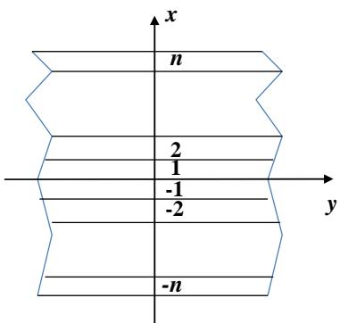

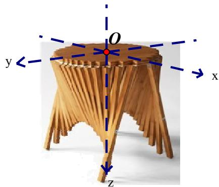  
图 5-1：长方形木板编号图  
图 5-2：桌子状态下的空间直角坐标系

以桌面底面的中心为坐标原点O，-1号和1号木条相接的线为y轴，在桌面底面上作过原点并垂直y轴方向为x轴，过坐标原点并垂直xoy平面的直线为z轴，建立空间直角坐标系，如图 5-2 所示.

## 5.2 直纹曲面(桌侧面)的方程

按5.1 中所述建立空间直角坐标系，设直纹曲面上任意一点 $P = ( x , y , z )$ ，u为P点还原到木板状态下到平面 $x O z$ 的距离，ν为点P到平面 $y O z$ 的距离.

由几何关系知： $\overrightarrow { O P } = \overrightarrow { O C } + \overrightarrow { C P }$

在桌子状态下，将空间直角坐标系中各点位置关系抽象为图5-3，如下：

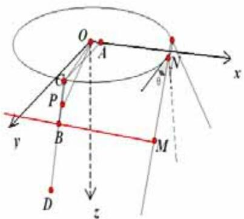  
图 5-3：桌子状态下的各点符号

其中：直线BM为桌子状态下钢筋所在位置，点C为P点所在木条的折点,即铰链位置，点B为P点所在木条与钢筋的交点，D是P点所在木条桌腿末端的点.

## (1) 桌面半径

将桌子理想化为圆形桌子，易知圆O的方程为：

$$
\left\{ { \begin{array} { l } { x ^ { 2 } + y ^ { 2 } = r ^ { 2 } } \\ { \zeta = 0 } \end{array} } \right.\tag{5-1}
$$

其中，r为桌面半径,可按下式计算

$$
r = \sqrt { \left( \frac { W } { 2 } \right) ^ { 2 } + w ^ { 2 } }\tag{5-2}
$$

其中，W表示桌面宽度，w表示木条宽度.

(2) 求解 $\overrightarrow { O C }$ 和 $\overrightarrow { C P }$

C为点P所在木条的弯折点，过C点向平面 $x O z$ 作垂线，交于点A.过直线CA且平行于 $\mathrm { y O z }$ 平面的方程为 $x = \nu$ ，两式联立可求得 $C \left( \nu , \sqrt { r ^ { 2 } - \nu ^ { 2 } } , 0 \right)$ ，所以

$$
\overrightarrow { O C } = \left( \nu , \sqrt { r ^ { 2 } - \nu ^ { 2 } } , 0 \right) .\tag{5-3}
$$

由上述参数假设及C点坐标可知， $\scriptstyle \left| { \overrightarrow { C P } } \right| = u - { \sqrt { r ^ { 2 } - \nu ^ { 2 } } }$

分析图 5-4、图 5-5 可得： $M \left( \nu , d \cos \theta + w , d \sin \theta \right)$ ，其中 $\left| \overrightarrow { N M } \right|$ 的长度用d表示，最外侧桌腿折叠时旋转的角度为θ.

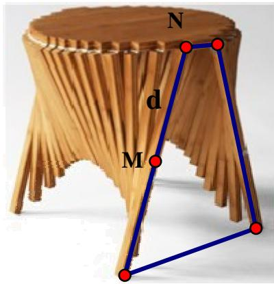  
图 5-4：桌子状态侧面图形

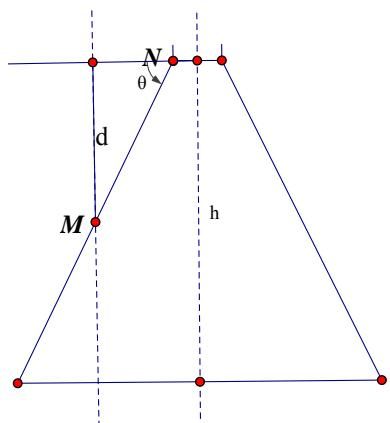  
图 5-5：桌子状态侧面平面图

分析动态变化过程可以发现，钢钉在由长方形平板向桌子状态变化过程中绕x轴旋

转，钢筋总是平行于x轴转动，由几何关系及M点坐标可知： $\boldsymbol { B } = ( \nu , d \cos \theta + w , d \sin \theta )$ 则：

$$
\overrightarrow { C B } = \overrightarrow { O B } - \overrightarrow { O C } = \left( 0 , d \cos \theta + w - \sqrt { r ^ { 2 } - \nu ^ { 2 } } , d \sin \theta \right) .
$$

B点所在木条的桌铰链位置到钢钉位置长度为：

$$
\begin{array} { r l } & { \left| \overrightarrow { C B } \right| = \sqrt { \left( d \cos \theta + w - \sqrt { r ^ { 2 } - { \nu } ^ { 2 } } \right) ^ { 2 } + \left( d \sin \theta \right) ^ { 2 } } } \\ & { \qquad = \sqrt { d ^ { 2 } + w ^ { 2 } + r ^ { 2 } - { \nu } ^ { 2 } - 2 ( d \cos \theta + w ) \sqrt { r ^ { 2 } - { \nu } ^ { 2 } } \cos \theta + 2 d w \cos \theta } } \end{array}
$$

所以，

$$
\overrightarrow { C P } = \frac { \overrightarrow { C B } } { \left| \overrightarrow { C B } \right| } \left| \overrightarrow { C P } \right| = \frac { \left( 0 , d \cos \theta + w - \sqrt { r ^ { 2 } - \nu ^ { 2 } } , d \sin \theta \right) } { \sqrt { \left( d \cos \theta + w - \sqrt { r ^ { 2 } - \nu ^ { 2 } } \right) ^ { 2 } + \left( d \sin \theta \right) ^ { 2 } } } \left( u - \sqrt { r ^ { 2 } - \nu ^ { 2 } } \right)
$$

即

$$
\overrightarrow { C P } = \frac { \left( 0 , d \cos \theta + w - \sqrt { r ^ { 2 } - \nu ^ { 2 } } , d \sin \theta \right) } { \sqrt { d ^ { 2 } + { w } ^ { 2 } + { r } ^ { 2 } - { \nu } ^ { 2 } - 2 ( d \cos \theta + w ) \sqrt { r ^ { 2 } - { \nu } ^ { 2 } } } + 2 d w \cos \theta } \left( u - \sqrt { r ^ { 2 } - { \nu } ^ { 2 } } \right)\tag{5-4}
$$

(3) 直纹曲面的参数方程

因此，

$$
\overrightarrow { O P } = \overrightarrow { O C } + \overrightarrow { C P } = \Big ( \nu , \sqrt { r ^ { 2 } - \nu ^ { 2 } } , 0 \Big ) + \frac { \Big ( 0 , d \cos \theta + w - \sqrt { r ^ { 2 } - \nu ^ { 2 } } , d \sin \theta \Big ) } { \sqrt { d ^ { 2 } + w ^ { 2 } + r ^ { 2 } - \nu ^ { 2 } - 2 ( d \cos \theta + w ) \sqrt { r ^ { 2 } - \nu ^ { 2 } } + 2 d w \cos \theta } } \Big ( u - \sqrt { r ^ { 2 } - \nu ^ { 2 } } \Big )\tag{5-5}
$$

故直纹曲面的参数方程为：

$$
\left\{ \begin{array} { l } { { x = \nu , } } \\ { { y = \sqrt { r ^ { 2 } - \nu ^ { 2 } } + \frac { \left( d \cos \theta + w - \sqrt { r ^ { 2 } - \nu ^ { 2 } } \right) \cdot \left( u - \sqrt { r ^ { 2 } - \nu ^ { 2 } } \right) } { \sqrt { d ^ { 2 } + w ^ { 2 } + r ^ { 2 } - \nu ^ { 2 } - 2 ( d \cos \theta + w ) \sqrt { r ^ { 2 } - \nu ^ { 2 } } + 2 d w \cos \theta } } } } \\ { { z = \frac { d \sin \theta \left( u - \sqrt { r ^ { 2 } - \nu ^ { 2 } } \right) } { \sqrt { d ^ { 2 } + w ^ { 2 } + r ^ { 2 } - \nu ^ { 2 } - 2 ( d \cos \theta + w ) \sqrt { r ^ { 2 } - \nu ^ { 2 } } + 2 d w \cos \theta } } , } } \\ { { \quad \quad \quad \quad \quad \quad \quad \quad \quad \quad \quad \quad \quad \quad \quad \quad \quad \quad \quad \quad \quad \quad \quad \quad \quad \quad \quad \quad \quad \quad \quad \quad \quad \quad \quad \quad \quad \quad \quad \quad \quad \quad \quad \quad \quad } } \end{array} \right.\tag{5-6}
$$

## (4) 直纹曲面的直接方程

将 $y - \sqrt { r ^ { 2 } - \nu ^ { 2 } }$ 和z相除，得到：

$$
{ \frac { y - { \sqrt { r ^ { 2 } - \nu ^ { 2 } } } } { z } } = { \frac { d \cos \theta + w - { \sqrt { r ^ { 2 } - \nu ^ { 2 } } } } { d \sin \theta } } ,
$$

代入 $x = \nu$ ，可得直纹曲面的方程为：

$$
z = { \frac { d { \left( y - { \sqrt { r ^ { 2 } - x ^ { 2 } } } \right) } \sin \theta } { d \cos \theta + w - { \sqrt { r ^ { 2 } - x ^ { 2 } } } } }\tag{5-7}
$$

## 5.3 折叠桌的加工参数

2n 根木条空槽长度及空槽上、下界沿y轴两边对称，仍按图 5-1 中编号方式考虑x轴正方向的n根木条即可.

对于第i根木条，

$$
\nu = w i , C \left( w i , \sqrt { { r } ^ { 2 } - { \nu } ^ { 2 } } , 0 \right) , B = \left( w i , d \cos \theta + w , d \sin \theta \right) ,
$$

所以：

$$
\left| { \overrightarrow { B C } } \right| = { \sqrt { d ^ { 2 } + w ^ { 2 } + r ^ { 2 } - \left( w i \right) ^ { 2 } - 2 ( d \cos \theta + w ) { \sqrt { r ^ { 2 } - \left( w i \right) ^ { 2 } } } + 2 d w \cos \theta } }
$$

木板状态时，分析动态过程可发现，此时钢钉刚好位于槽的上界处，桌子状态时，钢筋位于槽的下界处，故空槽长度 $l e n ( x _ { i } ) = \left| \overrightarrow { B C } \right| - \left( d + w - \frac { l } { 2 } \right)$ ，其中l为第i根木条的作为桌面部分长度，可得：

$$
l e n ( x _ { i } ) = \sqrt { d ^ { 2 } + w ^ { 2 } + r ^ { 2 } - x ^ { 2 } - 2 ( d \cos \theta + w ) \sqrt { r ^ { 2 } - x ^ { 2 } } } + 2 d w \cos \theta + \sqrt { r ^ { 2 } - x ^ { 2 } } - d - w\tag{5-8}
$$

由木板长度及勾股定理可得：

$$
{ \frac { l } { 2 } } = { \sqrt { r ^ { 2 } - { \left( w i \right) } ^ { 2 } } }\tag{5-9}
$$

所以：

$$
l e n ( x _ { i } ) = \sqrt { d ^ { 2 } + w ^ { 2 } + r ^ { 2 } - ( w i ) ^ { 2 } - 2 ( d \cos \theta + w ) \sqrt { r ^ { 2 } - ( w i ) ^ { 2 } } + 2 d w \cos \theta + \sqrt { r ^ { 2 } - ( w i ) ^ { 2 } } } - d - w\tag{5-10}
$$

$$
\lesseqqgtr - A g B + \frac { 1 } { 2 } = \frac { L - l } { 2 }\tag{5-11}
$$

其中L为长方形木板的长度.

$$
\begin{array}{c} \boldsymbol { \underline { { \dot { \boldsymbol { \Sigma } } } } } \mathbin { \dagger } \boldsymbol { \varXi } \mathbin { \dagger } \mathop { \mathbf { \Sigma } } \mathbin { \mathop { \mathbb { F } } } \mathop { \mathbf { \Sigma } } \mathbin { \overbrace { \mathbf { \Sigma } } } \mathrm { ~ \Delta } \frac { L } { 2 } - \boldsymbol { w }  \\ { \quad \boldsymbol { \dot { \Xi } } \mathbin { \dagger } \boldsymbol { \Xi } \mathbin { \dagger } \mathop { \mathbf { \Sigma } } \mathbin { \overleftarrow { \mathbf { \mu } } } \mathrm { ~ \Delta ~ } \frac { L } { 2 } - \boldsymbol { l e n } ( \boldsymbol { i } ) = \frac { L } { 4 } - \frac { \boldsymbol { w } } { 2 } - \boldsymbol { l e n } ( \boldsymbol { i } ) } \end{array}\tag{5-12}
$$

## 5.4 桌脚边缘线方程

设L为长木板长度，则桌脚边缘线实际上是直纹曲面(桌侧面)上的一条曲线，其上的点沿木条到桌面中轴线(x轴)的长度为 $\frac L 2$ .则在直纹曲面参数方程(5-6)中，令 $u = \frac { L } { 2 }$ 即为桌脚边缘线的参数方程：

$$
\begin{array} { l } { \displaystyle { \{ ^ { x = \nu , } _ { * } ( x ^ { 2 } - \nu ^ { 2 } ) ( \frac { L } { 2 } - \sqrt { r ^ { 2 } - \nu ^ { 2 } } ) ( \frac { L } { 2 } - \sqrt { r ^ { 2 } - \nu ^ { 2 } } ) } \qquad } \\ { \displaystyle { y = \sqrt { r ^ { 2 } - \nu ^ { 2 } } + \frac { ( d \cos \theta + w - \sqrt { r ^ { 2 } - \nu ^ { 2 } } ) ( \frac { L } { 2 } - \sqrt { r ^ { 2 } - \nu ^ { 2 } } ) } { \sqrt { d ^ { 2 } + w ^ { 2 } + r ^ { 2 } - \nu ^ { 2 } - 2 ( d \cos \theta + w ) \sqrt { r ^ { 2 } - \nu ^ { 2 } } + 2 d w \cos \theta } } , } } \\ { \displaystyle { z = \frac { d \sin \theta ( \frac { L } { 2 } - \sqrt { r ^ { 2 } - \nu ^ { 2 } } ) } { \sqrt { d ^ { 2 } + w ^ { 2 } + r ^ { 2 } - \nu ^ { 2 } - 2 ( d \cos \theta + w ) \sqrt { r ^ { 2 } - \nu ^ { 2 } } + 2 d w \cos \theta } } , } } \end{array}\tag{5-13}
$$

也可以消去参数ν，得到桌脚边缘线的直接方程：

$$
\left\{ \begin{array} { l l } { d \Big ( y - \sqrt { r ^ { 2 } - x ^ { 2 } } \Big ) \sin \theta = z \Big ( d \cos \theta + w - \sqrt { r ^ { 2 } - x ^ { 2 } } \Big ) } \\ { d \sin \theta \Big ( \displaystyle \frac { L } { 2 } - \sqrt { r ^ { 2 } - x ^ { 2 } } \Big ) = z \sqrt { d ^ { 2 } + w ^ { 2 } + r ^ { 2 } - x ^ { 2 } - 2 ( d \cos \theta + w ) \sqrt { r ^ { 2 } - x ^ { 2 } } + 2 d w \cos \theta } } \end{array} \right.\tag{5-14}
$$

## 5.5 模型求解

## 5.5.1 直纹曲面方程

将桌面的宽度W=50和长木条的宽度w=2.5代入(5-2)式，得桌面圆的半径：

$$
r = \sqrt { \left( \frac { W } { 2 } \right) ^ { 2 } + w ^ { 2 } } = \sqrt { 6 3 1 . 2 5 } = 2 5 . 1 2 5 .
$$

最外侧木条钢钉到铰链的距离：

$$
d = \frac { 1 } { 2 } \left( \frac { L } { 2 } - w \right) = 2 8 . 7 5 .
$$

根据桌子高度 $h = 5 3 - 3 = 5 0$ 和最外侧桌腿长度 $2 d = 5 7 . 5$ ，得最外侧桌腿弯折时旋转的角度：

$$
\begin{array} { c } { { \sin \theta = \displaystyle \frac { h } { 2 d } = \displaystyle \frac { 5 0 } { 5 7 . 5 } } } \\ { { \theta = \arcsin \left( \displaystyle \frac { h } { 2 d } \right) = \arcsin ( 0 . 8 6 9 6 ) = 1 . 0 5 4 3 . } } \end{array}
$$

将这些数据带入(5-7)式就得到桌子侧面方程为：

$$
z = { \frac { 2 5 \left( y - { \sqrt { 6 3 1 . 2 5 - x ^ { 2 } } } \right) } { 1 6 . 7 0 - { \sqrt { 6 3 1 . 2 5 - x ^ { 2 } } } } }\tag{5-15}
$$

## 5.5.2 设计加工参数

(1)铰链位置的确定

将 $r ^ { 2 } = 6 3 1 . 2 5$ $w = 2 . 5$ 代入(5-9)、(5-11)式，得：

$$
{ \frac { l } { 2 } } = { \sqrt { 6 3 1 . 2 5 - 6 . 2 5 i ^ { 2 } } } \ , \sharp \oplus i = 1 , . . . \ . . 1 \theta .
$$

$$
\overleftarrow { \frac { \Xi } { \Lambda } } \mathbb { H } \mathbb { E } \ncong \mathbb { H } \mathbb { E } = 6 0 - \frac { l } { 2 } .
$$

表1：每根木条作为桌面和桌腿的长度(单位：cm）
<table><tr><td>i</td><td>1</td><td>2</td><td>3</td><td>4</td><td>5</td><td>6</td><td>7</td><td>8</td><td>9</td><td>10</td></tr><tr><td>桌面长度</td><td>50</td><td>49.24</td><td>47.96</td><td>46.1</td><td>43.58</td><td>40.32</td><td>36.06</td><td>30.42</td><td>22.36</td><td>5</td></tr><tr><td>桌腿长度</td><td>32.5</td><td>32.88</td><td>33.52</td><td>34.45</td><td>35.71</td><td>37.34</td><td>39.47</td><td>42.29</td><td>46.32</td><td>55</td></tr></table>

这里桌腿部分长度就是木条上铰链距木条底端的距离.  
(2)桌腿木条空槽位置  
将 $d = 2 8 . 7 5 , r ^ { 2 } = 6 3 1 . 2 5 , \sin \theta = \frac { 5 0 } { 5 7 . 5 }$ 代入(5-10)式即可求解各木条空槽长度：

$$
l e n ( x _ { i } ) = { \sqrt { 1 4 6 4 . 0 6 - 6 . 2 5 i ^ { 2 } - 3 3 . 4 { \sqrt { 6 3 1 . 2 5 - 6 . 2 5 i ^ { 2 } } } + 7 0 . 9 9 } } + { \sqrt { 6 3 1 . 2 5 - 6 . 2 5 i ^ { 2 } } } - 3 1 . 2 5\tag{5-16}
$$

将 $L = 1 2 0 c m , w = 2 . 5 c m$ 代入(5-12)，得：空槽下界 $\mathbf { \rho } = 2 8 . 7 5 - l e n ( i )$ 结果如下：

表2：各木条空槽长度(单位： $c m )$
<table><tr><td>i</td><td>1</td><td>2</td><td>3</td><td>4</td><td>5</td><td>6</td><td>7</td><td>8</td><td>9</td><td>10</td></tr><tr><td>空槽下界</td><td>8.66</td><td>9.15</td><td>9.98</td><td>11.16</td><td>12.69</td><td>14.61</td><td>16.94</td><td>19.75</td><td>23.22</td><td>28.75</td></tr><tr><td>空槽长度</td><td>20.09</td><td>19.60</td><td>18.77</td><td>17.59</td><td>16.06</td><td>14.14</td><td>11.81</td><td>9.00</td><td>5.53</td><td>0</td></tr></table>

## 5.5.3 桌脚边缘线

将 $d = 2 8 . 7 5 , r ^ { 2 } = 6 3 1 . 2 5 , w = 2 . 5$ $\sin \theta = \frac { 5 0 } { 5 7 . 5 }$ 代入(5-14)式，得桌角边缘线的方程：

$$
\left\{ \begin{array} { l } { 2 5 { \left( y - \sqrt { 6 3 1 . 2 5 - x ^ { 2 } } \right) } = z { \left( 1 6 . 7 - \sqrt { 6 3 1 . 2 5 - x ^ { 2 } } \right) } } \\ { 2 5 { \left( 6 0 - \sqrt { 6 3 1 . 2 5 - x ^ { 2 } } \right) } = z { \sqrt { 1 5 3 5 . 0 6 - x ^ { 2 } - 3 3 . 4 { \sqrt { r ^ { 2 } - x ^ { 2 } } } } } } \end{array} \right.\tag{5-17}
$$

用 Matlab 绘制图像如图 5-6(程序见附录 1):

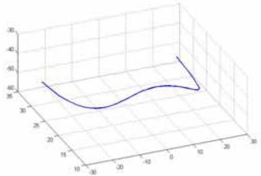

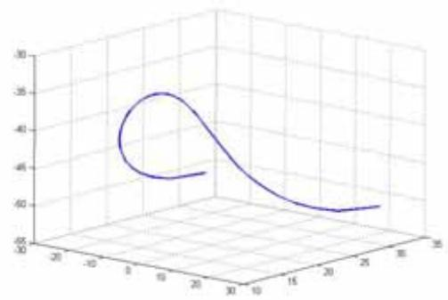  
图 5-6：桌脚边缘线(不同视角)

## 5.5.4折叠桌的动态变化过程

将 $r ^ { 2 } = 6 3 1 . 2 5$ ，并令 $x = w i$ 代入(5-1)式，桌面的近似圆的方程可化为：

$$
\left\{ \begin{array} { c } { { w ^ { 2 } i ^ { 2 } + y ^ { 2 } = 6 3 1 . 2 5 } } \\ { { z = 0 } } \end{array} \right.
$$

钢筋BM的方程可化为：

$$
\left\{ \begin{array} { c } { x = w i } \\ { y = d \cos \theta + w } \\ { z = d \sin \theta } \end{array} \right.
$$

将 $i = - 1 0 , \cdots , 0 , 1 , 2 , \cdots , 1 0$ 代入即可得 $x > 0 -$ 侧的直纹曲面20个铰链坐标位置及钢筋的坐标位置.设得到的铰链坐标及钢钉坐标为：

$$
C _ { i } ( x _ { c _ { i } } , y _ { c _ { i } } , z _ { c _ { i } } ) ~ , ~ B _ { i } ( x _ { b _ { i } } , y _ { b _ { i } } , z _ { b _ { i } } ) , i = - 1 0 , \cdots , 0 , 1 , 2 , \cdots , 1 0 ~ .
$$

分别连接对应的铰链坐标点C和钢筋坐标点B的线段.

D是木条桌腿末端的点,设为 $D _ { i } \left( x _ { d _ { i } } , y _ { d _ { i } } , z _ { d _ { i } } \right) , i = - 1 0 , \cdots , 0 , 1 , 2 , \cdots , 1 0$

B点所在木条钢筋位置到桌腿末端的长度为： $\left| { \overrightarrow { B D } } \right| = l - \left| { \overrightarrow { C A } } \right| - \left| { \overrightarrow { B C } } \right|$ ，其中$A _ { i } = ( w i , 0 , 0 ) ~ , ~ i = - 1 0 , \cdots , 0 , 1 , 2 , \cdots , 1 0$

又

$$
\begin{array} { c } { { \displaystyle { k = \frac { \overline { { { 2 } } } - \left| \overline { { { A C } } } \right| } { \left| \overline { { { B C } } } \right| } } } } \\ { { \displaystyle { \frac { x _ { d _ { i } } - x _ { c _ { i } } } { x _ { b _ { i } } - x _ { c _ { i } } } = \frac { y _ { d _ { i } } - y _ { c _ { i } } } { y _ { b _ { i } } - y _ { c _ { i } } } = \frac { z _ { d _ { i } } - z _ { c _ { i } } } { z _ { b _ { i } } - z _ { c _ { i } } } = k } } } \end{array}
$$

可得：

$$
\left\{ \begin{array} { c } { x _ { d _ { i } } = x _ { c _ { i } } + k \left( x _ { b _ { i } } - x _ { c _ { i } } \right) } \\ { y _ { d _ { i } } = y _ { c _ { i } } + k \left( y _ { b _ { i } } - y _ { c _ { i } } \right) } \\ { z _ { d _ { i } } = z _ { c _ { i } } + k \left( z _ { b _ { i } } - z _ { c _ { i } } \right) } \end{array} \right.
$$

再连接对应的桌腿末端坐标D和钢钉坐标点B，即可做出木条图像.

折叠桌每一时刻的形状都与θ角有关，通过改变θ的角度即可看出折叠桌的动态变化过程.

分別取 $\theta = \frac { 1 } { 6 } \times 1 . 0 5 4 3 , \frac { 2 } { 6 } \times 1 . 0 5 4 3 , \frac { 3 } { 6 } \times 1 . 0 5 4 3 , \frac { 4 } { 6 } \times 1 . 0 5 4 3 , \frac { 5 } { 6 } \times 1 . 0 5 4 3 , 1 . 0 5 4 3 , \frac { 2 0 } { 6 } \times 1 . 0 5 4 3 , 1 . 0 5 4 3 , 2 . 0 2 5 .$ 可以用matlab绘制折叠桌在变化过程中的图像，如图5-7(程序见附录2)

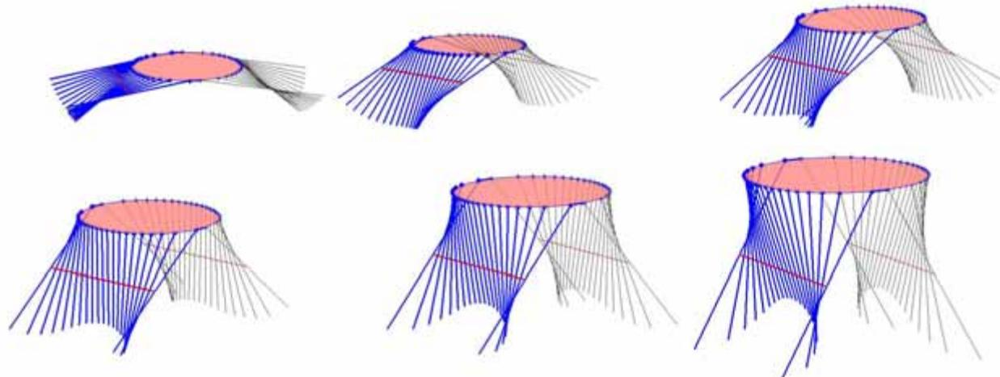  
图5-7：长方形木板到桌子的动态变化过程  
六、问题二的模型建立与求解

## 6.1 模型的建立

## 6.1.1 图示说明

现设木板的总长为L，钢筋的初始位置(平板)距离木条末端为s，最外侧的木条的折叠角度为θ，如图6-1 和图6-2 所示：

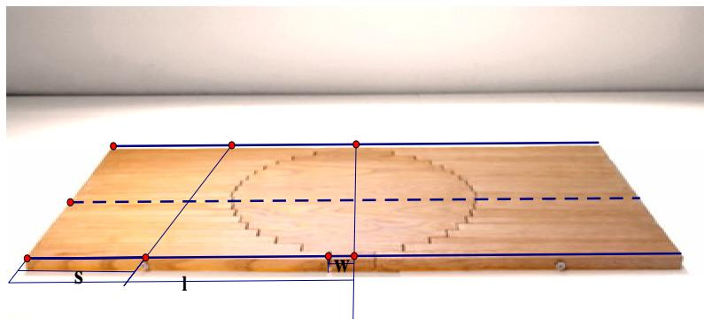  
图6-1 长方形木板状态下的符号图示

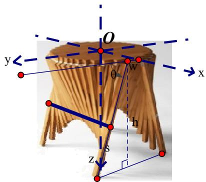  
图6-2 桌子状态下的符号图示

## 6.1.2 目标分析

## (1)折叠桌的用料最省

由于板材的宽度确定，所以用料的多少主要受折叠桌最边缘(最长)支腿所决定．那么，要使得折叠桌用料最少，即要求折叠桌最边缘的支腿最短：即：

$$
\operatorname* { m i n } { \frac { h } { \sin \theta } } { \frac { \Re } { \Im } } \operatorname* { m a x } \sin \theta\tag{6-1}
$$

## (2)加工方便

对折叠桌的加工主要分为对木条空槽的加工和需要安装得铰链个数．设桌面的宽度为 $W _ { : }$ ，木条的宽度w，所以木条的总数是一定的，为 $2 n = \frac { W } { w }$ 根，那么需要安装得铰链个数为定值4n，不影响加工的繁杂程度．从而，折叠桌的加工复杂程度主要受木条空槽的总长度影响.

要求木条空槽总长度最小，加工越简单．即：

$$
\operatorname* { m i n } \sum _ { i = 1 } ^ { n } l e n ( x _ { i } )\tag{6-2}
$$

其中 $x _ { i } = w i$ 表示桌面第i根木条最右侧顶点的横坐标，空槽长度可用(5-9)决定，即

$$
l e n ( x _ { i } ) = \sqrt { d ^ { 2 } + w ^ { 2 } + r ^ { 2 } - ( w i ) ^ { 2 } - 2 ( d \cos \theta + w ) \sqrt { r ^ { 2 } - ( w i ) ^ { 2 } } + 2 d w \cos \theta + \sqrt { r ^ { 2 } - ( w i ) ^ { 2 } } } - d - w
$$

其中最外侧木条钢钉到铰链的距离 $d = { \frac { h } { \sin \theta } } - s$

## 6.1.3 约束条件

## (1)空槽长度约束

钢筋在折叠过程中有位置移动，其在固定之前随着转动的θ角变化而变化，而且钢筋在转动过程中始终向下移动，但是每根木条的槽不能开出木条，即空槽长度不能大于s.考虑到实际情况，空槽的位置距木条末端的位置不宜过近，否则，不仅增加加工的困难度，降低桌子的稳固性，而且这样的桌子容易损坏.所以引入一个正常量，设为λ，使开槽长度取值切合实际．故

$$
l e n { \left( x _ { i } \right) } < s - \lambda , i = 1 , 2 , \cdots , n\tag{6-3}
$$

## (2) 相对两桌腿不相交约束

桌子在折叠过程中相对称的两条桌腿边缘不能相交，由于桌子是对称的，只要保证桌腿末端的y坐标 $y _ { D } ( x _ { i } )$ 大于等于零就可以保证相对两桌腿不相交，即：

$$
y _ { D } ( x _ { i } ) \geq 0 , i = 1 , 2 , \cdots , n\tag{6-4}
$$

由问题一的桌角边缘线的动态方程(5-12)可求得桌腿底端的纵坐标为：

$$
y _ { D } ( x ) = { \sqrt { r ^ { 2 } - x ^ { 2 } } } + { \frac { \Bigl ( d \cos \theta + w - { \sqrt { r ^ { 2 } - x ^ { 2 } } } \Bigr ) \Bigl ( d + w - { \sqrt { r ^ { 2 } - x ^ { 2 } } } \Bigr ) } { \sqrt { d ^ { 2 } + w ^ { 2 } + r ^ { 2 } - x ^ { 2 } - 2 \left( d \cos \theta + w \right) { \sqrt { r ^ { 2 } - x ^ { 2 } } } + 2 d w \cdot \cos \theta } } }
$$

## (3) 稳定性约束

为了使木板在某一角度下不能继续弯折时的状态下稳定，则需要长方形木板最外侧木条弯折后桌腿底端之间的距离应大于或等于桌面宽度 $W$ 的 $a$ 倍,则：

$$
2 { \big ( } w + h \cot \theta { \big ) } \geq a W\tag{6-5}
$$

## (4)除最边木条外的桌腿离地约束

除了最边上的4根桌腿外，要求其他所有桌腿都不能沾地，换句话说，就是保证最边上的 4 根桌腿在竖直方向上最长(等于 h). 这只要保证桌腿末端的 z 坐标 $z _ { D } ( x _ { i } )$ 小于 h即可，即

$$
z _ { D } ( x _ { i } ) \leq h , \ i = 1 , 2 , \cdots , n - 1\tag{6-6}
$$

由问题一的桌角边缘线的动态方程可求得木条末端点的z坐标为：

$$
z _ { D } ( x ) = { \frac { d \sin \theta \left( { \frac { L } { 2 } } - { \sqrt { r ^ { 2 } - x ^ { 2 } } } \right) } { \sqrt { d ^ { 2 } + w ^ { 2 } + r ^ { 2 } - x ^ { 2 } - 2 ( d \cos \theta + w ) { \sqrt { r ^ { 2 } - x ^ { 2 } } } + 2 d w \cos \theta } } }
$$

## 6.1.4 建立多目标优化模型

基于以上分析，以(6-1)、(6-2)式为目标，(6-3)(6-4)(6-5)(6-6)式为约束条件，建立模型如下：

$$
\begin{array} { c } { \displaystyle \operatorname* { m i n } h / \sin \theta } \\ { \displaystyle \operatorname* { m i n } \displaystyle \sum _ { i = 1 } ^ { n } l e n ( x _ { i } ) } \\ { \displaystyle } \\ { s t . \left\{ { l e n } \big ( x _ { i } \big ) < s - \lambda , i = 1 , 2 , \cdots , n \right. } \\ { s . t . } \\ { \displaystyle \left\{ 2 \big ( w + h \cot \theta ) \geq 0 , i = 1 , 2 , \cdots , n \right. } \\ { \displaystyle } \\ { \displaystyle \left. \begin{array} { r l } { \sum _ { p } ( x + h \cot \theta ) \geq a W } \\ { \vdots } & { i = 1 , 2 , \cdots , n - 1 } \end{array} \right. } \end{array}\tag{6-7}
$$

其中钢筋的初始位置(平板)距离木条末端为s和最外侧的木条的折叠角度为θ为决策变量，且

$$
\begin{array} { c } { { l e n \left( x _ { i } \right) = \sqrt { d ^ { 2 } + w ^ { 2 } + r ^ { 2 } - x _ { i } ^ { 2 } - 2 \left( d \cos \theta + w \right) \sqrt { r ^ { 2 } - x _ { i } ^ { 2 } } + 2 d \cos \theta \cdot w + \sqrt { r ^ { 2 } - x _ { i } ^ { 2 } } - d - w } } } \\ { { y _ { D } \left( x _ { i } \right) = \sqrt { r ^ { 2 } - x ^ { 2 } } + \frac { \left( d \cos \theta + w - \sqrt { r ^ { 2 } - x _ { i } ^ { 2 } } \right) \left( d + w - \sqrt { r ^ { 2 } - x _ { i } ^ { 2 } } \right) } { \sqrt { d ^ { 2 } + w ^ { 2 } + r ^ { 2 } - x _ { i } ^ { 2 } - 2 \left( d \cos \theta + w \right) \sqrt { r ^ { 2 } - x _ { i } ^ { 2 } } + 2 d w \cdot \cos \theta } } } } \\ { { { } } } \\ \\ { { z _ { D } \left( x _ { i } \right) = \frac { d \sin \theta \left( \displaystyle \frac { L } { 2 } - \sqrt { r ^ { 2 } - x _ { i } ^ { 2 } } \right) } { \sqrt { d ^ { 2 } + w ^ { 2 } + r ^ { 2 } - x _ { i } ^ { 2 } - 2 ( d \cos \theta + w ) \sqrt { r ^ { 2 } - x _ { i } ^ { 2 } } + 2 d w \cos \theta } } } } \\ { { { \vdots \displaystyle \Xi \equiv , ~ x _ { i } = w i \ , ~ d = \frac { h } { \sin \theta } - s . } } } \end{array}
$$

## 6.1.5 板材长度及空槽下界

由图6-2可得，板材长度L和空槽下界分别为：

$$
\begin{array} { l } { { { \cal L } = 2 ( w + { \frac { h } { \sin \theta } } ) ~ , } } \\ { { \ @ ~ { \frac { \displaystyle \sin \oplus ~ \pi ~ } { \displaystyle \bigwedge ~ } } ~ { \frac { \displaystyle \sin \theta } { \displaystyle \bigotimes ~ } } ~ { \frac { \displaystyle \sin \theta } { \displaystyle \bigotimes ~ } } ~ . } } \end{array}
$$

## 6.2 模型求解

## 6.2.1 多目标优化模型的求解

由已知条件可知 $h = 7 0 c m \ , w = 2 . 5 \ , W = 8 0 c m$ .根据经验可取λ=5，a为1或0.618，此处α取1，即保证桌腿在展开方向上跨度大于等于木板宽度．代入(6-6)式，可以利用Matlab 编程求解(程序见附录 3).

这里是对目标规划，我们先解单目标规划：

$$
\begin{array} { c } { \operatorname* { m i n } 7 0 / \sin \theta } \\ { [ l e n ( x _ { i } ) < s - 5 , \ i = 1 , 2 , \cdots , n  } \\ {  s { . } t . \ } \end{array}
$$

可得 $\theta = 1 . 0 6 0 5$ ，进而可算出 $L = 1 5 8 . 5 6$ ．再将 $\theta = 1 . 0 6 0 5$ 作为约束条件，求解单目标规划：

$$
\begin{array} { c } { \displaystyle \operatorname* { m i n } \sum _ { i = 1 } ^ { n } l e n ( x _ { i } ) } \\ { \displaystyle } \\ { s . t .  y _ { D } ( x _ { i } ) \leq s - 5 , \ i = 1 , 2 , \cdots , n  } \\ { \displaystyle } \\ { s . t .  y _ { D } ( x _ { i } ) \geq 0 , \ i = 1 , 2 , \cdots , n  } \\ { \displaystyle } \\ { \displaystyle   + 1 4 0 \cot \theta \geq 8 0  } \\ { \displaystyle } \\ { z _ { D } ( x _ { i } ) \leq h , \ i = 1 , 2 , \cdots , n - 1 } \end{array}
$$

可得：

$$
s = 4 3 . 8 0 .
$$

综上所述，结果为：折叠桌弯折角θ为1.0605(弧度)，钢筋的初始位置到桌腿底端的距离s为43.80cm，木板的长度L为158.56cm

## 6.2.2 设计加工参数的确定

## (1)空槽长度和位置

桌子状态下最外侧木条钢筋位置距铰链的距离：

$$
d = \frac { L } { 2 } - s - 2 . 5 = 3 2 . 9 8
$$

将 $W = 8 0$ ，w =2.5代入(5-2)式，得：

$$
r ^ { 2 } = \left( \frac { W } { 2 } \right) ^ { 2 } + w ^ { 2 } = 1 6 0 6 . 2 5 c m .
$$

将 $d = 3 2 . 9 8$ $r ^ { 2 } = 1 6 0 6 . 2 5$ ，θ=1.0605，代入(5-10)式，得：

$$
l e n ( i ) = { \sqrt { 2 2 1 5 . 8 3 - 6 . 2 5 i ^ { 2 } - 4 9 . 3 7 { \sqrt { 1 6 0 6 . 2 5 - 6 . 2 5 i ^ { 2 } } } + { \sqrt { 1 6 0 6 . 2 5 - 6 . 2 5 i ^ { 2 } } } } } - 2 4 . 6 5
$$

将 $s = 5 8 . 8 3$ 代入，计算空槽下界 $= s - l e n ( i )$ ，可得各木条空槽长度和空槽距桌腿底端的距离，见表3.

表3：各木条空槽长度(单位：cm)
<table><tr><td>i</td><td>1</td><td>2</td><td>3</td><td>4</td><td>5</td><td>6</td><td>7</td><td>8</td></tr><tr><td>空槽下界</td><td>4.83</td><td>5.19</td><td>5.80</td><td>6.66</td><td>7.76</td><td>9.13</td><td>10.77</td><td>12.69</td></tr><tr><td>空槽长度</td><td>38.97</td><td>38.61</td><td>38.00</td><td>37.15</td><td>36.04</td><td>34.67</td><td>33.03</td><td>31.11</td></tr><tr><td></td><td></td><td></td><td></td><td></td><td></td><td></td><td></td><td></td></tr><tr><td>i</td><td>9</td><td>10</td><td>11</td><td>12</td><td>13</td><td>14</td><td>15</td><td>16</td></tr><tr><td>空槽下界</td><td>14.91</td><td>17.43</td><td>20.29</td><td>23.52</td><td>27.16</td><td>31.30</td><td>36.16</td><td>-</td></tr><tr><td>空槽长度</td><td>28.90</td><td>26.37</td><td>23.51</td><td>20.28</td><td>16.64</td><td>12.51</td><td>7.64</td><td>=</td></tr></table>

## (2)铰链位置

将 $r ^ { 2 } = 1 6 0 6 . 2 5$ $w = 2 . 5$ 代入(5-9)式，得：

$$
{ \frac { l } { 2 } } = { \sqrt { r ^ { 2 } - { \bigl ( } w i { \bigr ) } ^ { 2 } } } = { \sqrt { 1 6 0 6 . 2 5 - 6 . 2 5 i ^ { 2 } } } .
$$

将 $L = 1 5 8 . 5 6$ $w = 2 . 5$ ，代入(5-11)，得桌腿部分长度 $= 7 9 . 2 8 - { \frac { l } { 2 } }$ ，可算出每根木条作为桌面和桌腿的长度见表4. 其中桌腿部分长度就是木条上铰链距木条末端的距离.

表4：每根木条作为桌面和桌腿的长度(单位：cm)
<table><tr><td>i</td><td>1</td><td>2</td><td>3</td><td>4</td><td>5</td><td>6</td><td>7</td><td>8</td></tr><tr><td>桌面长度</td><td>80</td><td>79.52</td><td>78.74</td><td>77.62</td><td>76.16</td><td>74.34</td><td>72.12</td><td>69.46</td></tr><tr><td>桌腿长度</td><td>39.28</td><td>39.52</td><td>39.91</td><td>40.47</td><td>41.2</td><td>42.11</td><td>43.22</td><td>44.55</td></tr><tr><td>i</td><td>9</td><td>10</td><td>11</td><td>12</td><td>13</td><td>14</td><td>15</td><td>16</td></tr><tr><td>桌面长度</td><td>66.34</td><td>62.64</td><td>58.3</td><td>53.16</td><td>46.9</td><td>39.06</td><td>28.28</td><td>5</td></tr><tr><td>桌腿长度</td><td>46.11</td><td>47.96</td><td>50.13</td><td>52.7</td><td>55.83</td><td>59.75</td><td>65.14</td><td>76.78</td></tr></table>

## 6.2.3 桌子示意图

与 5.5.4 相似，可以画出桌高 70 cm，桌面直径 80 cm的折叠桌的效果图(程序见附录4)，如图 6-4.

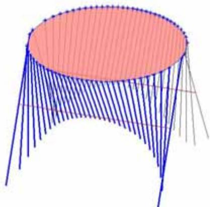  
图 6-4 折叠桌示意图(高 70 cm，桌面直径 80 cm)  
七、问题三的模型建立和求解

## 7.1 直纹曲面和桌脚边缘线的方程

为简单起见，本文下面再设计折叠桌的过程中只考虑一个侧面的设计．如果桌面形状是对称的，则另一面木条的滑槽、铰链位置都保持一致；如果桌面形状是非对称的，则可以将折叠桌的设计分为两个侧面分别设计.

首先，平板材料仍然需要长条形(可以不是长方形)，否则无法处理成折叠小木条.根据客户提供的桌面边缘线的形状大小，建立直接坐标系，确定桌面边缘曲线的方程，不妨设为 $y = f ( x )$ ；设平板材料的一端边缘的曲线方程为 $y = g ( x )$ ，如图7-1.

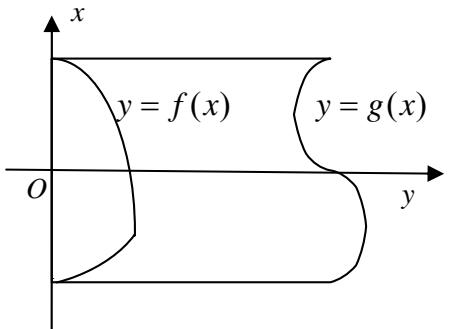  
图 7-1 平板材料边缘和桌面边缘

由于直纹曲面方程的确立方法与上文叙述过程基本一致，当桌子的形状为其他图形时，只需用 $f ( x )$ 代替 $\sqrt { r ^ { 2 } - x ^ { 2 } }$ ，即可确定直纹曲面的方程，再根据特定的形状带入数据就可得到直纹曲面的具体方程.

用 f(x) 替换 $\sqrt { r ^ { 2 } - x ^ { 2 } }$ (或用 $f ( \nu )$ 替换 ${ \sqrt { r ^ { 2 } - \nu ^ { 2 } } } \ .$ )代入(5-6)和(5-7)式，得直纹曲面的参数方程为：

$$
\left\{ \begin{array} { l l } { x = \nu , } \\ { y = f ( \nu ) + \frac { \big ( d \cos \theta + w - f ( \nu ) \big ) \cdot \big ( u - f ( \nu ) \big ) } { \sqrt { d ^ { 2 } + w ^ { 2 } + f ^ { 2 } ( \nu ) - 2 ( d \cos \theta + w ) f ( \nu ) + 2 d w \cos \theta } } , } \\ { z = \frac { d \sin \theta \big ( u - f ( \nu ) \big ) } { \sqrt { d ^ { 2 } + w ^ { 2 } + f ^ { 2 } ( \nu ) - 2 ( d \cos \theta + w ) f ( \nu ) + 2 d w \cos \theta } } , } \\ { ( u , \nu \frac { \cos \theta \ast \pi } { \kappa } , ) } \end{array} \right.\tag{7-1}
$$

以及直接方程：

$$
z = \frac { d { \bigl ( } y - f ( x ) { \bigr ) } \sin \theta } { d \cos \theta + w - f ( x ) }\tag{7-2}
$$

其中， $\theta$ 为桌子状态下桌面与最外侧木条的夹角，d为最外侧木条钢筋到铰链的距离，w为木条的宽度.

桌脚边缘线实际上是由平板材料的最外侧边缘经折叠后组成，而平板材料的最外侧边缘上的点 $( x , y ) = ( x , g ( x ) )$ 到桌面中线(x轴)的距离 $u = g ( x )$ ，所以桌脚边缘线的曲线方程就为：

$$
\left\{ \begin{array} { l l } { x = \nu , } \\ { \displaystyle y = f ( \nu ) + \frac { \big ( d \cos \theta + w - \sqrt { r ^ { 2 } - \nu ^ { 2 } } \big ) \cdot \big ( g ( \nu ) - f ( \nu ) \big ) } { \sqrt { d ^ { 2 } + w ^ { 2 } + f ^ { 2 } ( \nu ) - 2 ( d \cos \theta + w ) f ( \nu ) + 2 d w \cos \theta } } , } \\ { z = \frac { d \sin \theta \big ( g ( \nu ) - f ( \nu ) \big ) } { \sqrt { d ^ { 2 } + w ^ { 2 } + f ^ { 2 } ( \nu ) - 2 ( d \cos \theta + w ) f ( \nu ) + 2 d w \cos \theta } } , } \\ { \displaystyle ( \nu \frac { \cos \theta \ast \pi } { \kappa \mathrm { \scriptsize { E } } ^ { 2 } \mathrm { \scriptsize { \approx } } \frac { \nu \mathrm { \scriptsize { e } } } { \beta } } ) } \end{array} \right.\tag{7-3}
$$

或

$$
\left\{ \begin{array} { l l } { d \big ( y - f ( x ) \big ) \sin \theta = z \big ( d \cos \theta + w - f ( x ) \big ) } \\ { d \big ( g ( x ) - f ( x ) \big ) \sin \theta = z \sqrt { d ^ { 2 } + w ^ { 2 } + f ^ { 2 } ( x ) - 2 ( d \cos \theta + w ) f ( x ) + 2 d w \cos \theta } } \end{array} \right.\tag{7-4}
$$

另外，桌腿的空槽长度为：

$$
l e n ( x _ { i } ) = \sqrt { d ^ { 2 } + w ^ { 2 } + f ^ { 2 } \left( x _ { i } \right) - 2 ( d \cos \theta + w ) f \left( x _ { i } \right) + 2 d w \cos \theta } + f \left( x _ { i } \right) - d - w\tag{7-5}
$$

## 7.2 多目标优化模型的建立

对于给定的桌面边缘曲线 $y = f ( x )$ 和平板材料的一端边缘的曲线方程 $y = g ( x )$ ，以及桌面高度h，可以建立与问题2类似的多目标优化模型：

$$
\begin{array} { c } { \displaystyle \operatorname* { m i n } h / \sin \theta } \\ { \displaystyle \operatorname* { m i n } \displaystyle \sum _ { i = 1 } ^ { n } l e n ( x _ { i } ) } \\ { \displaystyle } \\ { s . t . } \\ { \displaystyle \left. 2 \left( w + h \mathrm { c } _ { i } \right) \leq s - \lambda , i = 1 , 2 , \cdots , n \right. } \\ { \displaystyle } \\ { \displaystyle } \\ { \displaystyle } \\ { z _ { D } ( x _ { i } ) \geq 0 , i = 1 , 2 , \cdots , n } \\ { \displaystyle } \\ { z _ { D } ( x _ { i } ) \leq h \mathrm { c o t } \theta ) \geq a W } \\ { \displaystyle } \\ { z _ { D } ( x _ { i } ) \leq h , i = 1 , 2 , \cdots , n - 1 } \end{array}\tag{7-6}
$$

其中s为钢筋的初始位置(平板)到最外侧木条底端的距离，θ为最外侧的木条的折叠角度，a为稳定性参数，λ为空槽距离底端的最小长度．s和θ为决策变量，且

$$
\begin{array} { l } { { l e n \left( x _ { i } \right) = \sqrt { d ^ { 2 } + w ^ { 2 } + f ^ { 2 } \left( x _ { i } \right) - 2 \left( d \cos \theta + w \right) f \left( x _ { i } \right) + 2 d \cos \theta \cdot w } + f \left( x _ { i } \right) - d - w } } \\ { { \ } } \\ { { y _ { D } \left( x _ { i } \right) = f \left( x _ { i } \right) + \frac { \left( d \cos \theta + w - f \left( x _ { i } \right) \right) \left( d + w - f \left( x _ { i } \right) \right) } { \sqrt { d ^ { 2 } + w ^ { 2 } + f ^ { 2 } \left( x _ { i } \right) - 2 \left( d \cos \theta + w \right) f \left( x _ { i } \right) + 2 } d w \cdot \cos \theta } } } \\ { { \ z _ { D } \left( x _ { i } \right) = \frac { d \sin \theta \left( g \left( x _ { i } \right) - f \left( x _ { i } \right) \right) } { \sqrt { d ^ { 2 } + w ^ { 2 } + f ^ { 2 } \left( x _ { i } \right) - 2 \left( d \cos \theta + w \right) f \left( x _ { i } \right) + 2 d w \cos \theta } } } } \\ { { \ } } \\ { { , \ x _ { i } = w i \ , \ d = \frac { h } { \sin \theta } - s . } } \end{array}
$$

## 7.3 多目标优化模型的建立

下面给出两组客户需求数据，分别设计创意平板折叠桌.

## 7.3.1 正方形桌面的设计

设桌面为正方形，对角线长60cm，桌高60cm，桌脚边缘线大致呈圆弧形（如图7-2).

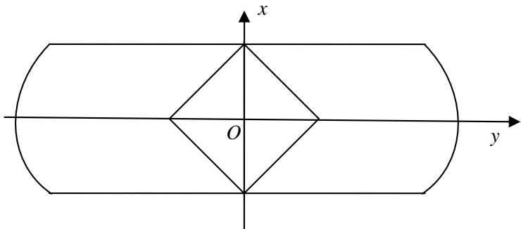  
图7-2 正方形桌面和圆弧形平板边缘

(1) 确定展开角度和空槽位置

可以确定 $h = 5 7$ , w = 2.5 , $W = 6 0$ .根据经验可取λ=5，αa=1，代入(7-6)式，与6.2.1 节类似，可以求解出(程序见附录 5):

$$
\theta = 1 . 0 4 7 2 \ , s = 3 2 \ .
$$

(2) 设计加工参数

进而可以算出各组设计加工参数.

根据 $d = \frac { h } { \sin \theta } - s = 3 6 . 3 1 8 , w = 2 . 5 , \theta = 1 . 0 4 7 2$ ，和公式

$$
l e n { \left( x _ { i } \right) } = \sqrt { d ^ { 2 } + w ^ { 2 } + f ^ { 2 } \left( x _ { i } \right) - 2 \left( d \cos \theta + w \right) f \left( x _ { i } \right) + 2 d \cos \theta \cdot w } + f \left( x _ { i } \right) - d - w
$$

可以计算各木条空槽长度和空槽距木条底端的距离，见表5.

也可算出每根木条作为桌面和桌腿的长度，其中桌腿部分长度就是木条上铰链距木条末端的距离，具体数据见表5.

表5：正方形桌面的设计加工参数(单位：cm)
<table><tr><td>i 1</td><td>2 3 4 5 6 7 8 9 10 11 12</td></tr><tr><td>木条 长度</td><td>147.36</td></tr><tr><td>137.07137.30137.74138.38139.20140.19141.31142.53 145.07 146.28 11.766</td><td>143.81</td></tr><tr><td>空槽 29.50 29.23 28.71 27.93 26.89 25.58 23.98 22.10 14.76</td><td>19.94 17.49</td></tr><tr><td>下界 空槽 2.50 2.77 3.297 4.07 5.11 6.42 长度</td><td>8.02 9.90 12.061 14.511 17.244</td></tr><tr><td>桌面 60 55 50 45 长度</td><td>40 35 30 25 20 15 10</td></tr></table>

## (3) 动态变化过程

折叠桌每一时刻的形状都与θ角有关，通过改变θ的角度即可看出折叠桌的动态变化过程.

分别取θ=0,0.1496 ,0.2992 ,0.4488 ,0.5984 ,0.7480,0.8976 ,1.0472 可以用matlab绘制折叠桌在变化过程中的图像以及桌脚边缘线，如图7-3 和图7-4.(程序见附录6)

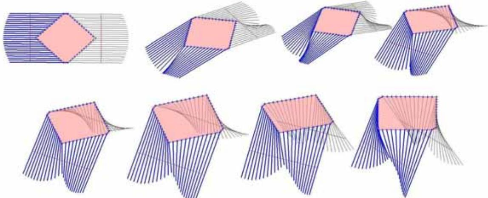  
图7-3：正方形折叠桌的动态变化过程

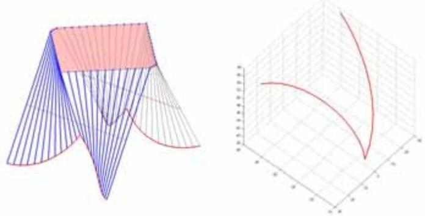

图7-4：正方形折叠桌的桌脚边缘线

## 7.3.2 8 字形桌面的设计

设给定桌面形状为8字形(如图7-5)，由两个圆形重叠而成，半径为60cm，桌面高度为70cm，简单起见，设平板材料为长方形.

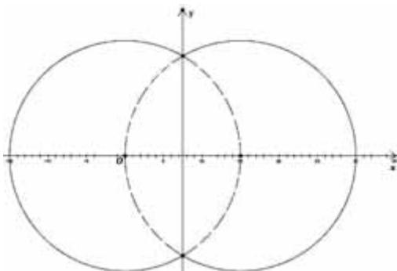  
图 7-5：8字形桌面

可以确定h= 67，w=2.5，W=90.取λ=5，a=1，代入(7-6)式，可以求解出(程序见附录7)展开角度θ=1.2217和钢筋的初始位置(平板)到木条末端的距离s=40.进而可以算出各组设计加工参数，见表6.

表6：8字形桌面的设计加工参数(单位：cm)
<table><tr><td>i</td><td>1</td><td>2</td><td>3</td><td>4</td><td>5</td><td>6</td><td>7</td><td>8</td><td>9</td></tr><tr><td>木条 长度</td><td>149.2</td><td>149.1</td><td>148.9</td><td>148.5</td><td>147.9</td><td>147.1</td><td>146.2</td><td>145.1</td><td>143.8</td></tr><tr><td>空槽 下界</td><td>30.28</td><td>26.02</td><td>22.69</td><td>19.94</td><td>17.64</td><td>15.72</td><td>14.14</td><td>12.87</td><td>11.90</td></tr><tr><td>开槽 长度</td><td>9.72</td><td>13.98</td><td>17.31</td><td>20.06</td><td>22.36</td><td>24.28</td><td>25.86</td><td>27.13</td><td>28.10</td></tr><tr><td>桌面 长度</td><td>106.03</td><td>114.54</td><td>121.20</td><td>126.70</td><td>131.31</td><td>135.15</td><td>138.31</td><td>140.84</td><td>142.77</td></tr><tr><td>桌腿 长度</td><td>106.03</td><td>114.54</td><td>121.20</td><td>126.70</td><td>131.31</td><td>135.15</td><td>138.31</td><td>140.84</td><td>59.4</td></tr><tr><td colspan="12"></td></tr><tr><td>i 木条</td><td>10</td><td>11</td><td>12</td><td>13</td><td></td><td>14</td><td>15</td><td>16</td><td>17</td></tr><tr><td>长度</td><td>23.81</td><td>22.44</td><td>21.62</td><td></td><td>21.35</td><td>21.62</td><td>22.44</td><td>23.81</td><td>25.74</td></tr><tr><td>开槽 下界</td><td>11.22</td><td>10.81</td><td>10.68</td><td></td><td>10.81</td><td>11.22</td><td>11.90</td><td>12.87</td><td>14.14</td></tr><tr><td>开槽 长度</td><td>28.78</td><td>29.19</td><td>29.32</td><td>29.19</td><td></td><td>28.78</td><td>28.10</td><td>27.13</td><td>25.86</td></tr><tr><td>桌面 长度</td><td>23.81</td><td>22.44</td><td>21.62</td><td>21.35</td><td></td><td>21.62</td><td>22.44</td><td>23.81</td><td>25.74</td></tr><tr><td>桌腿 长度</td><td>144.14</td><td>144.96</td><td>145.23</td><td>144.96</td><td></td><td>144.14</td><td>142.77</td><td>140.84</td><td>138.31</td></tr></table>

可以用 matlab绘制折叠桌在变化过程中的图像及桌角边缘线，如图7-6和图7-7.(程序见附件7)

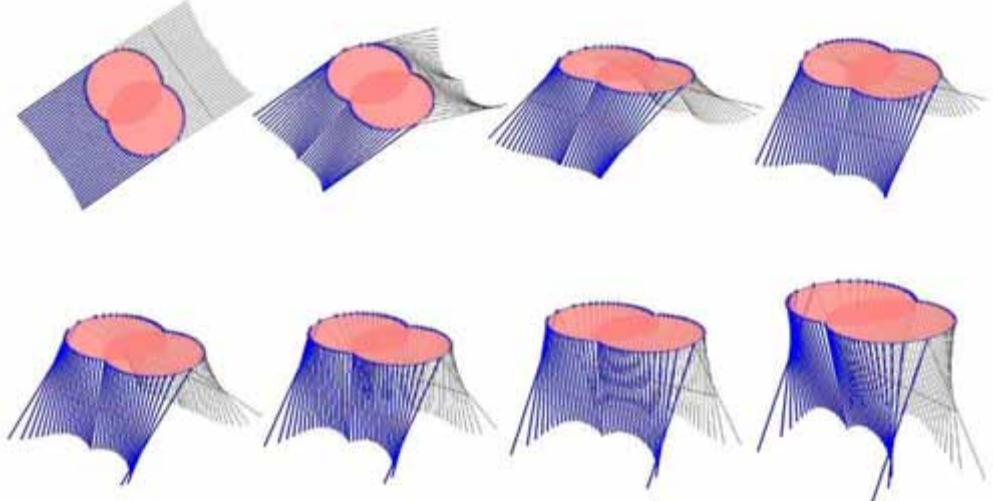

图7-6：8字形折叠桌的动态变化过程  
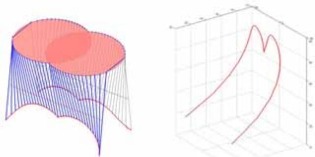  
图7-7：8字形折叠桌的桌脚边缘线

## 八、模型评价与改进

## 8.1 模型一评价与改进

优点：模型简洁，能够准确的描述折叠桌的曲面形状，并能生动的反映出折叠桌的动态变化过程.木条的开槽模型及铰链位置模型对生产加工具有实用价值.

缺点：本文没有考虑钢筋的粗细d，直接将钢筋抽象为一条直线.这样处理是不符合实际的，也使模型结果出现一定误差.

改进：可以考虑将钢筋中轴线作为钢筋的方程，从而使模型更能接近事实.

## 8.2 模型二评价与改进

优点：本模型建立过程中关注动态变化，把我影响该优化模型引入λ和a，使模型更简单.

缺点：本文只考虑到折叠桌的稳定性、开槽长度限制和某些非边缘桌脚必须离地限制条件，使加工最方便、用料最省.假设桌脚与地面摩擦力足够大，没有考虑到当桌面上放一重物，此时桌面的受力情况和稳定性的改变.

改进：建立每根木条与桌面的倾角方程 $\theta ( x _ { i } )$ ，然后分析 $\theta ( x _ { i } )$ 导数的变化趋势，从而分析桌面的受力情况和稳定性.

## 8.3 模型三评价与改进

优点：该直纹曲面方程模型引入桌面边缘曲线 $f ( x )$ ，使得本模型更具一般特性，更 具实际意义.

缺点：本文没有采用桌脚边缘线ψ(x)来确定折叠桌的最优参数，并且给出的几个桌边模型非常局限，而实际生产和需求中，桌面可以是不规则的平面。

改进：在本模型中引入桌脚边缘线ψ(x)，并通过空间坐标和空间距离关系建立ψ(x)与f(x)之间的联系，从而在顾客提供一定桌脚边缘线ψ(x)时，形成较精确的动态模拟和最优参数.

## 参考文献

[1]吕林根，许子道，解析几何(第四版)，北京：高等教育出版社，2006.

[1]刁在筠，刘桂真，宿洁，马建华，运筹学，北京：高等教育出版社，2007.

```matlab
附录1：直纹曲面和桌脚边缘线图像绘制程序 % gangjin dian zuobiao
%canshu xg=-10:10;
w=2.5; xg=xg*w;
r=sqrt(100+1)*w; yg=d*cos(theta)*ones(1,21)+w;
1=60-w; zg=d*sin(theta)*ones(1,21);
d=1/2;
h=53-3; %zhuobian dao gangjin de juli:
theta=asin(h/1); for i=1:21
% shengcheng canshu dis(i)=norm([xc(i),yc(i),zc(i)]-[xg(i),yg(i),zg(i)]);
v=-25:25; end
u=25:60;
[u,v]=meshgrid(u,v); %kaicang dao banbian de juli:
for i=1:21
%qumian canshu fangcheng margin(i)=60-yc(i)-dis(i);
x=v; end
y=sqrt(r^2-v.^2)+(d*cos(theta)+w-sqrt(r^2-v.^2)).
*(u-sqrt(r^2-v.^2))./sqrt(d^2-+w^2+r^2-v.^2-2*(d* %muban dingdian zuobiao
cos(theta)+w)*sqrt(r^2-v.^2)+2*d*w*cos(theta)); for i=1:21
z=d*sin(theta)*(u-sqrt(r^2-v.^2))./sqrt(d^2-+w^2+ k=(margin(i)+dis(i))/dis(i);
r^2-v.^2-2*(d*cos(theta)+w)*sqrt(r^2-v.^2)+2*d* xd(i)=xc(i)+k*(xg(i)-xc(i));
w*cos(theta)); yd(i)=yc(i)+k*(yg(i)-yc(i));
Z=-Z; zd(i)=zc(i)+k*(zg(i)-zc(i));
end
%cemian tuxiang
figure(1); figure(1); hold on;
mesh(x,y,z); plot3(xc,yc,zc,'*','LineWidth',2);
plot3(xg,yg,zg,'r','LineWidth',2);
%zhuojiao bianyuanxian for i=1:21
u=60;
v=-25:25; line([xc(i),xg(i)],[yc(i),yg(i)],[zc(i),zg(i)],'LineWid
x=v; th',2);
y=sqrt(r^2-v.^2)+(d*cos(theta)+w-sqrt(r^2-v.^2)).
*(u-sqrt(r^2-v.^2))./sqrt(d^2-+w^2+r^2-v.^2-2*(d* line([xd(i),xg(i)],[yd(i),yg(i)],[zd(i),zg(i)],'LineWi
cos(theta)+w)*sqrt(r^2-v.^2)+2*d*w*cos(theta)); dth',2);
z=d*sin(theta)*(u-sqrt(r^2-v.^2))./sqrt(d^2-+w^2+ end
r^2-v.^2-2*(d*cos(theta)+w)*sqrt(r^2-v.^2)+2*d*
w*cos(theta)); figure(1); hold on;
Z=-Z; plot3(xc,-yc,zc,'*');
figure(2); plot3(xg,-yg,zg,'r');
plot3(x,y,z,'LineWidth',2); for i=1:21
grid on;
line([xc(i),xg(i)],[-yc(i),-yg(i)],[zc(i),zg(i)],'LineW
附录2：圆形折叠桌的动态变化过程图绘制程序 idth',1,'Color',[.2 .2 .2]);
%canshu
w=2.5; line([xd(i),xg(i)],[-yd(i),-yg(i)],[zd(i),zg(i)],'LineW
r=sqrt(100+1)*w; idth',1,'Color',[.2 .2 .2]);
1=60-w; end
d=1/2;
h=53-3; plot3(xc,yc,zc);plot3(xc,-yc,zc);
theta=asin(h/1); line([xc(1),xc(1)],[yc(1),-yc(1)],[zc(1),zc(1)],'Line
Width',2);
%zhuobian dian zuobiao line([xc(21),xc(21)],[yc(21),-yc(21)],[zc(21),zc(21
xc=-10:10; )],'LineWidth',2);
xc=xc*w; view(3)
yc=sqrt(r^2-xc.^2);
zc=zeros(1,21); [X,Y,Z]=sphere(30);
```

## 附录3：多目标规划求解程序(问题2)

## 附录4：问题2 折叠桌示意图程序

```matlab
ub=[pi/2,h];
ts=fmincon(@objfun,ts0,[],[],[],[],lb,ub,@confun)
theta=ts(1); % youhua jieguo
s=ts(2); % youhua jieguo
l=w+h/sin(theta);
d=1-s;
n=80/2.5+1;
% zhuobian dian zuobiao
xc=-40:2.5:40;
yc=sqrt(r^2-xc.^2);
zc=zeros(1,n);
% gangjin dian zuobiao
xg=-40:2.5:40;
yg=d*cos(theta)*ones(1,n)+w;
zg=d*sin(theta)*ones(1,n);
% zhuobian dao gangjin de juli:
for i=1:n
dis(i)=norm([xc(i),yc(i),zc(i)]-[xg(i),yg(i),zg(i)]);
end
%kaicang dao banbian de juli:
for i=1:n
margin(i)=1-yc(i)-dis(i);
end
%muban dingdian zuobiao
for i=1:n
k=(margin(i)+dis(i))/dis(i);
xd(i)=xc(i)+k*(xg(i)-xc(i));
yd(i)=yc(i)+k*(yg(i)-yc(i));
zd(i)=zc(i)+k*(zg(i)-zc(i));
end
figure(1); hold on;
plot3(xc,yc,zc,'*');
plot3(xg,yg,zg,'r');
for i=1:n
line([xc(i),xg(i)],[yc(i),yg(i)],[zc(i),zg(i)],'LineWid
th',2);
line([xd(i),xg(i)],[yd(i),yg(i)],[zd(i),zg(i)],'LineWi
dth',2);
end
figure(1); hold on;
plot3(xc,-yc,zc,'*');
plot3(xg,-yg,zg,'r');
for i=1:n
line([xc(i),xg(i)],[-yc(i),-yg(i)],[zc(i),zg(i)],'LineW
idth',1,'Color',[.2 .2 .2]);
```

```matlab
line([xd(i),xg(i)],[-yd(i),-yg(i)],[zd(i),zg(i)],'LineW
idth',1,'Color',[.2 .2 .2]);
end
plot3(xc,yc,zc);plot3(xc,-yc,zc);
line([xc(1),xc(1)],[yc(1),-yc(1)],[zc(1),zc(1)],'Line
Width',2);
line([xc(n),xc(n)],[yc(n),-yc(n)],[zc(n),zc(n)],'Line
Width',2);
view(3)
[X,Y,Z]=sphere(30);
X=1*X/2;Y=1*Y/2;Z=zeros(31);
surf(X,Y,Z);
colormap(spring);
alpha(.5)
shading interp; axis equal; axis off;
```

## 附录5：多目标规划求解程序(问题3)

```matlab
global w h a W x lamda;
w=2.5;h=60-3;a=1;W=60;lamda=5;
x=[2.5:2.5:30]';
% 8xing, gaiwei:
% w=2.5;h=70-3;a=1;W=90;lamda=5;
%x=[2.5:2.5:45]';
ts0=[pi/4,h/2];
1b=[0,0];
ub=[pi/2,h];
ts=fmincon(@objfun,ts0,[],[],[],[],1b,ub,@confun)
confun.m:
function [c,ceq]=confun(ts)
%ts=[theta,s];
global w h a W x lamda;
1=w+h/sin(ts(1));
d=1-ts(2);
q=32.5-abs(x); % 8xing, gaiwei:
q=sqrt(30^2-(x-15)^2);
1en=sqrt(d^2-+w^2+q^2-2*(d*cos(ts(1))+w)*q+2*
d*w*cos(ts(1)))+q-d-w;
c=[a*W-2*(w+h*cot(ts(1)));
-(q+(d*cos(ts(1))+w-q).*(1-q)./sqrt(d^2-+w^2+r^2-
x.^2-2*(d*cos(ts(1))+w)*q+2*d*w*cos(ts(1))));
len-ts(2)+1amda
];
ceq=[];
objfun.m
function f=objfun(ts)
f=-sin(ts(1));
% di er mubiao
%1=w+h/sin(ts(1));
```

```matlab
%d=1-ts(2);
%q=32.5-abs(x);
%1en=sqrt(d^2-+w^2+q^2-2*(d*cos(ts(1))+w)*q+
2*d*w*cos(ts(1)))+q-d-w
%f=sum(len);
```

## 附录6：正方形折叠桌的动态变化过程绘图程序

```matlab
clear;
%canshu
w=2.5;h=60-3;a=1;W=60; n=W/2.5+1;s=32;
t=pi/3;
1=w+h/sin(t);
R=sqrt(1^2+30^2);
%zhuobian dian zuobiao
xc=-30:2.5:30;
yc=32.5-abs(xc);
zc=zeros(1,n);
xd=xc;xg=xc;
1l=sqrt(R^2-xc.^2);
d=1-s;
for m=1:8
tt=linspace(0,8,8);
theta=tt(m)*t/8;
% gangjin dian zuobiao
yg=d*cos(theta)*ones(1,n)+w;
zg=d*sin(theta)*ones(1,n);
% zhuobian dao gangjin de juli:
for i=1:n
dis(i)=norm([xc(i),yc(i),zc(i)]-[xg(i),yg(i),zg(i)]);
end
%kaicang dao banbian de juli:
margin=ll-yc-dis;
%muban dingdian zuobiao
for i=1:n
k=(margin(i)+dis(i))/dis(i);
yd(i)=yc(i)+k*(yg(i)-yc(i))
zd(i)=zc(i)+k*(zg(i)-zc(i));
end
subplot(2,4,m)
figure(1); hold on;
plot3(xc,yc,zc,'*');
plot3(xg,yg,zg,'r');
for i=1:n
line([xc(i),xg(i)],[yc(i),yg(i)],[zc(i),zg(i)],'LineWid
th',2);
line([xd(i),xg(i)],[yd(i),yg(i)],[zd(i),zg(i)],'LineWi
```

```matlab
dth',2);
end
plot3(xc,-yc,zc,'*');
plot3(xg,-yg,zg,'r');
for i=1:n
line([xc(i),xg(i)],[-yc(i),-yg(i)],[zc(i),zg(i)],'LineW
idth',1,'Color',[.2 .2 .2]);
line([xd(i),xg(i)],[-yd(i),-yg(i)],[zd(i),zg(i)],'LineW
idth',1,'Color',[.2 .2 .2]);
end
plot3(xc,yc,zc);plot3(xc,-yc,zc);
line([xc(1),xc(1)],[yc(1),-yc(1)],[zc(1),zc(1)],'Line
Width',2);
line([xc(n),xc(n)],[yc(n),-yc(n)],[zc(n),zc(n)],'Line
Width',2);
view(3)
X=[0 0;-1 1;0 0];Y=[1 1;0 0;-1 -1];
X=32.5*X;Y=32.5*Y;Z=zeros(3,2);
surf(X,Y,Z);
colormap(spring);
alpha(.5)
shading interp; axis equal; axis off;
end
figure(2);
plot3(xd,yd,zd);plot3(xd,-yd,zd);
```

## 附录7：8方形折叠桌的动态变化过程绘图程序

```matlab
clear;
%canshu
w=2.5;h=70-3;W=90; n=W/2.5-1;s=40;
t=pi*70/180;
%zhuobian dian zuobiao
xc=-42.5:2.5:42.5;
yc=sqrt(30^2-(abs(xc)-15).^2);
zc=zeros(1,n);
1=yc(1)+h/sin(t);
xd=xc;xg=xc;
d=1-s;
for m=1:8
theta=m*t/8;
% gangjin dian zuobiao
yg=d*cos(theta)*ones(1,n)+w;
zg=d*sin(theta)*ones(1,n);
%zhuobian dao gangjin de juli:
for i=1:n
```

```matlab
dis(i)=norm([xc(i),yc(i),zc(i)]-[xg(i),yg(i),zg(i)]);
end
%kaicang dao banbian de juli:
margin=l-yc-dis;
% muban dingdian zuobiao
for i=1:n
k=(margin(i)+dis(i))/dis(i);
yd(i)=yc(i)+k*(yg(i)-yc(i));
zd(i)=zc(i)+k*(zg(i)-zc(i));
end
subplot(2,4,m)
figure(1); hold on;
plot3(xc,yc,zc,'*');
plot3(xg,yg,zg,'r');
for i=1:n
line([xc(i),xg(i)],[yc(i),yg(i)],[zc(i),zg(i)],'LineWid
th',2);
line([xd(i),xg(i)],[yd(i),yg(i)],[zd(i),zg(i)],'LineWi
dth',2);
end
plot3(xc,-yc,zc,'*');
plot3(xg,-yg,zg,'r');
for i=1:n
line([xc(i),xg(i)],[-yc(i),-yg(i)],[zc(i),zg(i)],'LineW
idth',1,'Color',[.2 .2 .2]);
line([xd(i),xg(i)],[-yd(i),-yg(i)],[zd(i),zg(i)],'LineW
idth',1,'Color',[.2 .2 .2]);
end
plot3(xc,yc,zc);plot3(xc,-yc,zc);
line([xc(1),xc(1)],[yc(1),-yc(1)],[zc(1),zc(1)],'Line
Width',2);
line([xc(n),xc(n)],[yc(n),-yc(n)],[zc(n),zc(n)],'Line
Width',2);
view(3)
[X,Y,Z]=sphere(30);
X=30*X;Y=30*Y;Z=zeros(31);
X=X+15; surf(X,Y,Z);
X=X-30; surf(X,Y,Z);
colormap(spring);
alpha(.5)
shading interp; axis equal; axis off;
end
figure(2);
plot3(xd,yd,zd);plot3(xd,-yd,zd);
```